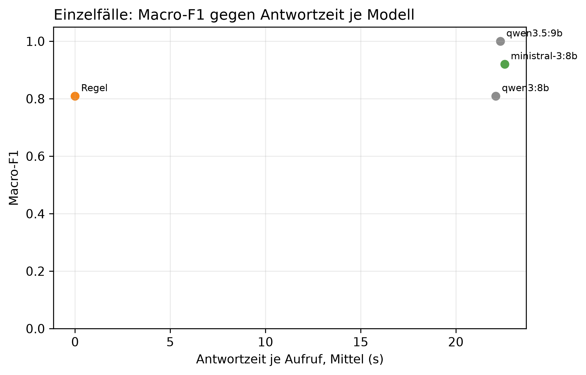

# K3 LLM-Klassifikation und Modellwahl, Läufe k3_017 / k3_seq_017

## Setup

- Läufe (Ebene 1 / Ebene 2): k3_017 / k3_seq_017
- Prompt (Ebene 1 / Ebene 2): v30 / v30
- Modelle: MDL1 qwen3:8b, MDL2 qwen3.5:9b, MDL5 ministral-3:8b
- LLM: temperature 0,0, höchstens 2 Versuche je Aufruf
- Ebene 1: 10 synthetische Fälle, je Modell 1 Aufruf je Fall, Regel (BASELINE) läuft mit
- Ebene 2: Standard-Szenarien, Cutover CO3 (2015-03-01), 40 Tage davor, 60 danach, jedes Modell als eigener Kreislauf wie SYS3 mit Adaption
- Ereignisse Ebene 2: control = keine Änderung, scaled_strong = Sprung +30 %, peak_strong = Spitze +1000 W über 6 h
- Produktivmodell SYS3: ministral-3:8b
- Commit (Ebene 1 / Ebene 2): 83b23e4 (mit lokalen Änderungen) / 83b23e4 (mit lokalen Änderungen)
- Textprüfung: 9 Steuerungswörter, Zahlentoleranz 0,5, gerundet auf 10 erlaubt, Fensterzahlen aus dem Prompt 7, 28

## Kennzahlen

| Kennzahl | Wert | Bezug |
|---|---|---|
| Ebene 1: bestes Modell nach Macro-F1 | qwen3.5:9b | Macro-F1 1,00, Regel 0,81 |
| ministral-3:8b: Ebene 1 richtig | 9/10 | Regel 9/10 |
| ministral-3:8b: Antwortzeit je Aufruf im Mittel [s] | 22,6 | p95 39,5 s, Regel 0,0 s |
| ministral-3:8b: Ebene 2 Ereignis-Arten erkannt | 2/2 | Regel 2/2 |
| ministral-3:8b: Ebene 2 Tage mit anderer Klasse als die Regel | 0 | - |
| ministral-3:8b: ungültige Antworten Ebene 1 | 0 | Ausfalltage Ebene 2: 0 |
| ministral-3:8b: Antworten mit Textverstoß (Ebene 1 / Ebene 2) | 1/10 / 0/96 | Steuerung oder Zahl, Datum, Uhrzeit nicht im State |
| ministral-3:8b: Antworten mit fehlenden Belegen (Ebene 1 / Ebene 2) | 1/10 / 0/96 | zitierte Belege passen nicht zur eigenen Klasse |

## Ebene 1: Modellvergleich auf den Einzelfällen

| ID | Modell | richtig | Macro-F1 | ungültig | Ø Versuche | Grounding | Ø s je Aufruf | p95 s |
|---|---|---|---:|---:|---:|---:|---:|---:|
| MDL2 | qwen3.5:9b | 10/10 | 1,0 | 0 | 1,1 | 0,8 | 22,3 | 41,7 |
| MDL5 | ministral-3:8b | 9/10 | 0,9 | 0 | 1,0 | 0,9 | 22,6 | 39,5 |
| BASELINE | Regel | 9/10 | 0,8 | 0 | 1,0 | - | 0,0 | 0,0 |
| MDL1 | qwen3:8b | 9/10 | 0,8 | 0 | 1,0 | 0,8 | 22,1 | 34,4 |

## Ebene 1: Antwort je Fall (✓ = richtig, sonst die Antwort, - = ungültig)

| Fall | erwartet | qwen3.5:9b | ministral-3:8b | Regel | qwen3:8b |
|---|---|---|---|---|---|
| absence_drift_down | absence | ✓ | ✓ | new_pattern | new_pattern |
| low_single_scale | low | ✓ | ✓ | ✓ | ✓ |
| measurement_error_missing_day | measurement_error | ✓ | ✓ | ✓ | ✓ |
| new_pattern | new_pattern | ✓ | ✓ | ✓ | ✓ |
| new_pattern_at_min_scales_boundary | new_pattern | ✓ | ✓ | ✓ | ✓ |
| new_pattern_drift_down | new_pattern | ✓ | ✓ | ✓ | ✓ |
| normal_single_sustained_scale | normal | ✓ | ✓ | ✓ | ✓ |
| normal_weekly_after_reset | normal | ✓ | new_pattern | ✓ | ✓ |
| peak | peak | ✓ | ✓ | ✓ | ✓ |
| peak_single_sustained_scale | peak | ✓ | ✓ | ✓ | ✓ |

## Automatische Textprüfung je Modell (Antworten mit Verstoß oder fehlenden Belegen)

| Modell | E1 Antworten | E1 mit Verstoß | E1 Belege fehlen | E2 Antworten | E2 mit Verstoß | E2 Belege fehlen |
|---|---:|---:|---:|---:|---:|---:|
| qwen3.5:9b | 10 | 2 | 1 | 44 | 1 | 0 |
| ministral-3:8b | 10 | 1 | 1 | 96 | 0 | 0 |
| qwen3:8b | 10 | 0 | 0 | 96 | 8 | 0 |

## Ebene 2: je Modell über alle Ereignis-Arten

| Modell | Ereignis-Arten erkannt | Tage anders als die Regel | Gate-Tage | Ausfalltage | Meldungen Kontrolle | unknown Kontrolle | Resets Kontrolle |
|---|---|---:|---:|---:|---:|---:|---:|
| qwen3.5:9b | 2/2 | 23 | 44 | 0 | 9 | 0 | 3 |
| ministral-3:8b | 2/2 | 0 | 96 | 0 | 0 | 0 | 0 |
| Regel | 2/2 | 0 | 96 | 0 | 0 | 0 | 0 |
| qwen3:8b | 2/2 | 12 | 96 | 0 | 0 | 0 | 0 |

## Ebene 2: Erkennung je Ereignis, Tag seit Cutover

| config | Ereignis | erwartet | Gate-Tage durch das Ereignis | davon richtig | erster richtiger Tag | Resets |
|---|---|---|---:|---:|---:|---:|
| BASELINE | Spitze +1000 W über 6 h | peak | 6 | 1 | 1 | 0 |
| BASELINE | Sprung +30 % | new_pattern | 13 | 1 | 22 | 1 |
| MDL1 | Spitze +1000 W über 6 h | peak | 6 | 1 | 1 | 0 |
| MDL1 | Sprung +30 % | new_pattern | 13 | 1 | 22 | 1 |
| MDL2 | Spitze +1000 W über 6 h | peak | 6 | 1 | 1 | 3 |
| MDL2 | Sprung +30 % | new_pattern | 6 | 4 | 7 | 4 |
| MDL5 | Spitze +1000 W über 6 h | peak | 6 | 1 | 1 | 0 |
| MDL5 | Sprung +30 % | new_pattern | 13 | 1 | 22 | 1 |

## Ebene 2: Tage, an denen ein Modell anders einordnet als die Regel

| Modell | analysierter Tag | Regel | Modell sagt | in Arten |
|---|---|---|---|---|
| qwen3:8b | 2015-01-26 | normal | low | control, scaled_strong, peak_strong |
| qwen3:8b | 2015-01-27 | normal | low | control, scaled_strong, peak_strong |
| qwen3:8b | 2015-04-05 | normal | low | scaled_strong |
| qwen3:8b | 2015-04-06 | normal | low | scaled_strong |
| qwen3:8b | 2015-04-07 | normal | low | control, peak_strong |
| qwen3:8b | 2015-04-08 | normal | low | scaled_strong |
| qwen3:8b | 2015-04-09 | normal | low | control, scaled_strong, peak_strong |
| qwen3:8b | 2015-04-12 | normal | low | control, scaled_strong, peak_strong |
| qwen3:8b | 2015-04-24 | normal | low | peak_strong |
| qwen3:8b | 2015-04-25 | normal | low | peak_strong |
| qwen3:8b | 2015-04-26 | normal | low | peak_strong |
| qwen3:8b | 2015-04-28 | normal | low | peak_strong |
| qwen3.5:9b | 2015-01-24 | normal | peak | control, scaled_strong, peak_strong |
| qwen3.5:9b | 2015-01-26 | normal | new_pattern | control, scaled_strong, peak_strong |
| qwen3.5:9b | 2015-02-20 | normal | low | control, scaled_strong, peak_strong |
| qwen3.5:9b | 2015-02-23 | normal | peak | control, scaled_strong, peak_strong |
| qwen3.5:9b | 2015-03-02 | normal | peak | scaled_strong |
| qwen3.5:9b | 2015-03-06 | normal | new_pattern | peak_strong |
| qwen3.5:9b | 2015-03-07 | normal | new_pattern | scaled_strong |
| qwen3.5:9b | 2015-03-15 | normal | low | scaled_strong |
| qwen3.5:9b | 2015-03-15 | low | normal | peak_strong |
| qwen3.5:9b | 2015-03-19 | normal | new_pattern | control |
| qwen3.5:9b | 2015-03-20 | normal | new_pattern | scaled_strong |
| qwen3.5:9b | 2015-03-22 | new_pattern | normal | scaled_strong |
| qwen3.5:9b | 2015-04-02 | low | normal | control, scaled_strong |
| qwen3.5:9b | 2015-04-03 | low | normal | control, scaled_strong |
| qwen3.5:9b | 2015-04-04 | low | normal | control |
| qwen3.5:9b | 2015-04-05 | low | normal | control |
| qwen3.5:9b | 2015-04-06 | low | normal | control |
| qwen3.5:9b | 2015-04-07 | normal | new_pattern | scaled_strong |
| qwen3.5:9b | 2015-04-08 | normal | new_pattern | control, peak_strong |
| qwen3.5:9b | 2015-04-08 | normal | peak | scaled_strong |
| qwen3.5:9b | 2015-04-09 | normal | peak | control, peak_strong |
| qwen3.5:9b | 2015-04-10 | normal | peak | control, peak_strong |
| qwen3.5:9b | 2015-04-11 | normal | peak | control, peak_strong |
| qwen3.5:9b | 2015-04-20 | normal | new_pattern | scaled_strong |
| qwen3.5:9b | 2015-04-22 | normal | peak | control |
| qwen3.5:9b | 2015-04-22 | normal | new_pattern | peak_strong |

## Hinweise

- Ebene 1 prüft, ob ein Modell die Regeln aus dem Prompt nachvollzieht. Der Prompt wurde auf denselben Fällen verbessert, die Quoten begründen deshalb nur die Modellwahl und belegen nicht das Ziel von 80 % richtiger Klassen (dafür E5)
- wenige Fälle: ein Fall sind mehrere Prozentpunkte, eine Klasse hängt teils an einem einzigen Fall
- Macro-F1: Mittel der F1-Werte über die Klassen, die als erwartete Klasse vorkommen
- Grounding: Anteil der für den Fall erwarteten Felder, die das Modell als Beleg zitiert. Die Regel zitiert keine
- Tag seit Cutover = Entscheidungstag: an Tag n meldet das System, eingeordnet ist dabei Tag n-1. Ab Cutover zählt deshalb erst ab Tag 1
- Ebene 2, erkannt: erwartete Klasse an einem Tag, an dem nur das Ereignis das Gate öffnet (gepaart mit dem Kontrolllauf desselben Modells)
- Ebene 2, anders als die Regel: gleiche Art und gleicher analysierter Tag, Regel gegen Modell. Nach einem Reset an verschiedenen Tagen laufen die Reihen auseinander, spätere Abweichungen können daraus folgen
- Antwortzeit: gemessen auf dem Rechner des Laufs, nur zum Vergleich der Modelle untereinander
- Textprüfung: Verstoß heißt, ein Steuerungswort oder eine Zahl, ein Datum oder eine Uhrzeit steht im Text, aber nicht im State des Falls. Zahlwörter („sechs Wochen“) findet sie nicht. Die Fensterlängen 7 und 28 aus der Skalenbeschreibung im Prompt gelten als erlaubt
- Fehlende Belege: der Prompt verlangt je Klasse bestimmte Pfade (new_pattern: sustained_drift, Streaks, peak/low: level, direction, absence: level, Kalendereintrag, measurement_error: Flag). Geprüft wird gegen die eigene Klasse des Modells, nicht gegen die erwartete. Ebene 1 wird nur für Läufe geprüft, die den State der Fälle in der Antwortdatei speichern, ältere Läufe haben in der Tabelle 0 Antworten
- Antworttexte und Auffälligkeiten der Textprüfung im Anhang, Antworten für alle Modelle in Ebene 1 und Ebene 2. Als CSV: answers_single.csv für Ebene 1, answers_sequence.csv für Ebene 2 nur vom Produktivmodell, result_text_findings.csv für die Auffälligkeiten

## Anhang

### Ebene 1: Precision, Recall und F1 je Klasse

| Modell | Klasse | Precision | Recall | F1 |
|---|---|---:|---:|---:|
| Regel | absence | 0,0 | 0,0 | 0,0 |
| Regel | low | 1,0 | 1,0 | 1,0 |
| Regel | measurement_error | 1,0 | 1,0 | 1,0 |
| Regel | new_pattern | 0,8 | 1,0 | 0,9 |
| Regel | normal | 1,0 | 1,0 | 1,0 |
| Regel | peak | 1,0 | 1,0 | 1,0 |
| qwen3:8b | absence | 0,0 | 0,0 | 0,0 |
| qwen3:8b | low | 1,0 | 1,0 | 1,0 |
| qwen3:8b | measurement_error | 1,0 | 1,0 | 1,0 |
| qwen3:8b | new_pattern | 0,8 | 1,0 | 0,9 |
| qwen3:8b | normal | 1,0 | 1,0 | 1,0 |
| qwen3:8b | peak | 1,0 | 1,0 | 1,0 |
| qwen3.5:9b | absence | 1,0 | 1,0 | 1,0 |
| qwen3.5:9b | low | 1,0 | 1,0 | 1,0 |
| qwen3.5:9b | measurement_error | 1,0 | 1,0 | 1,0 |
| qwen3.5:9b | new_pattern | 1,0 | 1,0 | 1,0 |
| qwen3.5:9b | normal | 1,0 | 1,0 | 1,0 |
| qwen3.5:9b | peak | 1,0 | 1,0 | 1,0 |
| ministral-3:8b | absence | 1,0 | 1,0 | 1,0 |
| ministral-3:8b | low | 1,0 | 1,0 | 1,0 |
| ministral-3:8b | measurement_error | 1,0 | 1,0 | 1,0 |
| ministral-3:8b | new_pattern | 0,8 | 1,0 | 0,9 |
| ministral-3:8b | normal | 1,0 | 0,5 | 0,7 |
| ministral-3:8b | peak | 1,0 | 1,0 | 1,0 |

### Ebene 1: Antworten der Modelle je Fall

**peak** (erwartet: peak)

- qwen3.5:9b: peak ✓
  - Erklärung: Gestern war der Stromverbrauch ungewöhnlich hoch, etwa 45 % mehr als sonst an diesem Wochentag.
  - Empfehlung: Überprüfen Sie, ob gestern besondere Aktivitäten wie ein langes Wochenende oder eine Party stattgefunden haben.
  - Unsicherheit: Die Bewertung könnte sich ändern, wenn es einen nicht im Kalender verzeichneten Ausfall gab.
- ministral-3:8b: peak ✓
  - Erklärung: Gestern war der Stromverbrauch um etwa 45 % höher als an einem normalen Wochentag. Das ist ungewöhnlich für diesen Tag.
  - Empfehlung: Überprüfen Sie, ob gestern ungewöhnliche Geräte oder Aktivitäten den Verbrauch erhöht haben könnten.
  - Unsicherheit: Ob der erhöhte Verbrauch auf eine geplante Aktivität zurückzuführen ist, hängt davon ab, ob Sie gestern etwas Ungewöhnliches im Haushalt hatten.
- qwen3:8b: peak ✓
  - Erklärung: Gestern war der Stromverbrauch höher als üblich, insbesondere im Vergleich zu einem normalen Werktag. Der Verbrauch lag um etwa 45 % über dem üblichen Niveau.
  - Empfehlung: Überprüfen Sie, ob in der Wohnung etwas anders war, wie z. B. eine längere Heizperiode oder ein vergessenes Gerät. Falls nichts auffällt, ist es wahrscheinlich ein Zufall.
  - Unsicherheit: Die Verbrauchssteigerung könnte auf einen kalten Winterabend oder eine ungewöhnliche Nutzung zurückgehen, was im Dezember in Großbritannien möglich ist.

**new_pattern** (erwartet: new_pattern)

- qwen3.5:9b: new_pattern ✓
  - Erklärung: Der Stromverbrauch war gestern ungewöhnlich hoch und ist seit dem 9. Dezember auf einem neuen, höheren Niveau gestiegen.
  - Empfehlung: Bitte prüfen Sie, ob sich im Haushalt etwas geändert hat, zum Beispiel durch längeres Verweilen zu Hause oder das Einschalten neuer Geräte.
  - Unsicherheit: Die Bewertung könnte sich ändern, wenn der hohe Verbrauch nur vorübergehend war und nicht über mehrere Wochen anhält.
- ministral-3:8b: new_pattern ✓
  - Erklärung: Gestern war der Stromverbrauch um etwa 38 % höher als an einem normalen Wochentag. Seit dem 9. Dezember liegt er dauerhaft über dem üblichen Niveau.
  - Empfehlung: Überprüfen Sie, ob Geräte oder Heizungsanlagen ungewöhnlich stark genutzt wurden oder ob sich der Haushaltsbedarf verändert hat.
  - Unsicherheit: Ob die erhöhte Nutzung auf eine dauerhafte Veränderung zurückzuführen ist, hängt davon ab, ob sich der Verbrauch in den kommenden Tagen stabilisiert.
- qwen3:8b: new_pattern ✓
  - Erklärung: Gestern war der Stromverbrauch deutlich höher als üblich, insbesondere im Vergleich zur letzten Woche und den letzten vier Wochen. Der Verbrauch lag um etwa 36 % über dem üblichen Niveau der letzten Woche und um 22 % über dem üblichen Niveau der letzten vier Wochen.
  - Empfehlung: Überprüfen Sie, ob in der Wohnung etwas verändert wurde, wie z. B. neue Geräte oder eine Änderung der Nutzungsgewohnheiten. Falls nichts auffällt, könnte es sich um eine vorübergehende Veränderung handeln.
  - Unsicherheit: Die genaue Ursache für den erhöhten Verbrauch ist nicht bekannt und könnte auf einen temporären Effekt zurückgehen, der sich in den nächsten Tagen wieder normalisiert.

**low_single_scale** (erwartet: low)

- qwen3.5:9b: low ✓
  - Erklärung: Gestern war der Stromverbrauch ungewöhnlich niedrig, etwa 30 % unter dem für diesen Wochentag üblichen Wert.
  - Empfehlung: Überlegen Sie, ob Sie gestern weniger zu Hause waren oder bestimmte Geräte nicht genutzt haben. Wenn dies nicht der Fall ist, prüfen Sie, ob sich Ihre Gewohnheiten geändert haben.
  - Unsicherheit: Die Bewertung könnte sich ändern, wenn ein Kalendereintrag verfügbar wäre, der belegt, dass das Haushalt in den vergangenen Tagen abwesend war.
- ministral-3:8b: low ✓
  - Erklärung: Gestern war der Stromverbrauch um etwa 30 % niedriger als an einem normalen Dienstag im Dezember.
  - Empfehlung: Da keine geplanten Abwesenheiten oder besondere Ereignisse vorlagen, prüfen Sie bitte, ob Geräte ausgeschaltet oder der Verbrauch sonst wie reduziert wurde.
  - Unsicherheit: Ob ein geplanter Urlaub oder eine andere Abwesenheit fehlt, kann nicht geprüft werden, da der Kalender nicht verfügbar war.
- qwen3:8b: low ✓
  - Erklärung: Gestern war der Stromverbrauch um 30 % niedriger als üblich für einen Dienstag. Der Verbrauch war insgesamt niedriger, aber es gab keine Hinweise darauf, dass die Familie abwesend war.
  - Empfehlung: Überprüfen Sie, ob etwas im Haushalt verändert wurde, das den Verbrauch beeinflussen könnte, wie eine fehlende Heizung oder ein abgeschaltetes Gerät.
  - Unsicherheit: Da keine Kalenderinformationen verfügbar waren, können wir nicht bestätigen, ob die Abwesenheit der Familie den Verbrauch verursacht hat.

**peak_single_sustained_scale** (erwartet: peak)

- qwen3.5:9b: peak ✓
  - Erklärung: Gestern war der Stromverbrauch ungewöhnlich hoch, etwa 40 % mehr als für diesen Wochentag üblich.
  - Empfehlung: Bitte prüfen Sie, ob gestern besondere Aktivitäten wie Gäste oder ein längeres Arbeiten zu Hause stattgefunden haben.
  - Unsicherheit: Die Bewertung könnte sich ändern, wenn der Kalender eine Abwesenheit am gestrigen Tag enthalten würde.
- ministral-3:8b: peak ✓
  - Erklärung: Gestern war der Stromverbrauch um etwa 40 % höher als an einem normalen Wochentag. Das ist ungewöhnlich für einen einzelnen Tag.
  - Empfehlung: Überprüfen Sie, ob gestern ungewöhnliche Geräte oder Aktivitäten den Verbrauch erhöht haben könnten, z. B. längeres Nutzen von Heizungen oder elektrischen Geräten.
  - Unsicherheit: Ob der erhöhte Verbrauch auf einen einmaligen Grund zurückzuführen ist oder länger anhält, hängt davon ab, ob sich die Werte in den nächsten Tagen normalisieren.
- qwen3:8b: peak ✓
  - Erklärung: Gestern war der Stromverbrauch höher als üblich, insbesondere im Vergleich zu einem normalen Werktag. Der Verbrauch lag um etwa 40 % über dem üblichen Niveau.
  - Empfehlung: Überprüfen Sie, ob in der Wohnung etwas anders war, wie z. B. eine längere Heizperiode oder ein vergessenes Gerät. Falls nichts auffällt, ist es wahrscheinlich ein Zufall.
  - Unsicherheit: Die Verbrauchssteigerung könnte auf einen kalten Winterabend oder eine ungewöhnliche Nutzung zurückgehen, was im Dezember in Großbritannien möglich ist.

**normal_single_sustained_scale** (erwartet: normal)

- qwen3.5:9b: normal ✓
  - Erklärung: Die Stromverbrauchsdaten von gestern sind normal, auch wenn der Verbrauch leicht über dem üblichen Niveau lag.
  - Empfehlung: Es ist nichts zu tun. Der leichte Anstieg entspricht den normalen Schwankungen für diesen Wochentag.
  - Unsicherheit: Die Bewertung könnte sich ändern, wenn der Verbrauch über die nächsten Tage weiterhin deutlich über dem Durchschnitt bleibt.
- ministral-3:8b: normal ✓
  - Erklärung: Gestern war der Verbrauch für einen Dienstag etwas höher als sonst, aber nicht ungewöhnlich. Die Abweichung hat sich seit dem 10. Dezember gehalten.
  - Empfehlung: Es gibt nichts zu beachten, da der Verbrauch im Rahmen liegt und sich die leichte Erhöhung bereits länger so zeigt.
  - Unsicherheit: Ob es sich um eine dauerhafte Veränderung handelt oder nur eine vorübergehende Anpassung ist, lässt sich erst in den kommenden Tagen klären.
- qwen3:8b: normal ✓
  - Erklärung: Gestern war der Stromverbrauch leicht höher als üblich, aber innerhalb des normalen Bereichs. Der Verbrauch lag um 9 % über dem üblichen Wochenmittel.
  - Empfehlung: Da der Verbrauch leicht erhöht war, können Sie prüfen, ob etwas im Haushalt anders lief, wie z. B. eine vergessene elektrische Geräte oder eine längere Nutzung von Heizung.
  - Unsicherheit: Die Daten zeigen einen leichten Anstieg, aber es gibt keine Hinweise auf eine dauerhafte Veränderung.

**normal_weekly_after_reset** (erwartet: normal)

- qwen3.5:9b: normal ✓
  - Erklärung: Die Analyse zeigt, dass der Stromverbrauch gestern im üblichen Rahmen lag.
  - Empfehlung: Es ist nichts zu tun. Der Verbrauch war normal.
  - Unsicherheit: Die Bewertung stützt sich auf die aktuelle Analyse, wobei der Kalender nicht verfügbar war.
- ministral-3:8b: new_pattern
  - Erklärung: Der Stromverbrauch war in der letzten Woche um etwa ein Drittel niedriger als sonst, und das seit dem 9. Dezember. Das könnte auf einen dauerhaften Wandel hinweisen.
  - Empfehlung: Überprüfen Sie, ob sich der Verbrauch in den letzten Tagen tatsächlich so stark verändert hat oder ob ein Gerät länger nicht genutzt wurde.
  - Unsicherheit: Ob es sich um einen dauerhaften Wandel handelt, hängt davon ab, ob sich der niedrigere Verbrauch auch in den kommenden Tagen fortsetzt.
- qwen3:8b: normal ✓
  - Erklärung: Gestern war der Stromverbrauch leicht niedriger als üblich, aber das ist nicht ungewöhnlich. Der Verbrauch lag um etwa 10 % unter dem üblichen Niveau für einen Dienstag.
  - Empfehlung: Sie können nichts besonderes tun, da der Verbrauch nicht signifikant abweicht. Falls Sie sich dennoch Sorgen machen, prüfen Sie, ob es in Ihrem Haushalt etwas Neues gab, das den Verbrauch beeinflussen könnte.
  - Unsicherheit: Die Kalenderdaten sind nicht verfügbar, sodass wir nicht prüfen können, ob ein geplanter Abwesenheit den Verbrauch beeinflusst hat.

**new_pattern_at_min_scales_boundary** (erwartet: new_pattern)

- qwen3.5:9b: new_pattern ✓
  - Erklärung: Der Stromverbrauch war gestern ungewöhnlich hoch und ist seit dem 10. Dezember auf einem neuen, höheren Niveau gestiegen.
  - Empfehlung: Bitte prüfen Sie, ob sich im Haushalt etwas geändert hat, zum Beispiel durch längeres Verweilen zu Hause oder das Einschalten neuer Geräte.
  - Unsicherheit: Die Bewertung könnte sich ändern, wenn der hohe Verbrauch nur vorübergehend war und nicht über mehrere Wochen anhält.
- ministral-3:8b: new_pattern ✓
  - Erklärung: Gestern war der Stromverbrauch um etwa 35 % höher als an einem normalen Wochentag. Seit dem 10. Dezember liegt er dauerhaft über dem üblichen Niveau.
  - Empfehlung: Überprüfen Sie, ob Geräte oder Heizungsanlagen länger laufen als sonst oder ob neue Verbraucher hinzugekommen sind.
  - Unsicherheit: Ob der erhöhte Verbrauch auf eine dauerhafte Veränderung zurückzuführen ist, hängt davon ab, ob sich die Werte in den kommenden Tagen stabilisieren.
- qwen3:8b: new_pattern ✓
  - Erklärung: Gestern war der Stromverbrauch deutlich höher als üblich, insbesondere im Vergleich zur letzten Woche und den letzten vier Wochen. Der Verbrauch lag um etwa 30 % über dem üblichen Niveau.
  - Empfehlung: Überprüfen Sie, ob in der Wohnung etwas verändert wurde, wie Geräte oder Heizung. Falls nichts verändert wurde, könnte es eine neue Musterentwicklung geben.
  - Unsicherheit: Die genaue Ursache für den erhöhten Verbrauch ist unbekannt und könnte auf einen technischen Fehler oder ein neues Verhalten in der Wohnung zurückgehen.

**measurement_error_missing_day** (erwartet: measurement_error)

- qwen3.5:9b: measurement_error ✓
  - Erklärung: Die Messung von gestern ist nicht vertrauenswürdig, da der Wert unplausibel ist.
  - Empfehlung: Bitte überprüfen Sie die Geräte oder den Zählerstand, um sicherzustellen, dass keine Störung vorliegt.
  - Unsicherheit: Die Zuverlässigkeit der Messung ist das entscheidende Kriterium für diese Einschätzung.
- ministral-3:8b: measurement_error ✓
  - Erklärung: Der gemessene Wert für gestern ist nicht vertrauenswürdig und kann keine Rückschlüsse auf den Verbrauch zulassen.
  - Empfehlung: Es gibt keinen zuverlässigen Wert, den Sie überprüfen können. Bitte prüfen Sie die Messgeräte oder kontaktieren Sie Ihren Stromanbieter.
  - Unsicherheit: Ob der Fehler nur gestern aufgetreten ist oder länger anhält, kann nicht beurteilt werden.
- qwen3:8b: measurement_error ✓
  - Erklärung: Die Messung gestern ist nicht zuverlässig, sodass keine Aussage über den Stromverbrauch getroffen werden kann.
  - Empfehlung: Überprüfen Sie die Geräte und Steckdosen, um sicherzustellen, dass keine Anomalien vorliegen. Falls die Messung weiterhin unzuverlässig ist, kontaktieren Sie den Stromversorger.
  - Unsicherheit: Die Zuverlässigkeit der Messung kann nicht bestätigt werden, was die Interpretation des Stromverbrauchs erschwert.

**new_pattern_drift_down** (erwartet: new_pattern)

- qwen3.5:9b: new_pattern ✓
  - Erklärung: Der Stromverbrauch ist seit dem 9. Dezember deutlich niedriger als sonst, was auf einen neuen Verbrauchsmuster hindeutet.
  - Empfehlung: Bitte prüfen Sie, ob sich Ihre Gewohnheiten oder die Nutzung bestimmter Geräte in den letzten Wochen geändert haben.
  - Unsicherheit: Die Verfügbarkeit des Kalenders könnte eine geplante Abwesenheit bestätigen, die den niedrigen Verbrauch erklärt.
- ministral-3:8b: new_pattern ✓
  - Erklärung: Der Stromverbrauch ist seit dem 9. Dezember um etwa 40 % niedriger als sonst in der Woche und seit dem 10. Dezember auch über vier Wochen hinweg. Gestern lag er im üblichen Bereich, aber die Abweichung hat sich nicht gebessert.
  - Empfehlung: Überprüfen Sie, ob der Stromzähler oder ein Gerät wie ein Heizstab oder eine Warmwasserboiler defekt ist. Vielleicht wurde auch etwas repariert oder umgestellt.
  - Unsicherheit: Ob die Abweichung durch einen technischen Defekt oder eine Umstellung verursacht wird, hängt davon ab, ob sich der Verbrauch in den nächsten Tagen wieder normalisiert.
- qwen3:8b: new_pattern ✓
  - Erklärung: Die Stromverbrauchsmuster der letzten Wochen und Monate zeigen eine deutliche Abnahme, was auf einen veränderten Verbrauch hinweist. Die Verbrauchsreduktion beträgt etwa 25 % im Vergleich zur üblichen Langzeitperiode.
  - Empfehlung: Überprüfen Sie, ob sich etwas in Ihrem Haushalt verändert hat, wie z. B. eine neue Technologie oder ein Verhalten, das den Stromverbrauch beeinflussen könnte.
  - Unsicherheit: Die genaue Ursache der Verbrauchsänderung ist nicht bekannt und könnte auf verschiedene Faktoren zurückgehen.

**absence_drift_down** (erwartet: absence)

- qwen3.5:9b: absence ✓
  - Erklärung: Der Verbrauch war gestern niedriger, da Sie sich im Zeitraum vom 8. bis 22. Dezember nicht in der Wohnung befunden haben.
  - Empfehlung: Es ist keine Überprüfung nötig, da die Abwesenheit den niedrigen Verbrauch erklärt.
  - Unsicherheit: Die Verfügbarkeit des Kalenders war gegeben.
- ministral-3:8b: absence ✓
  - Erklärung: Gestern war der Verbrauch ungewöhnlich niedrig, da Sie im Urlaub waren und die Daten vom 8. bis zum 21. Dezember abgedeckt sind.
  - Empfehlung: Da der Urlaub geplant war, ist nichts weiter zu prüfen. Der Verbrauch wird sich nach Ihrer Rückkehr wieder normalisieren.
  - Unsicherheit: Ob die gemessenen Werte während des Urlaubs korrekt sind, kann erst nach Ihrer Rückkehr überprüft werden.
- qwen3:8b: new_pattern
  - Erklärung: Die Stromverbrauchsmuster der letzten Wochen und Monate zeigen einen deutlichen Rückgang, was auf eine veränderte Nutzung hinweist. Der Verbrauch war gestern niedriger als üblich.
  - Empfehlung: Überprüfen Sie, ob sich etwas in Ihrem Haushalt verändert hat, wie z.B. eine neue Technologie oder ein Verhalten, das den Verbrauch beeinflussen könnte.
  - Unsicherheit: Die genaue Ursache des Rückgangs ist nicht bekannt und könnte auf saisonale Veränderungen oder andere Faktoren zurückgehen.

### Ebene 2: Antworten von qwen3.5:9b, ein Tag mit allen Arten, in denen derselbe Text kam

- 2015-01-24: peak (Arten: control, peak_strong, scaled_strong)
  - Erklärung: Gestern war der Stromverbrauch ungewöhnlich hoch, etwa 22 % mehr als sonst für diesen Wochentag.
  - Empfehlung: Bitte prüfen Sie, ob gestern besondere Aktivitäten stattgefunden haben, die den Verbrauch erhöht haben könnten.
  - Unsicherheit: Die Bewertung könnte sich ändern, wenn der Kalender verfügbar wäre und eine Abwesenheit bestätigen würde.
- 2015-01-25: normal (Arten: control, peak_strong, scaled_strong)
  - Erklärung: Die Stromverbrauchsdaten von gestern sind normal, auch wenn der Verbrauch im Vergleich zum langfristigen Durchschnitt leicht höher war.
  - Empfehlung: Es ist nichts zu tun. Der leichte Anstieg lässt sich durch die Witterung oder den Alltag erklären.
  - Unsicherheit: Die Kalenderdaten waren nicht verfügbar, sodass eine geplante Abwesenheit nicht ausgeschlossen werden kann.
- 2015-01-26: new_pattern (Arten: control, peak_strong, scaled_strong)
  - Erklärung: Der Stromverbrauch ist seit dem 19. Januar deutlich niedriger als sonst, was auf einen neuen Verbrauchsmuster hindeutet.
  - Empfehlung: Bitte prüfen Sie, ob in Ihrem Haushalt Geräte weniger genutzt werden oder wenn die Heizung anders eingestellt ist.
  - Unsicherheit: Die Bewertung könnte sich ändern, sobald der Kalender verfügbar wird und eine Abwesenheit bestätigt.
- 2015-02-20: low (Arten: control, peak_strong, scaled_strong)
  - Erklärung: Gestern war der Stromverbrauch ungewöhnlich niedrig, etwa 30 % unter dem für diesen Wochentag üblichen Wert.
  - Empfehlung: Da keine Kalenderdaten verfügbar sind, kann nicht ausgeschlossen werden, dass Sie unterwegs waren. Bitte prüfen Sie, ob dies der Fall war.
  - Unsicherheit: Die Verfügbarkeit von Kalendereinträgen wäre entscheidend, um eine Abwesenheit zu bestätigen.
- 2015-02-23: peak (Arten: control, peak_strong, scaled_strong)
  - Erklärung: Gestern war der Stromverbrauch ungewöhnlich hoch, etwa 58 % mehr als für diesen Wochentag üblich.
  - Empfehlung: Bitte prüfen Sie, ob gestern besondere Aktivitäten wie Gäste oder ein längeres Arbeiten zu Hause stattgefunden haben.
  - Unsicherheit: Die Einschätzung könnte sich ändern, wenn der Kalender verfügbar wäre und eine Abwesenheit bestätigen würde.
- 2015-03-01: peak (Arten: peak_strong)
  - Erklärung: Gestern war der Stromverbrauch ungewöhnlich hoch, etwa 54 % mehr als sonst an diesem Wochentag.
  - Empfehlung: Überprüfen Sie, ob gestern besondere Aktivitäten wie ein langes Wochenende oder eine Party stattgefunden haben.
  - Unsicherheit: Die Kalenderdaten waren nicht verfügbar, sodass keine geplanten Abwesenheiten ausgeschlossen werden können.
- 2015-03-02: peak (Arten: scaled_strong)
  - Erklärung: Gestern war der Stromverbrauch ungewöhnlich hoch, etwa 65 % mehr als sonst an diesem Wochentag.
  - Empfehlung: Überprüfen Sie, ob gestern besondere Aktivitäten wie ein langes Wochenende oder eine Party stattgefunden haben.
  - Unsicherheit: Ohne Kalender können wir nicht ausschließen, dass die Abwesenheit des Haushalts den Verbrauch beeinflusst hat.
- 2015-03-05: peak (Arten: scaled_strong)
  - Erklärung: Gestern war der Stromverbrauch ungewöhnlich hoch, etwa 84 % mehr als sonst an einem Werktag.
  - Empfehlung: Überprüfen Sie, ob gestern besondere Aktivitäten wie Gäste oder ein längeres Arbeiten zu Hause stattgefunden haben.
  - Unsicherheit: Da keine Kalenderdaten verfügbar sind, kann nicht ausgeschlossen werden, dass eine geplante Abwesenheit vorlag.
- 2015-03-06: new_pattern (Arten: peak_strong)
  - Erklärung: Der Stromverbrauch ist seit dem 1. März ungewöhnlich niedrig geblieben.
  - Empfehlung: Da der Kalender nicht verfügbar ist, kann ich keine Abwesenheit bestätigen. Prüfen Sie, ob die niedrigen Werte durch eine längere Abwesenheit oder andere Änderungen im Haushalt begründet sind.
  - Unsicherheit: Die Verfügbarkeit des Kalenders wäre entscheidend, um zu klären, ob die niedrige Nutzung auf eine geplante Abwesenheit zurückzuführen ist.
- 2015-03-07: new_pattern (Arten: scaled_strong)
  - Erklärung: Der Stromverbrauch ist seit dem 2. März ungewöhnlich niedrig geblieben.
  - Empfehlung: Bitte prüfen Sie, ob sich im Haushalt etwas geändert hat, zum Beispiel durch eine längere Abwesenheit oder ein verändertes Nutzungsverhalten.
  - Unsicherheit: Die Bewertung könnte sich ändern, wenn der Kalender verfügbar wäre und eine Abwesenheit bestätigen würde.
- 2015-03-15: low (Arten: control)
  - Erklärung: Die Stromverbrauchsdaten von gestern zeigen eine ungewöhnlich niedrige Nutzung, die etwa 63 % unter dem für diesen Wochentag üblichen Wert liegt.
  - Empfehlung: Da keine Kalenderdaten verfügbar sind, kann nicht ausgeschlossen werden, dass Sie abwesend waren. Bitte prüfen Sie, ob die niedrige Nutzung auf einer geplanten Abwesenheit oder einem ungewöhnlichen Verhalten zurückzuführen ist.
  - Unsicherheit: Die Verfügbarkeit von Kalendereinträgen wäre entscheidend, um eine Abwesenheit als Ursache zu bestätigen.
- 2015-03-15: low (Arten: scaled_strong)
  - Erklärung: Gestern war der Stromverbrauch ungewöhnlich niedrig, etwa 14 % unter dem für diesen Wochentag üblichen Wert.
  - Empfehlung: Da der Kalender nicht verfügbar ist, kann nicht ausgeschlossen werden, dass Sie unterwegs waren. Falls dies nicht der Fall ist, prüfen Sie, ob Geräte heute weniger genutzt wurden oder die Heizung niedriger eingestellt war.
  - Unsicherheit: Die Verfügbarkeit des Kalenders wäre entscheidend, um zu klären, ob eine Abwesenheit den niedrigen Verbrauch erklärt.
- 2015-03-16: normal (Arten: control)
  - Erklärung: Die Analyse zeigt, dass der Stromverbrauch gestern im üblichen Rahmen lag.
  - Empfehlung: Es ist nichts zu tun. Der Verbrauch war normal.
  - Unsicherheit: Die Kalenderdaten waren nicht verfügbar, was eine Überprüfung von Abwesenheiten verhindert.
- 2015-03-17: normal (Arten: control)
  - Erklärung: Die Analyse zeigt, dass der Stromverbrauch gestern im üblichen Rahmen lag.
  - Empfehlung: Es ist nichts zu tun. Der Verbrauch war normal.
  - Unsicherheit: Die Kalenderdaten waren nicht verfügbar, was eine Überprüfung von Abwesenheiten verhindert.
- 2015-03-18: normal (Arten: control)
  - Erklärung: Die Analyse zeigt, dass der Stromverbrauch gestern im üblichen Rahmen lag.
  - Empfehlung: Es ist nichts zu tun. Der Verbrauch war normal.
  - Unsicherheit: Die Kalenderdaten waren nicht verfügbar, was eine Überprüfung durch den Haushalt unmöglich macht.
- 2015-03-19: new_pattern (Arten: control)
  - Erklärung: Der Stromverbrauch war in der vergangenen Woche durchschnittlich etwa 7 % niedriger als üblich und diese Abweichung hält seit dem 9. März an.
  - Empfehlung: Bitte prüfen Sie, ob sich im Haushalt etwas geändert hat, zum Beispiel durch weniger Nutzung von Geräten oder eine andere Heizweise.
  - Unsicherheit: Die Bewertung könnte sich ändern, wenn der Kalender verfügbar wäre und eine Abwesenheit bestätigen würde.
- 2015-03-20: new_pattern (Arten: scaled_strong)
  - Erklärung: Der Stromverbrauch ist seit dem 15. März um etwa 7 % niedriger als üblich und hat sich auf diesem Niveau stabilisiert.
  - Empfehlung: Da der Kalender nicht verfügbar ist, kann ich keine Abwesenheit bestätigen. Bitte prüfen Sie, ob die niedrigen Werte durch eine längere Abwesenheit oder andere Änderungen im Haushalt begründet sind.
  - Unsicherheit: Die Verfügbarkeit des Kalenders wäre entscheidend, um zu klären, ob die reduzierte Nutzung auf eine geplante Abwesenheit zurückzuführen ist.
- 2015-04-02: low (Arten: peak_strong)
  - Erklärung: Die Stromverbrauchsdaten von gestern zeigen eine ungewöhnlich niedrige Nutzung, die etwa 57 % unter dem für diesen Wochentag üblichen Wert liegt.
  - Empfehlung: Da keine Kalenderdaten verfügbar sind, kann nicht ausgeschlossen werden, dass Sie abwesend waren. Bitte prüfen Sie, ob ein Urlaub oder eine andere Abwesenheit vorliegt.
  - Unsicherheit: Die Verfügbarkeit von Kalendereinträgen wäre entscheidend, um zwischen einer geplanten Abwesenheit und einem neuen Verbrauchsverhalten zu unterscheiden.
- 2015-04-03: low (Arten: peak_strong)
  - Erklärung: Gestern war der Stromverbrauch ungewöhnlich niedrig, etwa 63 % unter dem für diesen Wochentag üblichen Wert.
  - Empfehlung: Da keine Kalenderdaten verfügbar sind, kann nicht ausgeschlossen werden, dass Sie abwesend waren. Bitte prüfen Sie, ob dies der Fall war.
  - Unsicherheit: Die Verfügbarkeit von Kalendereinträgen wäre entscheidend, um eine Abwesenheit zu bestätigen.
- 2015-04-04: low (Arten: peak_strong)
  - Erklärung: Gestern war der Stromverbrauch ungewöhnlich niedrig, etwa 67 % unter dem für diesen Wochentag üblichen Wert.
  - Empfehlung: Da keine Kalenderdaten verfügbar sind, kann nicht ausgeschlossen werden, dass Sie abwesend waren. Bitte prüfen Sie, ob dies der Fall war.
  - Unsicherheit: Die Verfügbarkeit von Kalendereinträgen wäre entscheidend, um eine Abwesenheit zu bestätigen.
- 2015-04-05: low (Arten: peak_strong)
  - Erklärung: Gestern war der Stromverbrauch ungewöhnlich niedrig, etwa 66 % unter dem für diesen Wochentag üblichen Wert.
  - Empfehlung: Da keine Kalenderdaten verfügbar sind, kann nicht ausgeschlossen werden, dass Sie abwesend waren. Bitte prüfen Sie, ob dies der Fall war.
  - Unsicherheit: Die Verfügbarkeit von Kalendereinträgen wäre entscheidend, um eine Abwesenheit zu bestätigen.
- 2015-04-07: new_pattern (Arten: scaled_strong)
  - Erklärung: Der Stromverbrauch war in der vergangenen Woche ungewöhnlich niedrig, was auf eine neue Verbrauchssituation hindeutet.
  - Empfehlung: Bitte prüfen Sie, ob sich im Haushalt etwas geändert hat, zum Beispiel durch weniger Nutzung von Geräten oder eine andere Heizweise.
  - Unsicherheit: Die Bewertung könnte sich ändern, wenn der Kalender verfügbar wäre und eine Abwesenheit bestätigen würde.
- 2015-04-08: new_pattern (Arten: control)
  - Erklärung: Der Stromverbrauch war in der vergangenen Woche deutlich niedriger als üblich und diese Tendenz hält an.
  - Empfehlung: Da der Kalender nicht verfügbar ist, kann ich keine Abwesenheit bestätigen. Bitte prüfen Sie, ob die Familie in den letzten Tagen weniger zu Hause war oder wenn Geräte länger ausgeschaltet blieben.
  - Unsicherheit: Die Verfügbarkeit des Kalenders wäre entscheidend, um eine geplante Abwesenheit als Ursache auszuschließen.
- 2015-04-08: new_pattern (Arten: peak_strong)
  - Erklärung: Der Stromverbrauch war in der vergangenen Woche deutlich niedriger als üblich und diese Tendenz hält an.
  - Empfehlung: Bitte prüfen Sie, ob in Ihrem Haushalt ungewöhnliche Sparmaßnahmen getroffen wurden oder wenn die Wetterbedingungen einen Einfluss haben.
  - Unsicherheit: Die Bewertung könnte sich ändern, sobald der Kalender verfügbar wird und eine Abwesenheit bestätigt werden kann.
- 2015-04-08: peak (Arten: scaled_strong)
  - Erklärung: Gestern war der Stromverbrauch ungewöhnlich hoch.
  - Empfehlung: Bitte prüfen Sie, ob gestern Geräte laufen ließen, die normalerweise nicht genutzt werden.
  - Unsicherheit: Die Kalenderdaten waren nicht verfügbar.
- 2015-04-09: peak (Arten: control, peak_strong)
  - Erklärung: Gestern war der Stromverbrauch ungewöhnlich hoch.
  - Empfehlung: Bitte prüfen Sie, ob gestern Geräte laufen gelassen wurden oder wenn die Heizung stärker genutzt wurde.
  - Unsicherheit: Ohne Kalenderdaten können wir nicht ausschließen, dass eine Abwesenheit vorlag.
- 2015-04-10: peak (Arten: control, peak_strong)
  - Erklärung: Gestern war der Stromverbrauch ungewöhnlich hoch.
  - Empfehlung: Bitte prüfen Sie, ob gestern besondere Aktivitäten stattgefunden haben, die den Verbrauch erhöht haben könnten.
  - Unsicherheit: Die Kalenderdaten waren nicht verfügbar.
- 2015-04-11: peak (Arten: control, peak_strong)
  - Erklärung: Gestern war der Stromverbrauch ungewöhnlich hoch.
  - Empfehlung: Bitte prüfen Sie, ob gestern Geräte laufen ließen, die normalerweise nicht genutzt werden.
  - Unsicherheit: Ohne Kalender können wir keine geplanten Abwesenheiten ausschließen.
- 2015-04-20: new_pattern (Arten: scaled_strong)
  - Erklärung: Der Stromverbrauch war in der vergangenen Woche deutlich niedriger als üblich und diese Tendenz hält an.
  - Empfehlung: Da der Kalender nicht verfügbar ist, kann ich nicht prüfen, ob Sie verreist waren. Bitte überprüfen Sie, ob die niedrigen Werte durch eine Abwesenheit oder andere Änderungen im Haushalt begründet sind.
  - Unsicherheit: Die Verfügbarkeit des Kalenders wäre entscheidend, um zu klären, ob die niedrige Nutzung auf eine Abwesenheit zurückzuführen ist.
- 2015-04-22: peak (Arten: control)
  - Erklärung: Gestern war der Stromverbrauch ungewöhnlich hoch, etwa 21 % mehr als sonst üblich.
  - Empfehlung: Bitte prüfen Sie, ob gestern besondere Aktivitäten stattgefunden haben, die den Verbrauch erhöht haben könnten.
  - Unsicherheit: Die Bewertung könnte sich ändern, wenn der Kalender verfügbar wäre und eine Abwesenheit bestätigen würde.
- 2015-04-22: new_pattern (Arten: peak_strong)
  - Erklärung: Der Stromverbrauch war in der vergangenen Woche deutlich höher als sonst, was auf einen neuen Verbrauchsmuster hindeutet.
  - Empfehlung: Bitte prüfen Sie, ob sich in Ihrem Haushalt etwas geändert hat, zum Beispiel durch längeres Verbleiben zu Hause oder das Einschalten neuer Geräte.
  - Unsicherheit: Die Verfügbarkeit des Kalenders ist nicht gegeben, sodass geplante Abwesenheiten nicht ausgeschlossen werden können.

### Ebene 2: Antworten von ministral-3:8b, ein Tag mit allen Arten, in denen derselbe Text kam

- 2015-01-24: normal (Arten: control, peak_strong, scaled_strong)
  - Erklärung: Gestern war der Stromverbrauch etwas höher als sonst an einem Dienstag, aber insgesamt im üblichen Bereich.
  - Empfehlung: Es gibt nichts Ungewöhnliches zu beachten. Der Verbrauch liegt weiterhin unter dem langfristigen Durchschnitt der letzten vier Wochen, was auf eine mögliche Gewöhnung an geringeren Verbrauch hindeuten könnte.
  - Unsicherheit: Ob die aktuelle niedrigere Grundlast anhält oder sich wieder normalisiert, hängt davon ab, ob sich der Verbrauch in den kommenden Tagen weiter stabilisiert.
- 2015-01-25: normal (Arten: control, peak_strong, scaled_strong)
  - Erklärung: Gestern lag der Verbrauch im Vergleich zum üblichen Winterverlauf etwa 22 % niedriger als erwartet, was auf eine ungewöhnlich geringe Nutzung hindeutet.
  - Empfehlung: Da der Verbrauch seit dem 19. Januar ungewöhnlich niedrig bleibt, prüfen Sie bitte, ob Geräte oder Heizung länger ausgeschaltet waren oder ob jemand den Haushalt verlassen hat.
  - Unsicherheit: Ob die Kalenderdaten verfügbar sind, ist unklar.
- 2015-01-26: normal (Arten: control, peak_strong, scaled_strong)
  - Erklärung: Gestern war der Stromverbrauch um etwa 30 % niedriger als sonst an einem Dienstag, aber das ist nicht ungewöhnlich für diese Zeit im Jahr.
  - Empfehlung: Es gibt nichts zu überprüfen, da der Verbrauch im Winter oft niedriger ist als in anderen Jahreszeiten.
  - Unsicherheit: Ob die Kalenderdaten verfügbar wären, könnte den Blick auf geplante Abwesenheiten ermöglichen.
- 2015-01-27: normal (Arten: control, peak_strong, scaled_strong)
  - Erklärung: Gestern war der Stromverbrauch etwas niedriger als sonst, aber nicht ungewöhnlich für einen einzelnen Tag.
  - Empfehlung: Es gibt nichts zu überprüfen, da es sich um eine normale Abweichung handelt. Der Verbrauch ist im Vergleich zum langfristigen Durchschnitt seit dem 19. Januar niedriger.
  - Unsicherheit: Ob der Verbrauch weiter sinkt oder sich stabilisiert, hängt davon ab, ob sich die äußeren Umstände wie Wetter oder Nutzung geändert haben.
- 2015-01-28: normal (Arten: control, peak_strong, scaled_strong)
  - Erklärung: Gestern lag der Verbrauch im Vergleich zum üblichen Winterverlauf etwa 10 % niedriger, aber die Abweichung ist nicht neu und hat sich bereits seit dem 19. Januar gehalten.
  - Empfehlung: Da die Abweichung bereits länger besteht und keine ungewöhnlichen Ereignisse vorlagen, ist nichts weiter zu prüfen.
  - Unsicherheit: Ob der Verbrauch im Winter tatsächlich niedriger liegt als sonst, hängt davon ab, ob Sie kürzer geheizt oder weniger Strom verbraucht haben.
- 2015-02-18: normal (Arten: control, peak_strong, scaled_strong)
  - Erklärung: Gestern war der Stromverbrauch etwas höher als sonst, aber nicht ungewöhnlich für die letzten Wochen.
  - Empfehlung: Es gibt nichts zu beachten, da der Verbrauch im Rahmen liegt und keine ungewöhnlichen Geräte oder Aktivitäten bekannt sind.
  - Unsicherheit: Ob ein geplanter Urlaub oder besondere Umstände den Verbrauch beeinflusst haben könnten, lässt sich ohne Kalender nicht prüfen.
- 2015-02-19: normal (Arten: control, peak_strong, scaled_strong)
  - Erklärung: Gestern lag der Verbrauch im Vergleich zum üblichen Winterverlauf etwa 28 % höher als sonst, aber das ist nicht ungewöhnlich für diese Jahreszeit.
  - Empfehlung: Keine Maßnahmen nötig. Der erhöhte Verbrauch entspricht der üblichen Entwicklung im Februar.
  - Unsicherheit: Ob die Werte korrekt sind, kann nicht überprüft werden, da keine Kalenderdaten verfügbar sind.
- 2015-02-20: normal (Arten: control, peak_strong, scaled_strong)
  - Erklärung: Gestern war der Stromverbrauch etwas niedriger als sonst an einem Freitag, aber die Abweichung ist nicht ungewöhnlich und hält nur seit einer Woche an.
  - Empfehlung: Es gibt nichts zu beachten, da die Abweichung nur kurzfristig auftritt und keine ungewöhnliche Ursache erkennbar ist.
  - Unsicherheit: Ob der Verbrauch in den nächsten Tagen wieder normal bleibt, hängt davon ab, ob sich die Nutzung im Haushalt verändert hat.
- 2015-02-21: normal (Arten: control, peak_strong, scaled_strong)
  - Erklärung: Gestern lag der Verbrauch um etwa 22 % über dem üblichen Winterwert für diese Tageszeit, aber das ist nicht ungewöhnlich und bleibt im Rahmen.
  - Empfehlung: Keine Maßnahmen nötig. Der erhöhte Verbrauch ist seit Anfang Februar so hoch und bleibt stabil, was auf eine gewohnte Nutzung hindeutet.
  - Unsicherheit: Ob der Winterverbrauch tatsächlich höher liegt oder ob sich die Messung verändert hat, kann nicht geprüft werden.
- 2015-02-22: normal (Arten: control, peak_strong, scaled_strong)
  - Erklärung: Gestern war der Stromverbrauch etwas höher als sonst, aber nicht ungewöhnlich für die letzten Wochen.
  - Empfehlung: Es gibt nichts zu beachten. Der Verbrauch liegt im üblichen Rahmen und hat sich nicht nachhaltig verändert.
  - Unsicherheit: Ob der höhere Verbrauch auf eine geplante Abwesenheit oder andere Faktoren wie längere Nutzung von Geräten zurückzuführen ist, kann ohne Kalendereinträge nicht geklärt werden.
- 2015-02-23: normal (Arten: control, peak_strong, scaled_strong)
  - Erklärung: Gestern war der Stromverbrauch ungewöhnlich hoch für einen Dienstag, aber die Abweichung ist nur kurzfristig und nicht nachhaltig.
  - Empfehlung: Da der erhöhte Verbrauch nur einen Tag anhielt und keine Geräte oder ungewöhnliche Aktivitäten bekannt sind, ist kein Handeln nötig. Überprüfen Sie ggf., ob gestern besondere Umstände wie Gäste oder längeres Nutzen von Elektrogeräten vorgelegen haben.
  - Unsicherheit: Ob der erhöhte Verbrauch auf einen einmaligen Grund zurückzuführen war, kann ohne Kalenderdaten nicht sicher beurteilt werden.
- 2015-02-24: normal (Arten: control, peak_strong, scaled_strong)
  - Erklärung: Gestern war der Stromverbrauch im Vergleich zum üblichen Winterwert um etwa 16 % niedriger, aber die Abweichung ist nicht neu und bleibt ohne Folgen.
  - Empfehlung: Da die Abweichung schon seit dem 13. Februar besteht und keine ungewöhnlichen Umstände vorlagen, ist nichts weiter zu tun.
  - Unsicherheit: Ob der Verbrauch in den nächsten Tagen wieder normal bleibt, hängt davon ab, ob sich die Gewohnheiten oder äußere Bedingungen geändert haben.
- 2015-02-25: normal (Arten: control, peak_strong, scaled_strong)
  - Erklärung: Gestern war der Stromverbrauch etwas niedriger als sonst, aber nicht ungewöhnlich für einen einzelnen Tag.
  - Empfehlung: Es gibt nichts zu überprüfen, da es sich um eine normale Abweichung handelt. Die Verbrauchsmuster sind weiterhin stabil.
  - Unsicherheit: Ob der Stromverbrauch in den nächsten Tagen wieder normal bleibt, hängt davon ab, ob sich die Nutzung im Haushalt verändert hat.
- 2015-03-01: peak (Arten: peak_strong)
  - Erklärung: Gestern war der Stromverbrauch ungewöhnlich hoch, sowohl im Tagesverlauf als auch insgesamt für einen Dienstag. Der Verbrauch lag etwa 70 % über dem üblichen Wert für diesen Tag.
  - Empfehlung: Überprüfen Sie, ob gestern ungewöhnlich viele Geräte gleichzeitig genutzt wurden oder ob ein Gerät länger lief als sonst.
  - Unsicherheit: Ob der Verbrauch tatsächlich höher war, hängt davon ab, ob die Messung korrekt war.
- 2015-03-05: peak (Arten: scaled_strong)
  - Erklärung: Gestern war der Stromverbrauch um etwa 76 % höher als an einem normalen Wochentag. Das ist ungewöhnlich für einen einzigen Tag.
  - Empfehlung: Überprüfen Sie, ob gestern ungewöhnliche Geräte oder Aktivitäten den Verbrauch erhöht haben könnten.
  - Unsicherheit: Ob der erhöhte Verbrauch auf einen einmaligen Grund zurückzuführen ist oder länger anhält, lässt sich erst nach weiteren Tagen beurteilen.
- 2015-03-08: normal (Arten: scaled_strong)
  - Erklärung: Der Stromverbrauch war gestern etwas höher als sonst, aber nicht ungewöhnlich für die letzten Tage.
  - Empfehlung: Es gibt nichts zu beachten, da der Verbrauch im Rahmen liegt und keine ungewöhnlichen Geräte oder Aktivitäten bekannt sind.
  - Unsicherheit: Ob ein geplanter Aufenthalt außerhalb des Hauses den Verbrauch beeinflusst hat, kann nicht geprüft werden, da kein Kalender verfügbar war.
- 2015-03-09: normal (Arten: scaled_strong)
  - Erklärung: Gestern war der Stromverbrauch für einen Dienstag ungewöhnlich hoch, aber die Abweichung hat sich nur über eine Woche gehalten und ist nicht nachhaltig.
  - Empfehlung: Da die Abweichung nur kurz anhielt, ist keine weitere Handlung nötig. Sie können prüfen, ob der Verbrauch im Vergleich zu anderen Dienstagen in den letzten Wochen ungewöhnlich hoch war.
  - Unsicherheit: Ob es sich um eine einmalige Ausnahme oder einen neuen Muster handelt, lässt sich erst nach weiteren Tagen beurteilen.
- 2015-03-10: normal (Arten: scaled_strong)
  - Erklärung: Gestern war der Stromverbrauch für einen Dienstag ungewöhnlich hoch, aber die Abweichung hat sich nur über eine Woche gehalten und ist nicht nachhaltig.
  - Empfehlung: Da die Abweichung nur kurz anhielt, ist keine weitere Handlung nötig. Sie können prüfen, ob der Verbrauch im Vergleich zu anderen Dienstagen in den letzten Wochen ungewöhnlich hoch war.
  - Unsicherheit: Ob es sich um eine einmalige Ausnahme oder einen neuen Muster handelt, lässt sich erst nach weiteren Tagen beurteilen.
- 2015-03-11: normal (Arten: scaled_strong)
  - Erklärung: Gestern war der Stromverbrauch im Vergleich zur Woche zuvor um etwa 25 % höher, aber das ist nicht ungewöhnlich für diese Zeit des Jahres.
  - Empfehlung: Keine Maßnahmen nötig, da der erhöhte Verbrauch mit der Jahreszeit übereinstimmt.
  - Unsicherheit: Ob die höhere Nutzung auf längere Tage oder andere Faktoren wie Heizung zurückzuführen ist, kann nicht bestimmt werden.
- 2015-03-12: normal (Arten: scaled_strong)
  - Erklärung: Gestern war der Stromverbrauch im Vergleich zur Woche zuvor um etwa 20 % höher, aber das ist nicht ungewöhnlich für diese Zeit des Jahres.
  - Empfehlung: Es gibt keinen Grund zur Sorge, da der erhöhte Verbrauch auf die längeren Tage im Frühling zurückzuführen sein könnte.
  - Unsicherheit: Ob es sich um eine dauerhafte Veränderung handelt, lässt sich erst in den nächsten Tagen beurteilen.
- 2015-03-13: normal (Arten: scaled_strong)
  - Erklärung: Gestern war der Stromverbrauch für einen Dienstag ungewöhnlich hoch, aber die Abweichung hat sich nur über eine Woche gehalten und ist nicht nachhaltig.
  - Empfehlung: Da die Abweichung nur kurz anhielt, ist keine weitere Handlung nötig. Sie können prüfen, ob der Verbrauch im Vergleich zu anderen Dienstagen in den letzten Wochen ungewöhnlich hoch war.
  - Unsicherheit: Ob es sich um eine einmalige Ausnahme oder einen neuen Muster handelt, lässt sich erst nach weiteren Tagen beobachten.
- 2015-03-14: normal (Arten: scaled_strong)
  - Erklärung: Gestern war der Stromverbrauch im Vergleich zum üblichen Wochenwert um etwa 18 % niedriger, aber die Abweichung ist nicht nachhaltig und liegt innerhalb des normalen Bereichs für einen einzelnen Tag.
  - Empfehlung: Es gibt keine Handlungsbedarf, da der Verbrauch gestern im Rahmen lag und sich die Abweichung nicht wiederholt hat.
  - Unsicherheit: Ob ein geplanter Urlaub oder eine andere Abwesenheit den niedrigeren Verbrauch erklärt hätte, kann nicht geprüft werden, da kein Kalender verfügbar war.
- 2015-03-15: low (Arten: control)
  - Erklärung: Gestern war der Stromverbrauch um etwa 63 % niedriger als an einem normalen Wochentag. Das ist ungewöhnlich für diese Zeit des Jahres.
  - Empfehlung: Überprüfen Sie, ob gestern niemand zu Hause war oder ob der Stromzähler nicht korrekt abgelesen wurde.
  - Unsicherheit: Ob ein geplanter Urlaub oder eine Abwesenheit vorlag, kann nicht geprüft werden, da keine Kalenderdaten verfügbar sind.
- 2015-03-15: low (Arten: peak_strong)
  - Erklärung: Gestern war der Stromverbrauch um etwa zwei Drittel niedriger als an einem normalen Wochentag.
  - Empfehlung: Da kein Kalender verfügbar war, können Sie prüfen, ob gestern niemand zu Hause war oder ob ein ungewöhnliches Ereignis stattfand, das den Verbrauch stark reduziert haben könnte.
  - Unsicherheit: Ob es einen Grund für die starke Abweichung gab, hängt davon ab, ob jemand im Haushalt an dem Tag nicht da war.
- 2015-03-15: normal (Arten: scaled_strong)
  - Erklärung: Gestern war der Verbrauch ungewöhnlich niedrig, aber nur für einen Tag und ohne erkennbaren Grund. Die letzten sieben Tage zusammen lagen jedoch leicht über dem üblichen Wert.
  - Empfehlung: Da der Verbrauch gestern nur kurzzeitig niedriger war und keine Abwesenheit vorlag, ist nichts weiter zu prüfen. Die leichte Erhöhung über die letzten sieben Tage zusammen könnte auf einen saisonalen Anstieg im Frühling hindeuten.
  - Unsicherheit: Ob es sich um eine vorübergehende Veränderung oder ein neues Muster handelt, lässt sich erst nach weiteren Tagen beobachten.
- 2015-03-16: normal (Arten: scaled_strong)
  - Erklärung: Gestern war der Stromverbrauch etwas höher als sonst an einem Dienstag, aber nicht ungewöhnlich für die letzten Tage.
  - Empfehlung: Es gibt nichts Ungewöhnliches zu beachten, da der erhöhte Verbrauch seit mehreren Tagen anhält und kein Grund für eine weitere Untersuchung vorliegt.
  - Unsicherheit: Ob die Kalenderdaten verfügbar sind, könnte den Blick auf geplante Abwesenheiten ermöglichen.
- 2015-03-17: normal (Arten: scaled_strong)
  - Erklärung: Gestern war der Verbrauch für einen Wochentag ungewöhnlich hoch, aber die Abweichung hat sich nicht über mehrere Tage gehalten.
  - Empfehlung: Es gibt nichts zu tun, da der erhöhte Verbrauch nur einen Tag betraf und keine weiteren Hinweise auf ein Problem vorliegen.
  - Unsicherheit: Ob sich der Verbrauch in den nächsten Tagen wieder normalisiert, hängt davon ab, ob gestern ungewöhnliche Geräte genutzt wurden.
- 2015-03-18: normal (Arten: scaled_strong)
  - Erklärung: Gestern war der Stromverbrauch etwas höher als sonst an einem Dienstag, aber die Abweichung ist nicht ungewöhnlich für einen einzelnen Tag und bleibt im Rahmen des Üblichen.
  - Empfehlung: Es gibt keinen Grund zur Sorge, da der erhöhte Verbrauch nur auf einen einzelnen Tag beschränkt bleibt und keine ungewöhnlichen Geräte oder Aktivitäten zu erwarten sind.
  - Unsicherheit: Ob die Abweichung durch ein einzelnes Ereignis wie längeres Heizen oder Beleuchtung verursacht wurde, kann nicht überprüft werden.
- 2015-03-19: normal (Arten: scaled_strong)
  - Erklärung: Gestern war der Stromverbrauch etwas höher als sonst, aber nicht ungewöhnlich für die letzten Tage.
  - Empfehlung: Es gibt nichts zu beachten, da der Verbrauch im Rahmen liegt und sich die Situation seit Tagen nicht verändert hat.
  - Unsicherheit: Ob ein geplanter Urlaub oder eine andere Abwesenheit den Verbrauch beeinflusst haben könnte, lässt sich ohne Kalenderdaten nicht klären.
- 2015-03-22: new_pattern (Arten: scaled_strong)
  - Erklärung: Gestern war der Stromverbrauch im Vergleich zur letzten Woche um etwa 36 % höher und liegt seit dem 17. März auf diesem erhöhten Niveau. Die Abweichung hat sich über mehrere Tage hinweg stabilisiert.
  - Empfehlung: Überprüfen Sie, ob sich der Stromverbrauch in den letzten Tagen erhöht hat oder ob neue Geräte oder Veränderungen im Haushalt aufgetreten sind.
  - Unsicherheit: Da keine Kalenderdaten verfügbar sind, kann nicht ausgeschlossen werden, dass ein geplanter Aufenthalt außerhalb des Hauses die Verbrauchsänderung beeinflusst.
- 2015-04-02: low (Arten: control)
  - Erklärung: Gestern war der Stromverbrauch um etwa 57 % niedriger als an einem normalen Dienstag. Das ist ungewöhnlich für einen solchen Tag.
  - Empfehlung: Überprüfen Sie, ob der Stromzähler oder ein Gerät wie ein Heizstab defekt ist. Ein Defekt könnte den niedrigen Verbrauch erklären.
  - Unsicherheit: Ob es sich um einen Messfehler handelt, kann nicht geprüft werden, da keine Kalenderdaten verfügbar sind.
- 2015-04-02: low (Arten: peak_strong)
  - Erklärung: Gestern war der Stromverbrauch um etwa 57 % niedriger als an einem normalen Dienstag. Das ist ungewöhnlich für einen solchen Tag.
  - Empfehlung: Überprüfen Sie, ob gestern niemand zu Hause war oder ob der Stromzähler nicht korrekt abgelesen wurde.
  - Unsicherheit: Ob ein geplanter Urlaub oder eine Abwesenheit vorlag, kann nicht geprüft werden, da keine Kalenderdaten verfügbar sind.
- 2015-04-02: low (Arten: scaled_strong)
  - Erklärung: Gestern war der Stromverbrauch insgesamt ungewöhnlich niedrig, da der Tagesverlauf sehr flach verlief. Die letzten sieben Tage zusammen lagen um etwa 10 % unter dem üblichen Wert.
  - Empfehlung: Überprüfen Sie, ob der Stromzähler oder ein Messgerät möglicherweise nicht korrekt funktioniert hat. Ein ungewöhnlich flacher Tagesverlauf kann auch auf eine vorübergehende Störung hindeuten.
  - Unsicherheit: Ob die niedrige Verbrauchsmessung durch einen technischen Fehler verursacht wurde, lässt sich ohne Zugriff auf den Kalender oder weitere Geräte nicht sicher klären.
- 2015-04-03: low (Arten: control)
  - Erklärung: Gestern war der Stromverbrauch um etwa zwei Drittel niedriger als an einem normalen Dienstag im April.
  - Empfehlung: Da kein Kalender verfügbar war, prüfen Sie bitte, ob gestern niemand zu Hause war oder ob der Stromzähler nicht korrekt abgelesen wurde.
  - Unsicherheit: Ob ein geplanter Urlaub oder eine Abwesenheit vorlag, kann nicht geprüft werden, da keine Kalenderdaten verfügbar sind.
- 2015-04-03: low (Arten: peak_strong)
  - Erklärung: Gestern war der Stromverbrauch um etwa zwei Drittel niedriger als an einem normalen Dienstag im April.
  - Empfehlung: Da kein Kalender verfügbar war, prüfen Sie bitte, ob gestern niemand zu Hause war oder ob der Messwert fehlerhaft ist.
  - Unsicherheit: Ob ein Kalendereintrag fehlte, kann nicht geprüft werden.
- 2015-04-03: low (Arten: scaled_strong)
  - Erklärung: Gestern war der Stromverbrauch insgesamt ungewöhnlich niedrig, da die Schwankungen im Tagesverlauf sehr gering waren. Die letzten sieben Tage zusammen lagen um etwa 20 % unter dem üblichen Wert.
  - Empfehlung: Überprüfen Sie, ob der Stromzähler oder ein Messgerät ungewöhnlich niedrige Werte anzeigt. Prüfen Sie auch, ob alle Geräte wie gewohnt in Betrieb waren.
  - Unsicherheit: Ob die Abwesenheit von Personen den Verbrauch erklärt, lässt sich ohne Kalender nicht klären.
- 2015-04-04: low (Arten: control)
  - Erklärung: Gestern war der Stromverbrauch um etwa zwei Drittel niedriger als an einem normalen Dienstag dieser Woche.
  - Empfehlung: Überprüfen Sie, ob der Stromzähler gestern abgelesen oder umgestellt wurde.
  - Unsicherheit: Ob ein geplanter Urlaub oder eine andere Abwesenheit den Verbrauch beeinflusst hat, kann nicht geprüft werden.
- 2015-04-04: low (Arten: peak_strong)
  - Erklärung: Gestern war der Stromverbrauch um etwa zwei Drittel niedriger als an einem normalen Dienstag im April.
  - Empfehlung: Überprüfen Sie, ob der Stromzähler oder ein Unterbrecher ausgeschaltet war.
  - Unsicherheit: Ob es sich um einen Messfehler handelt, kann nicht geprüft werden.
- 2015-04-05: low (Arten: control)
  - Erklärung: Gestern war der Stromverbrauch um etwa zwei Drittel niedriger als an einem normalen Dienstag im April.
  - Empfehlung: Überprüfen Sie, ob der Stromzähler oder ein Unterbrecher ausgeschaltet war.
  - Unsicherheit: Ob es sich um einen Messfehler handelt, kann nicht geprüft werden.
- 2015-04-05: low (Arten: peak_strong)
  - Erklärung: Gestern war der Stromverbrauch um etwa zwei Drittel niedriger als an einem normalen Wochentag.
  - Empfehlung: Überprüfen Sie, ob der Stromzähler oder ein Gerät wie ein Heizstab defekt ist, da die Verbrauchswerte ungewöhnlich niedrig sind.
  - Unsicherheit: Ob es sich um einen Messfehler handelt, kann nicht geprüft werden.
- 2015-04-05: normal (Arten: scaled_strong)
  - Erklärung: Gestern war der Stromverbrauch ungewöhnlich niedrig, aber die Abweichung ist nur eine Woche alt und hält nicht an.
  - Empfehlung: Da die Abweichung nur eine Woche anhält und keine geplanten Abwesenheiten vorlagen, ist das kein Grund zur Sorge. Prüfen Sie ggf., ob der Verbrauch in den letzten Tagen ungewöhnlich niedrig war oder ob ein Gerät nicht wie gewohnt lief.
  - Unsicherheit: Ob die Abweichung auf einen technischen Defekt oder eine geplante Abwesenheit zurückzuführen ist, kann ohne Kalendereinträge nicht geklärt werden.
- 2015-04-06: low (Arten: control)
  - Erklärung: Gestern war der Stromverbrauch um etwa 58 % niedriger als an einem normalen Dienstag. Das ist ungewöhnlich für einen solchen Tag.
  - Empfehlung: Überprüfen Sie, ob der Stromzähler oder ein Gerät wie ein Heizstab defekt ist. Ein Defekt könnte den niedrigen Verbrauch erklären.
  - Unsicherheit: Ob es sich um einen dauerhaften Zustand handelt, lässt sich erst nach einigen Tagen mit normalem Verbrauch beurteilen.
- 2015-04-06: normal (Arten: scaled_strong)
  - Erklärung: Gestern war der Stromverbrauch ungewöhnlich niedrig, aber die Abweichung hat sich bereits seit mehreren Tagen so gehalten und ist nicht auf einen konkreten Grund zurückzuführen.
  - Empfehlung: Da die Abweichung bereits länger anhält und keine konkreten Hinweise auf eine Ursache vorliegen, ist es sinnvoll, zu prüfen, ob der Stromzähler oder Messgeräte korrekt funktionieren.
  - Unsicherheit: Ob ein geplanter Urlaub oder ein technischer Defekt die Ursache ist, kann ohne Kalendereinblick nicht geklärt werden.
- 2015-04-07: normal (Arten: control)
  - Erklärung: Gestern war der Stromverbrauch etwas niedriger als sonst, aber das ist nicht ungewöhnlich und bleibt ohne Folgen.
  - Empfehlung: Es gibt nichts zu beachten, da der Verbrauch nur kurzzeitig niedriger war und sich bereits wieder normalisiert hat.
  - Unsicherheit: Ob die Kalenderdaten verfügbar sind, könnte den Ausblick auf zukünftige Muster beeinflussen.
- 2015-04-07: normal (Arten: peak_strong)
  - Erklärung: Gestern war der Stromverbrauch etwas niedriger als sonst, aber es handelt sich nicht um eine ungewöhnliche Abweichung.
  - Empfehlung: Es gibt nichts zu beachten, da die Abweichung nur kurzfristig und nicht nachhaltig ist.
  - Unsicherheit: Ob ein geplanter Urlaub oder eine andere Ursache vorliegt, kann nicht geprüft werden, da der Kalender nicht verfügbar war.
- 2015-04-07: normal (Arten: scaled_strong)
  - Erklärung: Die Stromnutzung war gestern im Vergleich zur üblichen Woche um etwa 46 % niedriger, was ungewöhnlich ist. Dies könnte auf eine längere Abwesenheit zurückzuführen sein, da der Kalender nicht verfügbar war.
  - Empfehlung: Da der Kalender nicht verfügbar war, können Sie prüfen, ob Sie länger als erwartet weg waren oder ob ein geplanter Urlaub oder eine Abwesenheit stattfand.
  - Unsicherheit: Ob die niedrigere Nutzung auf eine Abwesenheit zurückzuführen ist, hängt davon ab, ob der Kalender tatsächlich keine geplanten Abwesenheiten enthält.
- 2015-04-08: normal (Arten: control)
  - Erklärung: Gestern war der Stromverbrauch etwas höher als sonst an einem Dienstag, aber insgesamt im üblichen Bereich.
  - Empfehlung: Es gibt nichts Ungewöhnliches zu beachten, da der Verbrauch gestern im Rahmen lag.
  - Unsicherheit: Ob ein geplanter Urlaub oder eine andere Abwesenheit den Verbrauch beeinflusst hat, kann nicht geprüft werden, da keine Kalendereintragungen verfügbar sind.
- 2015-04-08: normal (Arten: peak_strong)
  - Erklärung: Gestern war der Stromverbrauch etwas niedriger als sonst an einem Dienstag, aber die Abweichung ist nicht ungewöhnlich für einen einzelnen Tag und hat sich nicht über mehrere Tage gehalten.
  - Empfehlung: Es gibt nichts Ungewöhnliches zu beachten, da die Abweichung nur kurzfristig war und keine weiteren Hinweise auf ein Problem vorliegen.
  - Unsicherheit: Ob der Stromverbrauch in den nächsten Tagen wieder normal bleibt, hängt davon ab, ob sich das Verhalten oder die Nutzung von Geräten verändert hat.
- 2015-04-08: normal (Arten: scaled_strong)
  - Erklärung: Die Stromnutzung war gestern ungewöhnlich niedrig, aber nur für einen kurzen Zeitraum und ohne dass ein Muster entstanden ist.
  - Empfehlung: Da die niedrige Nutzung nur eine Woche anhielt und keine Geräte oder Verbraucher ausgeschlossen wurden, ist nichts weiter zu prüfen.
  - Unsicherheit: Ob der Wert korrekt gemessen wurde, kann nicht überprüft werden.
- 2015-04-09: normal (Arten: control)
  - Erklärung: Gestern war der Stromverbrauch ungewöhnlich niedrig, aber es gibt keine Hinweise auf ein neues Muster oder einen Ausfall.
  - Empfehlung: Da der Verbrauch seit dem 2. April um etwa 41 % niedriger ist als sonst, prüfen Sie bitte, ob Geräte oder Beleuchtung ausgeschaltet wurden oder ob jemand länger weg war.
  - Unsicherheit: Ob die Kalenderdaten verfügbar sind, kann nicht geprüft werden.
- 2015-04-09: normal (Arten: peak_strong)
  - Erklärung: Gestern war der Stromverbrauch ungewöhnlich niedrig, aber es handelt sich um eine einmalige Abweichung ohne Hinweise auf ein neues Muster oder einen Ausfall.
  - Empfehlung: Da es sich um eine einmalige Abweichung handelt und keine Geräte oder ungewöhnliche Aktivitäten bekannt sind, ist kein Handeln nötig.
  - Unsicherheit: Ob der Verbrauch gestern tatsächlich niedriger war, hängt davon ab, ob die Messwerte korrekt erfasst wurden.
- 2015-04-09: normal (Arten: scaled_strong)
  - Erklärung: Gestern war der Stromverbrauch ungewöhnlich niedrig, aber es handelt sich um eine einmalige Abweichung ohne weitere Hinweise auf ein neues Muster oder einen Fehler.
  - Empfehlung: Da es sich um eine einmalige Abweichung handelt und keine Geräte oder ungewöhnliche Aktivitäten bekannt sind, ist kein Handeln nötig.
  - Unsicherheit: Ob der niedrige Verbrauch auf einen Messfehler zurückzuführen ist, kann nicht geprüft werden.
- 2015-04-10: normal (Arten: control, peak_strong)
  - Erklärung: Gestern war der Verbrauch für einen Dienstag ungewöhnlich niedrig, aber die Abweichung hat sich nur über eine Woche gehalten und ist nicht nachhaltig.
  - Empfehlung: Da die Abweichung nur kurz anhielt und keine nachhaltige Veränderung vorliegt, ist nichts weiter zu tun.
  - Unsicherheit: Ob der Verbrauch in den nächsten Tagen wieder normal bleibt, hängt davon ab, ob sich die Ursache für die vorübergehende Senkung wiederholt.
- 2015-04-10: normal (Arten: scaled_strong)
  - Erklärung: Gestern war der Stromverbrauch im Vergleich zur letzten Woche um etwa 32 % niedriger, aber das ist nicht ungewöhnlich für diese Zeit des Jahres.
  - Empfehlung: Da die Verbrauchswerte seit dem 30. März so niedrig bleiben, prüfen Sie bitte, ob sich der Stromverbrauch in den letzten Wochen tatsächlich verändert hat oder ob es andere Gründe gibt.
  - Unsicherheit: Ob ein geplanter Urlaub oder eine längere Abwesenheit die Verbrauchswerte beeinflusst haben könnte, lässt sich ohne Kalender nicht klären.
- 2015-04-11: normal (Arten: control)
  - Erklärung: Gestern war der Stromverbrauch für einen Dienstag ungewöhnlich hoch, aber die Abweichung hat sich nur auf den letzten Tag beschränkt und ist nicht nachhaltig.
  - Empfehlung: Da es sich um eine einmalige Abweichung handelt, ist keine weitere Handlung nötig. Sie können prüfen, ob gestern ungewöhnlich viele Geräte gleichzeitig genutzt wurden oder ob ein einzelnes Gerät länger lief als sonst.
  - Unsicherheit: Ob der erhöhte Verbrauch auf einen konkreten Vorfall zurückzuführen ist, kann nur durch Rückfrage bei den im Haushalt genutzten Geräten geklärt werden.
- 2015-04-11: normal (Arten: peak_strong)
  - Erklärung: Gestern war der Stromverbrauch für einen Dienstag ungewöhnlich hoch, aber die Abweichung hat sich nur auf den letzten Tag beschränkt und ist nicht nachhaltig.
  - Empfehlung: Da es sich um eine einmalige Abweichung handelt, ist keine weitere Handlung nötig. Sie können prüfen, ob gestern ungewöhnlich viele Geräte gleichzeitig genutzt wurden oder ob ein Gerät länger lief als sonst.
  - Unsicherheit: Ob die Abweichung auf einen konkreten Vorfall zurückzuführen ist, kann nur durch Rückfrage bei den im Haushalt genutzten Geräten geklärt werden.
- 2015-04-11: normal (Arten: scaled_strong)
  - Erklärung: Gestern war der Stromverbrauch im Vergleich zur letzten Woche um etwa 20 % niedriger, aber das ist nicht ungewöhnlich für diese Zeit des Jahres.
  - Empfehlung: Es gibt nichts Ungewöhnliches zu beachten, da der Verbrauch im Rahmen liegt und die Abweichung mit der Jahreszeit übereinstimmen könnte.
  - Unsicherheit: Ob ein geplanter Urlaub oder eine andere Veränderung den Verbrauch beeinflusst hat, kann nicht geprüft werden, da keine Kalendereintragungen verfügbar sind.
- 2015-04-12: normal (Arten: control)
  - Erklärung: Gestern war der Stromverbrauch um etwa 37 % niedriger als an einem typischen Dienstag, aber die Abweichung ist nicht nachhaltig und liegt im Rahmen einer vorübergehenden Veränderung.
  - Empfehlung: Da die Abweichung nur einen Tag betrifft und keine nachhaltige Veränderung vorliegt, ist nichts weiter zu tun. Prüfen Sie ggf., ob gestern ungewöhnlich wenig Strom verbraucht wurde, etwa durch weniger Nutzung von Geräten oder eine kurze Abwesenheit.
  - Unsicherheit: Ob die niedrigere Verbrauchsmuster auf einen einmaligen Vorfall zurückzuführen ist, kann ohne Kalenderdaten nicht sicher beurteilt werden.
- 2015-04-12: normal (Arten: peak_strong)
  - Erklärung: Gestern war der Stromverbrauch um etwa 40 % niedriger als an einem typischen Dienstag, aber es gibt keine Hinweise auf einen neuen Muster oder ein Problem mit der Messung.
  - Empfehlung: Da die Verbrauchswerte über mehrere Tage hinweg niedriger sind, könnten Sie prüfen, ob der Stromzähler oder ein Gerät wie ein Heizstab oder eine Warmwasserboiler defekt ist.
  - Unsicherheit: Ob es sich um einen dauerhaften niedrigen Verbrauch handelt, hängt davon ab, ob die Werte in den nächsten Tagen wieder normal werden.
- 2015-04-12: normal (Arten: scaled_strong)
  - Erklärung: Gestern war der Stromverbrauch im Vergleich zur Woche insgesamt um etwa 14 % niedriger als sonst, aber das ist nicht ungewöhnlich für einen einzelnen Tag.
  - Empfehlung: Es gibt nichts zu beachten, da die Verbrauchsmuster sich nicht verändert haben und keine ungewöhnlichen Ereignisse vorlagen.
  - Unsicherheit: Ob der niedrigere Wert auf einen kürzeren Aufenthalt im Haushalt oder andere Faktoren zurückzuführen ist, kann ohne Kalendereinträge nicht geklärt werden.
- 2015-04-13: normal (Arten: control)
  - Erklärung: Gestern war der Verbrauch für einen Dienstag ungewöhnlich hoch, aber die Abweichung hat sich nicht über mehrere Tage gehalten.
  - Empfehlung: Da der erhöhte Verbrauch nur einen Tag betraf, ist keine weitere Handlung nötig.
  - Unsicherheit: Ob sich der Verbrauch in den nächsten Tagen wieder normalisiert, hängt davon ab, ob gestern ungewöhnliche Geräte genutzt wurden.
- 2015-04-13: normal (Arten: peak_strong)
  - Erklärung: Gestern war der Verbrauch für einen Dienstag ungewöhnlich hoch, aber die Abweichung hat sich nicht über mehrere Tage gehalten.
  - Empfehlung: Da der erhöhte Verbrauch nur einen Tag betraf, ist keine weitere Handlung nötig.
  - Unsicherheit: Ob sich der Verbrauch in den nächsten Tagen wieder normalisiert, hängt davon ab, ob gestern ein ungewöhnliches Gerät oder eine Aktivität genutzt wurde.
- 2015-04-24: normal (Arten: peak_strong)
  - Erklärung: Gestern war der Stromverbrauch insgesamt etwas niedriger als sonst, aber nicht ungewöhnlich für einen einzelnen Tag.
  - Empfehlung: Es gibt nichts zu überprüfen, da der Verbrauch im Rahmen liegt und keine ungewöhnlichen Umstände vorlagen.
  - Unsicherheit: Ob ein geplanter Urlaub oder eine andere Abwesenheit den niedrigeren Verbrauch erklärt hätte, kann nicht geprüft werden, da kein Kalender verfügbar war.
- 2015-04-25: normal (Arten: peak_strong)
  - Erklärung: Gestern war der Stromverbrauch im Vergleich zum üblichen Wert für einen Dienstag um etwa 19 % niedriger, aber dies ist nicht ungewöhnlich und bleibt innerhalb des normalen Bereichs.
  - Empfehlung: Es gibt keine Handlungsbedarf, da der Verbrauch im Rahmen liegt. Sie können prüfen, ob sich die Nutzung von Geräten oder Beleuchtung in den letzten Wochen verändert hat.
  - Unsicherheit: Da kein Kalender verfügbar war, kann nicht ausgeschlossen werden, dass ein geplanter Aufenthalt außerhalb des Hauses den Verbrauch beeinflusst haben könnte.
- 2015-04-26: normal (Arten: peak_strong)
  - Erklärung: Gestern war der Stromverbrauch im Vergleich zum üblichen Wert für einen Dienstag um etwa 31 % niedriger, aber dieser Unterschied ist nicht ungewöhnlich und hat sich bereits seit dem 15. April so gehalten.
  - Empfehlung: Es gibt keine Handlungsbedarf, da der Verbrauch seit längerem niedriger liegt und sich stabilisiert hat. Prüfen Sie ggf., ob die geminderte Nutzung mit Ihrem gewohnten Verhalten übereinstimmt.
  - Unsicherheit: Ob ein geplanter Urlaub oder eine andere Abwesenheit den Verbrauch beeinflusst hat, kann nicht geprüft werden, da der Kalender nicht verfügbar war.
- 2015-04-27: normal (Arten: peak_strong)
  - Erklärung: Gestern lag der Verbrauch um etwa 23 % über dem üblichen Wert für einen Dienstag, aber die Abweichung ist nicht nachhaltig und liegt im Rahmen einer vorübergehenden Schwankung.
  - Empfehlung: Es gibt keine Handlungsbedarf, da der erhöhte Verbrauch nur ein einzelnes Mal auftrat und nicht auf eine dauerhafte Veränderung hindeutet.
  - Unsicherheit: Ob die Abweichung durch ungewöhnliche Aktivitäten oder äußere Umstände wie Wetterbedingungen verursacht wurde, kann ohne weitere Informationen nicht geklärt werden.
- 2015-04-28: normal (Arten: peak_strong)
  - Erklärung: Gestern war der Stromverbrauch um etwa 29 % niedriger als an einem typischen Dienstag dieser Woche, aber das ist nicht ungewöhnlich für die letzten Wochen.
  - Empfehlung: Es gibt nichts zu überprüfen, da der Verbrauch im Rahmen der letzten Wochen liegt und keine ungewöhnlichen Ereignisse vorlagen.
  - Unsicherheit: Ob ein geplanter Urlaub oder eine andere Abwesenheit den Verbrauch beeinflusst hat, kann nicht geprüft werden, da kein Kalender verfügbar war.
- 2015-04-29: normal (Arten: control)
  - Erklärung: Gestern lag der Verbrauch im Vergleich zum langfristigen Durchschnitt etwa 17 % niedriger, aber die Abweichung ist nicht nachhaltig und betrifft nur den Gesamtverbrauch über mehrere Wochen.
  - Empfehlung: Es gibt keine Handlungsbedarf, da der Verbrauch gestern im Rahmen lag und die Abweichung nicht auf ein neues Muster hindeutet.
  - Unsicherheit: Ob sich der Verbrauch in den nächsten Tagen wieder normalisiert oder ob es einen neuen Grund für die niedrigere Nutzung gibt, lässt sich erst nach weiteren Beobachtungen sagen.
- 2015-04-29: normal (Arten: peak_strong)
  - Erklärung: Gestern lag der Verbrauch im Vergleich zum üblichen Winterverlauf etwa 17 % niedriger, aber die Abweichung ist nicht neu und hat sich bereits seit Mitte April gehalten.
  - Empfehlung: Da die Abweichung bereits länger besteht und keine ungewöhnlichen Ereignisse vorlagen, ist nichts weiter zu prüfen. Der Verbrauch könnte sich im Frühling normalisiert haben.
  - Unsicherheit: Ob der aktuelle Wert tatsächlich dem neuen Normalverbrauch entspricht, hängt davon ab, ob sich der Trend in den kommenden Tagen fortsetzt.

### Ebene 2: Antworten von qwen3:8b, ein Tag mit allen Arten, in denen derselbe Text kam

- 2015-01-24: normal (Arten: control, peak_strong, scaled_strong)
  - Erklärung: Gestern war der Stromverbrauch im Normalbereich, aber die langfristige Entwicklung zeigt einen leichten Rückgang von 25 % im Vergleich zu den letzten vier Wochen.
  - Empfehlung: Sie können prüfen, ob sich der Verbrauch in den letzten Wochen verändert hat, besonders im Winter, wenn mehr Licht und Heizung genutzt werden.
  - Unsicherheit: Die langfristige Entwicklung könnte durch saisonale Veränderungen oder andere Faktoren beeinflusst sein, die nicht im Kalender erfasst sind.
- 2015-01-25: normal (Arten: control, peak_strong, scaled_strong)
  - Erklärung: Gestern war der Stromverbrauch im Normalbereich, aber die langfristige Entwicklung zeigt einen leichten Rückgang von 22 % im Vergleich zur gleichen Periode des Vorjahres.
  - Empfehlung: Überprüfen Sie, ob sich etwas in Ihrem Haushalt verändert hat, das den Verbrauch beeinflussen könnte, wie z. B. eine neue Geräte oder ein anderer Nutzungsgewohnheit.
  - Unsicherheit: Die langfristige Entwicklung basiert auf Daten aus dem Vorjahr und kann durch saisonale oder gesellschaftliche Faktoren beeinflusst sein.
- 2015-01-26: low (Arten: control, peak_strong, scaled_strong)
  - Erklärung: Gestern war der Stromverbrauch niedriger als üblich, insbesondere im Vergleich zur langfristigen Durchschnittszeitraum. Der Verbrauch lag um etwa 19 % unter dem erwarteten Niveau.
  - Empfehlung: Überprüfen Sie, ob es in Ihrem Haushalt eine Veränderung gab, die den Verbrauch beeinflusst hat, wie z. B. weniger Nutzung von elektrischen Geräten oder ein längerer Zeitraum ohne Stromverbrauch.
  - Unsicherheit: Da keine Kalenderinformationen verfügbar sind, können wir nicht bestimmen, ob der niedrige Verbrauch auf eine geplante Abwesenheit zurückgeht.
- 2015-01-27: low (Arten: control, peak_strong, scaled_strong)
  - Erklärung: Gestern war der Stromverbrauch niedriger als üblich, insbesondere im Vergleich zur langfristigen Durchschnittszeitraum. Der Verbrauch lag um etwa 15 % unter dem erwarteten Niveau.
  - Empfehlung: Überprüfen Sie, ob es in Ihrem Haushalt eine Veränderung gab, die den Verbrauch beeinflusst hat, wie z. B. weniger Nutzung von elektrischen Geräten oder eine geringere Beleuchtung.
  - Unsicherheit: Da keine Kalenderinformationen verfügbar sind, können wir nicht bestätigen, ob ein geplanter Abwesenheit den Verbrauch beeinflusst hat.
- 2015-01-28: normal (Arten: control, peak_strong, scaled_strong)
  - Erklärung: Gestern war der Stromverbrauch im Normalbereich, aber die langfristige Entwicklung zeigt einen leichten Rückgang von etwa 10 % im Vergleich zur gleichen Periode vor einem Jahr.
  - Empfehlung: Da keine besonderen Ereignisse bekannt sind, ist nichts zu tun. Sie können jedoch prüfen, ob sich der Verbrauch in den letzten Wochen verändert hat.
  - Unsicherheit: Die langfristige Entwicklung basiert auf Daten aus dem Vorjahr und könnte durch saisonale oder andere Faktoren beeinflusst sein.
- 2015-02-18: normal (Arten: control, peak_strong, scaled_strong)
  - Erklärung: Gestern war der Stromverbrauch leicht höher als üblich, aber innerhalb des normalen Bereichs. Der Verbrauch lag etwa 26 % über dem Durchschnitt der letzten vier Wochen.
  - Empfehlung: Da der Verbrauch leicht erhöht war, können Sie prüfen, ob etwas im Haushalt anders lief, wie z. B. eine vergessene elektrische Geräte oder eine längere Heizungsnutzung.
  - Unsicherheit: Die genaue Ursache für den leicht erhöhten Verbrauch ist nicht bekannt und könnte auf verschiedene Faktoren zurückgehen.
- 2015-02-19: normal (Arten: control, peak_strong, scaled_strong)
  - Erklärung: Gestern war der Stromverbrauch leicht höher als üblich, aber innerhalb des normalen Bereichs. Der Verbrauch lag etwa 3 % über dem Durchschnitt für diese Woche und 28 % über dem Durchschnitt der letzten vier Wochen.
  - Empfehlung: Da der Verbrauch leicht höher war, können Sie prüfen, ob etwas im Haushalt anders lief. Falls Sie sich an etwas Erstes erinnern, können Sie dies mit anderen Tagen vergleichen.
  - Unsicherheit: Die genaue Ursache für den leicht erhöhten Verbrauch ist nicht bekannt, da keine Kalenderinformationen zur Verfügung standen.
- 2015-02-20: normal (Arten: control, peak_strong, scaled_strong)
  - Erklärung: Gestern war der Stromverbrauch leicht niedriger als üblich, aber das ist nicht ungewöhnlich. Der Verbrauch lag um etwa 2 % unter dem Durchschnitt der letzten Woche und um 16 % unter dem Durchschnitt der letzten vier Wochen.
  - Empfehlung: Da keine besonderen Ereignisse oder Veränderungen im Stromverbrauch festgestellt wurden, ist nichts zu tun. Sie können den Verbrauch weiterhin beobachten, wenn sie möchten.
  - Unsicherheit: Die genaue Ursache für den niedrigeren Verbrauch ist nicht bekannt und könnte auf saisonale Veränderungen oder andere Faktoren zurückgehen.
- 2015-02-21: normal (Arten: control, peak_strong, scaled_strong)
  - Erklärung: Gestern war der Stromverbrauch leicht höher als üblich, aber innerhalb des normalen Bereichs. Der Verbrauch lag etwa 2 % über dem Durchschnitt der vergangenen Woche und 22 % über dem Durchschnitt der letzten vier Wochen.
  - Empfehlung: Da der Verbrauch leicht höher war, können Sie prüfen, ob etwas im Haushalt anders lief. Falls Sie sich an etwas Erstes erinnern, können Sie dies mit anderen Tagen vergleichen.
  - Unsicherheit: Die Kalenderdaten sind nicht verfügbar, sodass wir nicht wissen, ob ein geplanter Abwesenheit den Verbrauch beeinflusst hat.
- 2015-02-22: normal (Arten: control, peak_strong, scaled_strong)
  - Erklärung: Gestern war der Stromverbrauch leicht höher als üblich, aber innerhalb des normalen Bereichs. Der Verbrauch lag etwa 15 % über dem Durchschnitt für einen Dienstag.
  - Empfehlung: Da der Verbrauch leicht erhöht war, können Sie prüfen, ob etwas im Haushalt anders lief, wie eine vergessene Geräte oder mehr Licht. Falls nichts auffällt, ist es wahrscheinlich nichts Ernstes.
  - Unsicherheit: Die Kalenderdaten sind nicht verfügbar, sodass wir nicht wissen, ob ein geplanter Abwesenheit den Verbrauch beeinflusst hat.
- 2015-02-23: normal (Arten: control, peak_strong, scaled_strong)
  - Erklärung: Gestern war der Stromverbrauch leicht höher als üblich, aber innerhalb des normalen Bereichs. Der Verbrauch lag etwa 20 % über dem Durchschnitt der letzten vier Wochen.
  - Empfehlung: Da der Verbrauch leicht erhöht war, können Sie prüfen, ob etwas im Haushalt anders lief, wie z.B. eine vergessene elektrische Geräte oder eine längere Heizungsnutzung.
  - Unsicherheit: Die genaue Ursache für den leicht erhöhten Verbrauch ist nicht bekannt und könnte auf verschiedene Faktoren zurückgehen.
- 2015-02-24: normal (Arten: control, peak_strong, scaled_strong)
  - Erklärung: Gestern war der Stromverbrauch leicht niedriger als üblich, aber das ist nicht ungewöhnlich. Der Verbrauch lag um etwa 13 % über dem Durchschnitt der letzten vier Wochen.
  - Empfehlung: Sie können nichts tun, da der Verbrauch innerhalb der erwarteten Grenzen lag und keine besondere Ursache bekannt ist.
  - Unsicherheit: Die genaue Ursache für den leicht niedrigeren Verbrauch gestern ist nicht bekannt, könnte aber auf saisonale Veränderungen oder andere tägliche Schwankungen zurückgehen.
- 2015-02-25: normal (Arten: control, peak_strong, scaled_strong)
  - Erklärung: Gestern war der Stromverbrauch leicht niedriger als üblich, aber das ist nicht ungewöhnlich. Der Verbrauch lag um etwa 12 % unter dem üblichen Niveau für diese Zeit des Jahres.
  - Empfehlung: Da der Verbrauch leicht niedriger war, können Sie prüfen, ob etwas im Haushalt anders lief oder ob es eine besondere Situation gab. Falls Sie nichts Ungewöhnliches bemerkt haben, ist alles in Ordnung.
  - Unsicherheit: Die Kalenderdaten sind nicht verfügbar, sodass wir nicht sicher sein können, ob ein geplanter Abwesenheit der Grund für den niedrigeren Verbrauch war.
- 2015-03-01: peak (Arten: peak_strong)
  - Erklärung: Gestern war der Stromverbrauch höher als üblich, insbesondere am Tag und im Vergleich zu einem normalen Werktag. Der Verbrauch lag um etwa 70 % über dem Erwarteten.
  - Empfehlung: Überprüfen Sie, ob es im Haushalt einen Moment gab, in dem besonders viel Strom verbraucht wurde, wie zum Beispiel eine längere Heizung oder ein vergessenes Gerät.
  - Unsicherheit: Da keine Kalenderinformationen verfügbar waren, können wir nicht sicher sagen, ob ein geplanter Abwesenheit den Verbrauch beeinflusst hat.
- 2015-03-05: peak (Arten: scaled_strong)
  - Erklärung: Gestern war der Stromverbrauch deutlich höher als üblich, insbesondere im Vergleich zu einem normalen Werktag. Der Verbrauch lag um etwa 76 % über dem Erwarteten.
  - Empfehlung: Überprüfen Sie, ob in der Wohnung etwas anders war, wie z. B. eine längere Heizungslaufzeit oder vergessene elektrische Geräte.
  - Unsicherheit: Da keine Kalenderinformationen vorliegen, können wir nicht sicher sagen, ob ein geplanter Absence den Verbrauch beeinflusst hat.
- 2015-03-08: normal (Arten: scaled_strong)
  - Erklärung: Gestern war der Stromverbrauch leicht höher als üblich, aber innerhalb des normalen Bereichs. Der tägliche Verbrauch lag um etwa 2 % über dem Durchschnitt für diese Zeit.
  - Empfehlung: Da der Verbrauch leicht erhöht war, können Sie prüfen, ob etwas im Haushalt anders lief, wie z. B. eine vergessene Geräte oder ein längerer Aufenthalt zu Hause.
  - Unsicherheit: Die genaue Ursache für den leichten Anstieg ist nicht bekannt, da keine Kalenderinformationen zur Verfügung standen.
- 2015-03-09: normal (Arten: scaled_strong)
  - Erklärung: Gestern war der Stromverbrauch im Normalbereich, aber die tägliche Nutzung war höher als üblich. Der Verbrauch lag etwa 25 % über dem Durchschnitt der letzten Woche.
  - Empfehlung: Da der Verbrauch gestern im Normalbereich lag, ist nichts zu tun. Sie können den Verbrauch weiterhin beobachten.
  - Unsicherheit: Die Kalenderdaten sind nicht verfügbar, sodass wir keine Informationen über geplante Abwesenheiten prüfen können.
- 2015-03-10: normal (Arten: scaled_strong)
  - Erklärung: Gestern war der Stromverbrauch im Normalbereich, aber die tägliche Nutzung war höher als üblich. Der Verbrauch lag etwa 28 % über dem Durchschnitt für einen Dienstag.
  - Empfehlung: Sie können nichts unternommen werden, da der Verbrauch im Normalbereich bleibt. Prüfen Sie jedoch, ob es in Ihrem Haushalt eine Änderung gab, die den Verbrauch beeinflusst hat.
  - Unsicherheit: Die Kalenderdaten sind nicht verfügbar, sodass wir keine Informationen über geplante Abwesenheiten prüfen können.
- 2015-03-11: normal (Arten: scaled_strong)
  - Erklärung: Gestern war der Stromverbrauch im Normalbereich, aber die tägliche Verbrauchsstruktur war ungewöhnlich. Der Verbrauch war um 25 % höher als üblich für diese Woche.
  - Empfehlung: Überprüfen Sie, ob es in Ihrem Haushalt einen Anstieg des Stromverbrauchs gab, der sich auf mehrere Tage erstreckt. Dies könnte auf eine neue Nutzungsmuster hinweisen.
  - Unsicherheit: Die Verbrauchsanalyse basiert auf Daten aus der letzten Woche, die möglicherweise nicht vollständig sind.
- 2015-03-12: normal (Arten: scaled_strong)
  - Erklärung: Gestern war der Stromverbrauch im Normalbereich, aber die tägliche Nutzung war höher als üblich. Der Verbrauch lag etwa 19 % über dem Durchschnitt der letzten Woche.
  - Empfehlung: Da der Verbrauch gestern im Normalbereich lag, ist nichts zu tun. Sie können den Verbrauch weiterhin beobachten.
  - Unsicherheit: Die genaue Ursache für den höheren Verbrauch gestern ist unbekannt und könnte auf eine kurzfristige Nutzungszunahme zurückzuführen sein.
- 2015-03-13: normal (Arten: scaled_strong)
  - Erklärung: Gestern war der Stromverbrauch im Normalbereich, aber die tägliche Nutzung war höher als üblich. Der Verbrauch lag etwa 24 % über dem Durchschnitt für diese Zeit des Jahres.
  - Empfehlung: Da der Verbrauch im Normalbereich bleibt, ist nichts zu tun. Sie können den Verbrauch weiterhin beobachten, um sicherzustellen, dass er sich nicht verändert.
  - Unsicherheit: Die genaue Ursache für den höheren Verbrauch ist unbekannt und könnte auf eine kurzfristige Nutzungszunahme zurückgehen.
- 2015-03-14: normal (Arten: scaled_strong)
  - Erklärung: Gestern war der Stromverbrauch leicht niedriger als üblich, aber das ist nicht ungewöhnlich. Der Verbrauch lag um etwa 18 % über dem Durchschnitt der letzten Woche.
  - Empfehlung: Sie können nichts tun, da der Verbrauch innerhalb der erwarteten Grenzen lag. Falls Sie sich dennoch Sorgen machen, prüfen Sie, ob etwas im Haushalt geändert wurde.
  - Unsicherheit: Die Kalenderdaten sind nicht verfügbar, sodass wir nicht wissen, ob ein geplanter Abwesenheit den Verbrauch beeinflusst hat.
- 2015-03-15: low (Arten: control)
  - Erklärung: Gestern war der Stromverbrauch deutlich niedriger als üblich, insbesondere im Vergleich zu einem normalen Werktag. Der Verbrauch lag um etwa 63 % unter dem erwarteten Wert.
  - Empfehlung: Überprüfen Sie, ob es in Ihrem Haushalt eine Veränderung gab, die den Verbrauch beeinflusst hat, wie z. B. weniger Nutzung von elektrischen Geräten oder ein fehlendes Gerät.
  - Unsicherheit: Da keine Kalenderinformationen verfügbar sind, können wir nicht bestätigen, ob der niedrige Verbrauch auf eine geplante Abwesenheit zurückgeht.
- 2015-03-15: low (Arten: peak_strong)
  - Erklärung: Gestern war der Stromverbrauch deutlich niedriger als üblich, insbesondere im Vergleich zu einem normalen Werktag. Der Verbrauch lag um etwa 64 % unter dem erwarteten Wert.
  - Empfehlung: Überprüfen Sie, ob es in Ihrem Haushalt eine Veränderung gab, die den Verbrauch beeinflusst hat, wie z. B. weniger Nutzung von elektrischen Geräten oder ein fehlendes Gerät.
  - Unsicherheit: Da keine Kalenderinformationen verfügbar sind, können wir nicht bestätigen, ob der niedrige Verbrauch auf eine Abwesenheit zurückgeht.
- 2015-03-15: normal (Arten: scaled_strong)
  - Erklärung: Gestern war der Stromverbrauch leicht niedriger als üblich, aber das ist nicht ungewöhnlich. Der Verbrauch lag um etwa 10 % unter dem Durchschnitt der letzten Woche.
  - Empfehlung: Da der Verbrauch leicht niedriger war, gibt es nichts zu tun. Sie können den Verbrauch im Vergleich zur letzten Woche prüfen, wenn sie möchten.
  - Unsicherheit: Die Kalenderdaten sind nicht verfügbar, sodass wir nicht wissen, ob ein geplanter Abwesenheit den Verbrauch beeinflusst hat.
- 2015-03-16: normal (Arten: scaled_strong)
  - Erklärung: Gestern war der Stromverbrauch im Normalbereich, aber die tägliche Nutzung war höher als üblich. Der Verbrauch lag etwa 13 % über dem Durchschnitt für diese Woche.
  - Empfehlung: Da der Verbrauch im Normalbereich bleibt, ist nichts zu tun. Sie können den Verbrauch weiterhin beobachten, um sicherzustellen, dass er sich nicht verändert.
  - Unsicherheit: Die Kalenderdaten sind nicht verfügbar, sodass wir nicht prüfen können, ob ein geplanter Abwesenheit den Verbrauch beeinflusst hat.
- 2015-03-17: normal (Arten: scaled_strong)
  - Erklärung: Gestern war der Stromverbrauch im Normalbereich, aber die Verbrauchsrate war höher als üblich für diese Woche. Der Verbrauch lag etwa 14 % über dem Durchschnitt der letzten sieben Tage.
  - Empfehlung: Da der Verbrauch gestern im Normalbereich lag, ist nichts zu tun. Sie können den Verbrauch weiterhin beobachten, um sicherzustellen, dass er sich nicht langfristig verändert.
  - Unsicherheit: Die Verbrauchsdaten sind auf Grundlage der letzten sieben Tage berechnet und können sich bei längerer Betrachtung ändern.
- 2015-03-18: normal (Arten: scaled_strong)
  - Erklärung: Gestern war der Stromverbrauch im Normalbereich, aber die tägliche Verbrauchsstruktur war ungewöhnlich. Der Verbrauch war insgesamt um 19 % höher als üblich für diese Woche.
  - Empfehlung: Überprüfen Sie, ob es in Ihrem Haushalt einen ungewöhnlichen Verbrauch gab, wie z. B. eine neue Geräte oder eine längere Nutzung.
  - Unsicherheit: Die genaue Ursache für die ungewöhnliche tägliche Struktur ist nicht bekannt.
- 2015-03-19: normal (Arten: scaled_strong)
  - Erklärung: Gestern war der Stromverbrauch leicht höher als üblich, aber innerhalb des normalen Bereichs. Der Verbrauch lag etwa 17 % über dem Durchschnitt für diese Woche.
  - Empfehlung: Da der Verbrauch leicht erhöht war, können Sie prüfen, ob etwas im Haushalt anders lief, wie z.B. eine vergessene elektrische Geräte oder eine längere Nutzung von Heizung.
  - Unsicherheit: Die genaue Ursache für den leichten Anstieg ist nicht bekannt und könnte auf saisonale Veränderungen oder ungewöhnliche Nutzung im Haushalt zurückgehen.
- 2015-03-22: new_pattern (Arten: scaled_strong)
  - Erklärung: Die Stromverbrauchsmuster der letzten Wochen und Monate haben sich verändert, und es wird angenommen, dass dies eine neue Norm darstellt. Der Verbrauch war gestern höher als üblich.
  - Empfehlung: Überprüfen Sie, ob sich in Ihrem Haushalt etwas geändert hat, das den Verbrauch beeinflussen könnte, wie neue Geräte oder Verhaltensweisen.
  - Unsicherheit: Die genaue Ursache der Veränderung ist unbekannt und könnte auf saisonale oder andere Faktoren zurückgehen.
- 2015-04-02: low (Arten: control)
  - Erklärung: Gestern war der Stromverbrauch deutlich niedriger als üblich, insbesondere im Vergleich zu einem normalen Werktag. Der Verbrauch lag um etwa 57 % unter dem erwarteten Wert.
  - Empfehlung: Überprüfen Sie, ob es in Ihrem Haushalt eine Veränderung gab, die den Verbrauch beeinflusst hat, wie z. B. weniger Nutzung von elektrischen Geräten oder ein fehlendes Gerät.
  - Unsicherheit: Da keine Kalenderinformationen verfügbar sind, können wir nicht bestätigen, ob der niedrige Verbrauch auf eine geplante Abwesenheit zurückgeht.
- 2015-04-02: low (Arten: peak_strong)
  - Erklärung: Gestern war der Stromverbrauch deutlich niedriger als üblich, insbesondere im Vergleich zu einem normalen Werktag. Der Verbrauch lag um etwa 57 % unter dem erwarteten Wert.
  - Empfehlung: Überprüfen Sie, ob es in Ihrem Haushalt eine Veränderung gab, die den Verbrauch beeinflusst hat, wie z. B. weniger Nutzung von elektrischen Geräten oder ein fehlendes Gerät.
  - Unsicherheit: Da keine Kalenderinformationen verfügbar sind, können wir nicht bestätigen, ob der niedrige Verbrauch auf eine Abwesenheit zurückgeht.
- 2015-04-02: low (Arten: scaled_strong)
  - Erklärung: Gestern war der Stromverbrauch niedriger als üblich, vor allem in den frühen Morgenstunden. Der Verbrauch war flacher als gewöhnlich, was auf eine geringere Nutzung von elektrischen Geräten hinweisen könnte.
  - Empfehlung: Überprüfen Sie, ob es in Ihrem Haushalt an einem Tag mit geringerem Verbrauch lag, beispielsweise bei einer reduzierten Nutzung von Geräten oder bei einer abweichenden Tagesstruktur.
  - Unsicherheit: Da keine Kalenderinformationen verfügbar sind, können wir nicht bestimmen, ob der niedrige Verbrauch auf eine geplante Abwesenheit zurückgeht.
- 2015-04-03: low (Arten: control)
  - Erklärung: Gestern war der Stromverbrauch deutlich niedriger als üblich für einen Donnerstag, um etwa 64 %. Der Verbrauch war über mehrere Tage leicht reduziert, aber es gab keine Hinweise darauf, dass die Familie abwesend war.
  - Empfehlung: Überprüfen Sie, ob es in der Wohnung eine Veränderung gab, die den Stromverbrauch beeinflusst hat, wie ein Ausfall von Geräten oder eine geringere Nutzung.
  - Unsicherheit: Da keine Kalenderinformationen verfügbar waren, können wir nicht sicher sagen, ob die niedrige Nutzung auf einen geplanten Abwesenheitszeitraum zurückgeht.
- 2015-04-03: low (Arten: peak_strong)
  - Erklärung: Gestern war der Stromverbrauch deutlich niedriger als üblich, insbesondere im Vergleich zu einem normalen Werktag. Der Verbrauch lag um etwa 64 % unter dem erwarteten Wert.
  - Empfehlung: Überprüfen Sie, ob in Ihrem Haushalt etwas verändert wurde, das den Verbrauch beeinflussen könnte, wie z. B. eine fehlende Heizung oder ein abgeschaltetes Gerät.
  - Unsicherheit: Da keine Kalenderinformationen verfügbar sind, können wir nicht bestimmen, ob der niedrige Verbrauch auf einen geplanten Abwesenheitszeitraum zurückgeht.
- 2015-04-03: low (Arten: scaled_strong)
  - Erklärung: Gestern war der Stromverbrauch niedriger als üblich, vor allem in den frühen Morgenstunden. Der Verbrauch war flacher als gewöhnlich, was auf eine geringere Nutzung von elektrischen Geräten hinweisen könnte.
  - Empfehlung: Überprüfen Sie, ob es in Ihrem Haushalt an einem Tag mit geringerem Verbrauch lag, beispielsweise bei einer reduzierten Nutzung von Geräten oder bei einer abweichenden Tagesstruktur.
  - Unsicherheit: Da keine Kalenderinformationen verfügbar sind, können wir nicht bestimmen, ob der niedrige Verbrauch auf eine geplante Abwesenheit zurückgeht.
- 2015-04-04: low (Arten: control)
  - Erklärung: Gestern war der Stromverbrauch deutlich niedriger als üblich, insbesondere im Vergleich zu einem normalen Werktag. Der Verbrauch lag um etwa 66 % unter dem erwarteten Wert.
  - Empfehlung: Überprüfen Sie, ob in Ihrem Haushalt etwas verändert wurde, das den Verbrauch beeinflussen könnte, wie z. B. eine fehlende Heizung oder ein abgeschaltetes Gerät.
  - Unsicherheit: Da keine Kalenderinformationen verfügbar sind, können wir nicht bestätigen, ob der niedrige Verbrauch auf eine Abwesenheit zurückgeht.
- 2015-04-04: low (Arten: peak_strong)
  - Erklärung: Gestern war der Stromverbrauch deutlich niedriger als üblich, insbesondere im Vergleich zu einem normalen Werktag. Der Verbrauch lag um etwa 66 % unter dem erwarteten Wert.
  - Empfehlung: Überprüfen Sie, ob es in Ihrem Haushalt eine Veränderung gab, die den Verbrauch beeinflusst hat, wie z. B. weniger Nutzung von elektrischen Geräten oder ein fehlendes Gerät.
  - Unsicherheit: Da keine Kalenderinformationen verfügbar sind, können wir nicht bestätigen, ob der niedrige Verbrauch auf eine geplante Abwesenheit zurückgeht.
- 2015-04-05: low (Arten: control)
  - Erklärung: Gestern war der Stromverbrauch deutlich niedriger als üblich, insbesondere im Vergleich zu einem normalen Werktag. Der Verbrauch lag um etwa 63 % unter dem erwarteten Wert.
  - Empfehlung: Überprüfen Sie, ob es in Ihrem Haushalt eine Veränderung gab, die den Verbrauch beeinflusst hat, wie z. B. weniger Nutzung von elektrischen Geräten oder ein fehlendes Gerät.
  - Unsicherheit: Da keine Kalenderinformationen verfügbar sind, können wir nicht bestätigen, ob der niedrige Verbrauch auf eine geplante Abwesenheit zurückgeht.
- 2015-04-05: low (Arten: peak_strong)
  - Erklärung: Gestern war der Stromverbrauch deutlich niedriger als üblich, insbesondere im Vergleich zu einem normalen Werktag. Der Verbrauch lag um etwa 64 % unter dem erwarteten Wert.
  - Empfehlung: Überprüfen Sie, ob es in Ihrem Haushalt eine Veränderung gab, die den Verbrauch beeinflusst hat, wie z. B. weniger Nutzung von elektrischen Geräten oder ein fehlendes Gerät.
  - Unsicherheit: Da keine Kalenderinformationen verfügbar sind, können wir nicht bestätigen, ob der niedrige Verbrauch auf eine geplante Abwesenheit zurückgeht.
- 2015-04-05: low (Arten: scaled_strong)
  - Erklärung: Gestern war der Stromverbrauch niedriger als üblich, insbesondere im Vergleich zur letzten Woche. Der Verbrauch lag um etwa 41 % unter dem normalen Niveau.
  - Empfehlung: Überprüfen Sie, ob in Ihrem Haushalt etwas verändert wurde, das den Stromverbrauch beeinflussen könnte, wie z. B. eine fehlende Heizung oder ein abgeschaltetes Gerät.
  - Unsicherheit: Da keine Kalenderinformationen verfügbar sind, können wir nicht bestätigen, ob der niedrige Verbrauch auf einen geplanten Abwesenheitszeitraum zurückgeht.
- 2015-04-06: low (Arten: control)
  - Erklärung: Gestern war der Stromverbrauch deutlich niedriger als üblich, insbesondere im Vergleich zu einem normalen Werktag. Der Verbrauch lag um etwa 58 % unter dem erwarteten Wert.
  - Empfehlung: Überprüfen Sie, ob in Ihrem Haushalt etwas verändert wurde, das den Verbrauch beeinflussen könnte, wie z. B. eine fehlende Heizung oder ein abgeschaltetes Gerät.
  - Unsicherheit: Da keine Kalenderinformationen verfügbar sind, können wir nicht bestätigen, ob der niedrige Verbrauch auf eine Abwesenheit zurückgeht.
- 2015-04-06: low (Arten: scaled_strong)
  - Erklärung: Gestern war der Stromverbrauch niedriger als üblich, insbesondere im Vergleich zur letzten Woche. Der Verbrauch lag um etwa 45 % unter dem normalen Niveau.
  - Empfehlung: Überprüfen Sie, ob in Ihrem Haushalt etwas verändert wurde, das den Stromverbrauch beeinflussen könnte, wie z. B. eine fehlende Heizung oder ein abgeschaltetes Gerät.
  - Unsicherheit: Da keine Kalenderinformationen verfügbar sind, können wir nicht bestätigen, ob der niedrige Verbrauch auf einen geplanten Abwesenheitszeitraum zurückgeht.
- 2015-04-07: low (Arten: control)
  - Erklärung: Gestern war der Stromverbrauch niedriger als üblich, insbesondere im Vergleich zur letzten Woche. Der Verbrauch lag um etwa 45 % unter dem üblichen Niveau.
  - Empfehlung: Überprüfen Sie, ob in der Wohnung etwas verändert wurde, das den Stromverbrauch beeinflussen könnte, wie eine fehlende Heizung oder ein abgeschalteter Geräte.
  - Unsicherheit: Da keine Kalenderinformationen verfügbar sind, können wir nicht bestimmen, ob die geringere Nutzung auf einen geplanten Abwesenheitszeitraum zurückgeht.
- 2015-04-07: low (Arten: peak_strong)
  - Erklärung: Gestern war der Stromverbrauch niedriger als üblich, insbesondere im Vergleich zur letzten Woche. Der Verbrauch lag um etwa 14 % unter dem erwarteten Niveau.
  - Empfehlung: Überprüfen Sie, ob es in Ihrem Haushalt eine Veränderung gab, die den Verbrauch beeinflusst hat, wie z. B. weniger Nutzung von elektrischen Geräten oder ein längerer Zeitraum ohne Heizung.
  - Unsicherheit: Da keine Kalenderinformationen verfügbar sind, können wir nicht bestimmen, ob der niedrige Verbrauch auf eine geplante Abwesenheit zurückgeht.
- 2015-04-07: normal (Arten: scaled_strong)
  - Erklärung: Gestern war der Stromverbrauch im Normalbereich, aber die wöchentliche Durchschnittsverbrauchsrate war um 46 % niedriger als üblich. Dies könnte auf eine Veränderung im Haushalt oder im Verhalten hinweisen.
  - Empfehlung: Überprüfen Sie, ob sich etwas im Haushalt verändert hat, wie z. B. eine neue Geräte oder ein Verhaltenswechsel.
  - Unsicherheit: Die Verbrauchsdaten sind nicht vollständig, da keine Kalenderinformationen zur Verfügung standen.
- 2015-04-08: normal (Arten: control)
  - Erklärung: Gestern war der Stromverbrauch im Normalbereich, aber die wöchentliche Durchschnittsverbrauchsrate war um 44 % niedriger als üblich.
  - Empfehlung: Überprüfen Sie, ob sich etwas in Ihrem Haushalt verändert hat, das den Verbrauch beeinflussen könnte.
  - Unsicherheit: Da keine Kalenderinformationen verfügbar waren, können wir nicht bestätigen, ob ein geplanter Abwesenheit der Grund für den niedrigeren Verbrauch ist.
- 2015-04-08: normal (Arten: peak_strong)
  - Erklärung: Gestern war der Stromverbrauch im Normalbereich, aber die tägliche Verbrauchsstruktur war ungewöhnlich. Der Verbrauch war leicht höher als üblich für einen Donnerstag.
  - Empfehlung: Überprüfen Sie, ob es in Ihrem Haushalt an einem Tag mit ungewöhnlich hohem Verbrauch etwas Besonderes gab, wie z. B. mehr Licht oder Geräte im Einsatz.
  - Unsicherheit: Die Verbrauchsstruktur gestern war ungewöhnlich, aber der Gesamtverbrauch lag im Normalbereich.
- 2015-04-08: low (Arten: scaled_strong)
  - Erklärung: Gestern war der Stromverbrauch niedriger als üblich, insbesondere im Vergleich zur letzten Woche. Der Verbrauch lag um etwa 46 % unter dem normalen Niveau.
  - Empfehlung: Überprüfen Sie, ob in Ihrem Haushalt etwas verändert wurde, das den Stromverbrauch beeinflussen könnte, wie z. B. eine fehlende Heizung oder ein abgeschaltetes Gerät.
  - Unsicherheit: Da keine Kalenderinformationen verfügbar sind, können wir nicht bestätigen, ob der niedrige Verbrauch auf einen geplanten Abwesenheitszeitraum zurückgeht.
- 2015-04-09: low (Arten: control)
  - Erklärung: Gestern war der Stromverbrauch niedriger als üblich, insbesondere im Vergleich zur letzten Woche. Der Verbrauch lag um etwa 41 % unter dem üblichen Niveau.
  - Empfehlung: Überprüfen Sie, ob in der Wohnung etwas verändert wurde, das den Stromverbrauch beeinflussen könnte, wie eine fehlende Heizung oder ein abgeschalteter Geräte.
  - Unsicherheit: Da keine Kalenderinformationen verfügbar waren, können wir nicht bestätigen, ob ein geplanter Abwesenheit der Grund für den niedrigen Verbrauch ist.
- 2015-04-09: low (Arten: peak_strong)
  - Erklärung: Gestern war der Stromverbrauch niedriger als üblich, insbesondere im Vergleich zur letzten Woche und dem langen Zeitraum. Der Verbrauch lag um etwa 14,6 % unter dem üblichen Niveau.
  - Empfehlung: Überprüfen Sie, ob es in Ihrem Haushalt eine Veränderung gab, die den Stromverbrauch beeinflusst hat, wie z. B. weniger Nutzung von elektrischen Geräten oder ein längerer Zeitraum ohne Heizung.
  - Unsicherheit: Da keine Kalenderinformationen verfügbar sind, können wir nicht bestätigen, ob eine Abwesenheit den Verbrauch beeinflusst hat.
- 2015-04-09: low (Arten: scaled_strong)
  - Erklärung: Gestern war der Stromverbrauch niedriger als üblich, insbesondere im Vergleich zur letzten Woche. Der Verbrauch lag um etwa 42 % unter dem normalen Niveau.
  - Empfehlung: Überprüfen Sie, ob in Ihrem Haushalt etwas verändert wurde, das den Stromverbrauch beeinflussen könnte, wie z. B. eine fehlende Heizung oder ein abgeschaltetes Gerät.
  - Unsicherheit: Da keine Kalenderinformationen verfügbar sind, können wir nicht bestätigen, ob der niedrige Verbrauch auf einen geplanten Abwesenheitszeitraum zurückgeht.
- 2015-04-10: normal (Arten: control)
  - Erklärung: Gestern war der Stromverbrauch im Normalbereich, aber die wöchentliche Durchschnittsverbrauchsrate war um 32 % niedriger als üblich.
  - Empfehlung: Überprüfen Sie, ob sich etwas in Ihrem Haushalt verändert hat, das den Verbrauch beeinflussen könnte.
  - Unsicherheit: Die Verbrauchsdaten sind nicht vollständig, da keine Kalenderinformationen zur Verfügung standen.
- 2015-04-10: normal (Arten: peak_strong)
  - Erklärung: Gestern war der Stromverbrauch im Normalbereich, aber die tägliche Verbrauchsstruktur war ungewöhnlich. Der Verbrauch war leicht höher als üblich für einen Donnerstag.
  - Empfehlung: Überprüfen Sie, ob es in Ihrem Haushalt an diesem Tag etwas Besonderes gab, das den Verbrauch beeinflusst hat.
  - Unsicherheit: Die genaue Ursache für die ungewöhnliche tägliche Struktur ist nicht bekannt.
- 2015-04-10: normal (Arten: scaled_strong)
  - Erklärung: Gestern war der Stromverbrauch im Normalbereich, aber die wöchentliche Durchschnittsverbrauchsrate war um etwa 32 % niedriger als üblich.
  - Empfehlung: Überprüfen Sie, ob sich etwas in Ihrem Haushalt verändert hat, das den Verbrauch beeinflussen könnte.
  - Unsicherheit: Da keine Kalenderinformationen verfügbar waren, können wir nicht bestätigen, ob ein geplanter Abwesenheit der Grund für den niedrigeren Verbrauch ist.
- 2015-04-11: normal (Arten: control)
  - Erklärung: Gestern war der Stromverbrauch im Normalbereich, aber die wöchentliche Durchschnittsverbrauchsrate war um 20 % niedriger als üblich.
  - Empfehlung: Überprüfen Sie, ob sich etwas in Ihrem Haushalt verändert hat, das den Verbrauch beeinflussen könnte.
  - Unsicherheit: Die Verbrauchsdaten sind nicht vollständig, da keine Kalenderinformationen zur Verfügung standen.
- 2015-04-11: normal (Arten: peak_strong)
  - Erklärung: Gestern war der Stromverbrauch im Normalbereich, aber die tägliche Verbrauchsstruktur war anders als üblich. Der Verbrauch war leicht höher als der übliche Donnerstagsverbrauch.
  - Empfehlung: Überprüfen Sie, ob es in Ihrem Haushalt etwas gab, das den Verbrauch verändert hat, wie ein neues Gerät oder eine andere Nutzung. Falls nichts auffällt, ist alles in Ordnung.
  - Unsicherheit: Die Verbrauchsstruktur war anders als üblich, aber der Gesamtverbrauch lag im Normalbereich.
- 2015-04-11: normal (Arten: scaled_strong)
  - Erklärung: Gestern war der Stromverbrauch im Normalbereich, aber die wöchentliche Durchschnittsverbrauchsrate war um etwa 19 % niedriger als üblich.
  - Empfehlung: Überprüfen Sie, ob sich etwas in Ihrem Haushalt geändert hat, das den Verbrauch beeinflussen könnte.
  - Unsicherheit: Da keine Kalenderinformationen verfügbar waren, können wir nicht bestätigen, ob ein geplanter Abwesenheit der Grund für den niedrigeren Verbrauch ist.
- 2015-04-12: low (Arten: control)
  - Erklärung: Gestern war der Stromverbrauch niedriger als üblich, insbesondere im Vergleich zur letzten Woche. Der Verbrauch lag um etwa 15 % unter dem üblichen Niveau.
  - Empfehlung: Überprüfen Sie, ob es in Ihrem Haushalt eine Veränderung gab, die den Verbrauch beeinflusst hat, wie z. B. weniger Nutzung von elektrischen Geräten oder ein längerer Zeitraum ohne Heizung.
  - Unsicherheit: Da keine Kalenderinformationen verfügbar waren, können wir nicht bestätigen, ob eine Abwesenheit den Verbrauch beeinflusst hat.
- 2015-04-12: low (Arten: peak_strong)
  - Erklärung: Gestern war der Stromverbrauch niedriger als üblich, insbesondere im Vergleich zur letzten Woche und dem langen Zeitraum. Der Verbrauch lag um etwa 16 % unter dem üblichen Niveau.
  - Empfehlung: Überprüfen Sie, ob in Ihrem Haushalt etwas verändert wurde, das den Stromverbrauch beeinflussen könnte, wie z. B. eine Abschaltung von Geräten oder ein Verhalten im Haushalt.
  - Unsicherheit: Da keine Kalenderinformationen verfügbar sind, können wir nicht bestimmen, ob der niedrige Verbrauch auf einen geplanten Abwesenheitszeitraum zurückgeht.
- 2015-04-12: low (Arten: scaled_strong)
  - Erklärung: Gestern war der Stromverbrauch niedriger als üblich, insbesondere im Vergleich zur letzten Woche. Der Verbrauch lag um etwa 14 % unter dem normalen Niveau.
  - Empfehlung: Überprüfen Sie, ob in Ihrem Haushalt etwas verändert wurde, das den Stromverbrauch beeinflussen könnte, wie z. B. eine fehlende Heizung oder ein abgeschaltetes Gerät.
  - Unsicherheit: Da keine Kalenderinformationen verfügbar sind, können wir nicht bestätigen, ob der niedrige Verbrauch auf eine Abwesenheit zurückgeht.
- 2015-04-13: normal (Arten: control)
  - Erklärung: Gestern war der Stromverbrauch im Normalbereich, aber die wöchentliche Durchschnittsverbrauchsrate war um etwa 1 % niedriger als üblich.
  - Empfehlung: Da der Verbrauch im Normalbereich bleibt, ist nichts zu tun. Sie können die Verbrauchsdaten weiterhin beobachten.
  - Unsicherheit: Die Verbrauchsdaten sind auf Grundlage der verfügbaren Kalenderinformationen und der saisonalen Erwartungen interpretiert worden.
- 2015-04-13: normal (Arten: peak_strong)
  - Erklärung: Gestern war der Stromverbrauch im Normalbereich, aber die tägliche Verbrauchsstruktur war ungewöhnlich. Der Verbrauch war leicht unter dem üblichen Niveau für einen Donnerstag.
  - Empfehlung: Überprüfen Sie, ob es in Ihrem Haushalt an diesem Tag etwas Besonderes gab, das den Verbrauch beeinflusst hat.
  - Unsicherheit: Da keine Kalenderinformationen verfügbar waren, können wir nicht bestätigen, ob ein geplanter Abwesenheit der Grund für den Verbrauchsaufschlag war.
- 2015-04-24: low (Arten: peak_strong)
  - Erklärung: Gestern war der Stromverbrauch niedriger als üblich, insbesondere im Vergleich zur langfristigen Durchschnittszeitraum. Der Verbrauch lag um etwa 17 % unter dem erwarteten Niveau.
  - Empfehlung: Überprüfen Sie, ob es in Ihrem Haushalt eine Veränderung gab, die den Verbrauch beeinflusst hat, wie z. B. weniger Nutzung von elektrischen Geräten oder ein längerer Zeitraum ohne Stromverbrauch.
  - Unsicherheit: Da keine Kalenderinformationen verfügbar sind, können wir nicht bestimmen, ob der niedrige Verbrauch auf eine geplante Abwesenheit zurückgeht.
- 2015-04-25: low (Arten: peak_strong)
  - Erklärung: Gestern war der Stromverbrauch niedriger als üblich, insbesondere im Vergleich zur langfristigen Durchschnittszeitraum. Der Verbrauch lag um etwa 18 % unter dem erwarteten Niveau.
  - Empfehlung: Überprüfen Sie, ob es in Ihrem Haushalt eine Veränderung gab, die den Verbrauch beeinflusst hat, wie z. B. weniger Nutzung von elektrischen Geräten oder ein längerer Zeitraum ohne Stromverbrauch.
  - Unsicherheit: Da keine Kalenderinformationen verfügbar sind, können wir nicht bestimmen, ob der niedrige Verbrauch auf eine geplante Abwesenheit zurückgeht.
- 2015-04-26: low (Arten: peak_strong)
  - Erklärung: Gestern war der Stromverbrauch niedriger als üblich, insbesondere im Vergleich zur letzten Woche und dem langen Zeitraum. Der Verbrauch lag um etwa 19 % unter dem üblichen Niveau.
  - Empfehlung: Überprüfen Sie, ob es in Ihrem Haushalt eine Veränderung gab, die den Verbrauch beeinflusst hat, wie z. B. weniger Nutzung von elektrischen Geräten oder ein längerer Zeitraum ohne Stromverbrauch.
  - Unsicherheit: Da keine Kalenderinformationen verfügbar sind, können wir nicht bestimmen, ob der niedrige Verbrauch auf eine geplante Abwesenheit zurückgeht.
- 2015-04-27: normal (Arten: peak_strong)
  - Erklärung: Gestern war der Stromverbrauch im Normalbereich, aber die langfristige Entwicklung zeigt einen leichten Rückgang von 16 %. Dies könnte auf saisonale Veränderungen oder andere Einflüsse zurückzuführen sein.
  - Empfehlung: Sie können prüfen, ob sich der Verbrauch in den letzten Wochen verändert hat, besonders im Hinblick auf das Wetter oder andere Einflüsse.
  - Unsicherheit: Die genaue Ursache des Rückgangs ist nicht bekannt und könnte durch externe Faktoren wie Wetter oder Nutzungsmuster beeinflusst sein.
- 2015-04-28: low (Arten: peak_strong)
  - Erklärung: Gestern war der Stromverbrauch niedriger als üblich, insbesondere im Vergleich zur langfristigen Durchschnittszeitraum. Der Verbrauch lag um etwa 18 % unter dem erwarteten Niveau.
  - Empfehlung: Überprüfen Sie, ob es in Ihrem Haushalt eine Veränderung gab, die den Verbrauch beeinflusst hat, wie z. B. weniger Nutzung von elektrischen Geräten oder ein längerer Zeitraum ohne Stromverbrauch.
  - Unsicherheit: Da keine Kalenderinformationen verfügbar sind, können wir nicht bestimmen, ob der niedrige Verbrauch auf eine geplante Abwesenheit zurückgeht.
- 2015-04-29: normal (Arten: control)
  - Erklärung: Gestern war der Stromverbrauch im Normalbereich, aber die langfristige Entwicklung zeigt einen leichten Rückgang von etwa 17 % im Vergleich zur gleichen Periode vor einem Jahr.
  - Empfehlung: Da keine besonderen Ereignisse bekannt sind, ist nichts zu tun. Sie können den Verbrauch im Vergleich zu früheren Monaten selbst überprüfen.
  - Unsicherheit: Die langfristige Entwicklung könnte durch saisonale oder andere Faktoren beeinflusst sein, die nicht in den Daten erfasst werden.
- 2015-04-29: normal (Arten: peak_strong)
  - Erklärung: Gestern war der Stromverbrauch leicht höher als üblich, aber innerhalb des normalen Bereichs. Der Verbrauch lag um etwa 2 % über dem üblichen Niveau für einen Donnerstag.
  - Empfehlung: Da der Verbrauch leicht höher war, können Sie prüfen, ob etwas im Haushalt anders lief. Falls Sie sich an etwas erinnern, das gestern anders war, können Sie dies mit dem üblichen Verbrauch vergleichen.
  - Unsicherheit: Die Kalenderdaten sind nicht verfügbar, sodass wir nicht wissen, ob ein geplanter Abwesenheit den Verbrauch beeinflusst hat.

### Auffälligkeiten der Textprüfung

| Ebene | Modell | Fall oder Tag | Verstoß | fehlende Belege |
|---|---|---|---|---|
| Ebene 2 | qwen3.5:9b | 2015-04-22 peak_strong | control: einschalt |  |
| Ebene 2 | qwen3:8b | 2015-02-19 control | number: 3 |  |
| Ebene 2 | qwen3:8b | 2015-02-19 peak_strong | number: 3 |  |
| Ebene 2 | qwen3:8b | 2015-02-19 scaled_strong | number: 3 |  |
| Ebene 2 | qwen3:8b | 2015-02-22 control | number: 15 |  |
| Ebene 2 | qwen3:8b | 2015-02-22 peak_strong | number: 15 |  |
| Ebene 2 | qwen3:8b | 2015-02-22 scaled_strong | number: 15 |  |
| Ebene 2 | qwen3:8b | 2015-04-12 peak_strong | control: abschalt |  |
| Ebene 2 | qwen3:8b | 2015-04-29 peak_strong | number: 2 |  |
| Ebene 1 | qwen3.5:9b | absence_drift_down |  | context.events.<index>.title |
| Ebene 1 | qwen3.5:9b | new_pattern | control: einschalt |  |
| Ebene 1 | qwen3.5:9b | new_pattern_at_min_scales_boundary | control: einschalt |  |
| Ebene 1 | ministral-3:8b | absence_drift_down | number: 21. Dezember | context.events.<index>.title |
