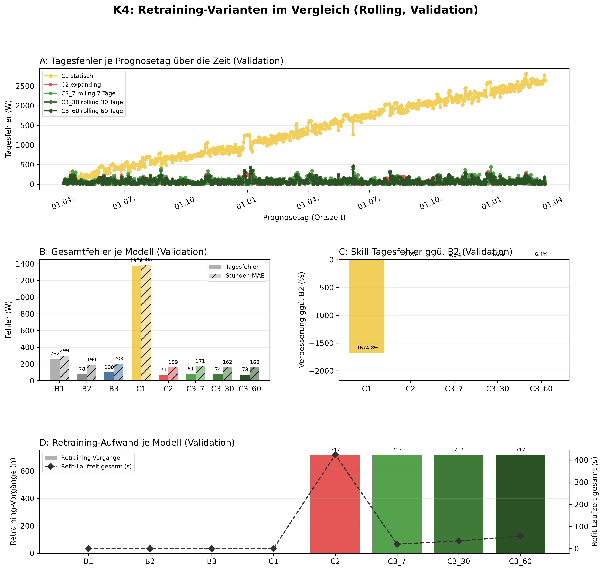
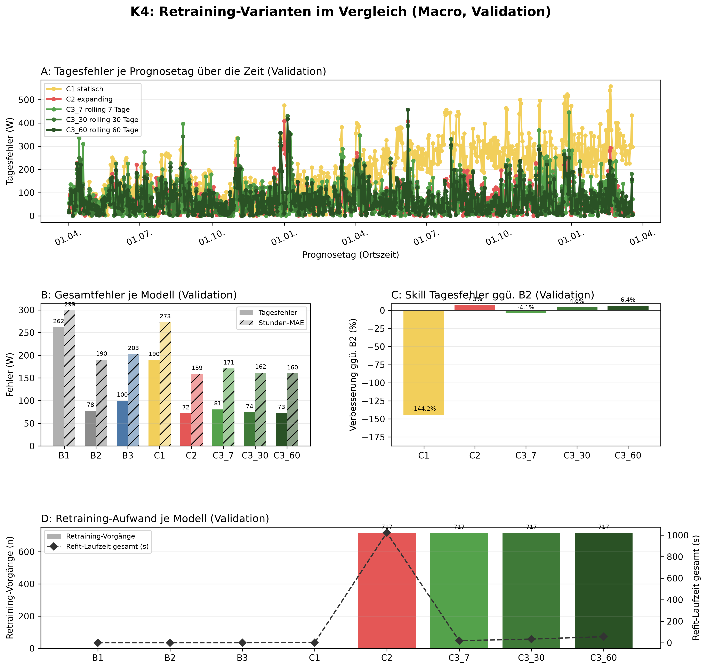

# K4 Retraining-Vergleich, Lauf k4_001

## Setup

- Split: validation, 2014-04-02 bis 2016-03-19, 718 Prognosetage (Ortszeit)
- Modus rolling: 60 Tage Historie vor Split-Start, wie der Online-Zyklus
- Modus macro: gesamte Historie vor Split-Start
- Naive Referenz: rolling B2, macro B2
- Prognose: 1 Tag ab lokaler Mitternacht, Intervall 80 %
- Konfiguration: forecast-model-0.1, Seed 42
- Commit: 5a5007e

## Kennzahlen

| Kennzahl | Wert | Bezug |
|---|---|---|
| rolling: Tagesfehler bestes Modell C2 expanding [W] | 70,6 | B2 77,6 W |
| rolling: Skill der Prophet-Varianten im Tagesfehler ggü. B2 [%] | 9,0 | Spanne -1674,8 bis 9,0 % |
| rolling: Varianten belastbar schlechter als das beste Modell | 2 | von 4 |
| macro: Tagesfehler bestes Modell C2 expanding [W] | 72,0 | B2 77,6 W |
| macro: Skill der Prophet-Varianten im Tagesfehler ggü. B2 [%] | 7,3 | Spanne -144,2 bis 7,3 % |
| macro: Varianten belastbar schlechter als das beste Modell | 2 | von 4 |

## Gesamtfehler rolling

| Modell | Tagesfehler MAE [W] | Tagesfehler MAPE [%] | Skill Tagesfehler ggü. B2 [%] | Stunden-MAE [W] | Stunden-RMSE [W] | Stunden-MAPE [%] | Intervall-Abdeckung [%], Soll 80 | Refit-Zeit gesamt [s] |
|---|---:|---:|---:|---:|---:|---:|---:|---:|
| C2 expanding | 70,6 | 26,2 | 9,0 | 158,6 | 247,0 | 54,7 | 87,7 | 424,0 |
| C3_60 rolling 60 Tage | 72,6 | 25,5 | 6,4 | 160,0 | 246,5 | 54,9 | 88,2 | 56,6 |
| C3_30 rolling 30 Tage | 74,1 | 25,3 | 4,6 | 161,7 | 247,6 | 55,5 | 87,4 | 34,5 |
| B2 naiv, Vortag | 77,6 | 23,2 | 0,0 | 190,3 | 331,0 | 57,0 | - | 0,0 |
| C3_7 rolling 7 Tage | 80,8 | 25,9 | -4,1 | 170,9 | 256,0 | 58,7 | 82,7 | 20,0 |
| B3 naiv, Vorwoche | 99,9 | 35,2 | -28,6 | 202,7 | 339,3 | 64,6 | - | 0,0 |
| B1 naiv, letzter Wert | 262,0 | 74,2 | -237,4 | 299,1 | 461,6 | 103,9 | - | 0,0 |
| C1 statisch | 1377,9 | 439,2 | -1674,8 | 1386,2 | 1587,0 | 612,8 | 7,8 | 0,2 |

## Gesamtfehler macro

| Modell | Tagesfehler MAE [W] | Tagesfehler MAPE [%] | Skill Tagesfehler ggü. B2 [%] | Stunden-MAE [W] | Stunden-RMSE [W] | Stunden-MAPE [%] | Intervall-Abdeckung [%], Soll 80 | Refit-Zeit gesamt [s] |
|---|---:|---:|---:|---:|---:|---:|---:|---:|
| C2 expanding | 72,0 | 26,5 | 7,3 | 158,8 | 247,6 | 54,7 | 87,3 | 1023,0 |
| C3_60 rolling 60 Tage | 72,6 | 25,5 | 6,4 | 160,0 | 246,5 | 54,9 | 88,1 | 56,5 |
| C3_30 rolling 30 Tage | 74,1 | 25,3 | 4,6 | 161,7 | 247,6 | 55,5 | 87,4 | 34,1 |
| B2 naiv, Vortag | 77,6 | 23,2 | 0,0 | 190,3 | 331,0 | 57,0 | - | 0,0 |
| C3_7 rolling 7 Tage | 80,8 | 25,9 | -4,1 | 170,9 | 256,0 | 58,7 | 82,6 | 19,3 |
| B3 naiv, Vorwoche | 99,9 | 35,2 | -28,6 | 202,7 | 339,3 | 64,6 | - | 0,0 |
| C1 statisch | 189,6 | 69,6 | -144,2 | 272,8 | 320,4 | 121,7 | 52,4 | 0,6 |
| B1 naiv, letzter Wert | 262,0 | 74,2 | -237,4 | 299,1 | 461,6 | 103,9 | - | 0,0 |

## Abstand zum besten Prophet-Modell im Tagesfehler, gepaart je Prognosetag

| Modus | Modell | Referenz | Differenz [W] | 2 Standardfehler [W] | Tage | Tage besser [%] | belastbar |
|---|---|---|---:|---:|---:|---:|---|
| rolling | C3_60 rolling 60 Tage | C2 expanding | 2,0 | 3,4 | 716 | 46,2 | nein |
| rolling | C3_30 rolling 30 Tage | C2 expanding | 3,5 | 4,1 | 716 | 46,6 | nein |
| rolling | C3_7 rolling 7 Tage | C2 expanding | 10,2 | 5,9 | 716 | 43,3 | ja |
| rolling | C1 statisch | C2 expanding | 1307,2 | 56,3 | 716 | 0,8 | ja |
| macro | C3_60 rolling 60 Tage | C2 expanding | 0,7 | 3,9 | 716 | 48,7 | nein |
| macro | C3_30 rolling 30 Tage | C2 expanding | 2,1 | 4,5 | 716 | 47,6 | nein |
| macro | C3_7 rolling 7 Tage | C2 expanding | 8,8 | 6,1 | 716 | 46,8 | ja |
| macro | C1 statisch | C2 expanding | 117,6 | 9,0 | 716 | 16,9 | ja |

## Hinweise

- belastbar: Betrag der Differenz größer als 2 Standardfehler der gepaarten Differenzen, grobe Faustregel
- Tagesfehler: Fehler des Tagesmittels (Mittel der 24 Prognosewerte gegen das Ist-Tagesmittel), nicht der Mittelwert der Stundenfehler. Beste Variante, Skill und gepaarter Abstand beruhen auf ihm, die Stundenfehler stehen nur zum Vergleich
- rolling: Tagesfehler aus 716 von 718 Tagen (nur Tage mit Ist-Tagesmittel)
- rolling: 49 von 17233 Zielstunden nicht bewertet (Messwert fehlt 48, imputiert 1)
- macro: Tagesfehler aus 716 von 718 Tagen (nur Tage mit Ist-Tagesmittel)
- macro: 49 von 17233 Zielstunden nicht bewertet (Messwert fehlt 48, imputiert 1)

