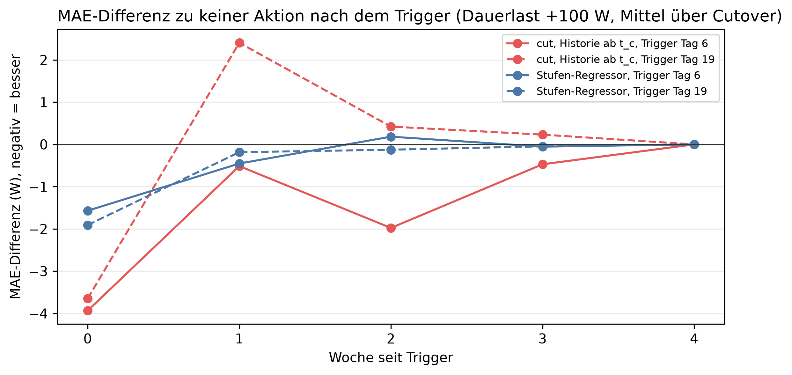

# K4 Adaptionsstrategien, Lauf k4_006

## Setup

- Cutover: 2013-10-15, 2014-02-12, 2014-06-12, 2014-10-10, 2015-02-07
- Ereignisse: Dauerlast +100 W, proportional jede Stunde × 1,3, dazu keine Änderung als Kontrolle
- Trigger: Aktion fest an Tag 6 und 19 nach dem Cutover (Orakel), t_c wie die Adaptionsregel
- Auswertung: 30 Prognosetage ab Trigger, gepaart gegen keine Aktion am selben Tag
- Commit: 83d6802 (mit lokalen Änderungen)

## Kennzahlen

| Kennzahl | Wert | Bezug |
|---|---|---|
| cut, Historie ab t_c, Trigger Tag 6: Netto-Effekt bei Dauerlast +100 W [W] | -2,4 | -1,7 % MAE, gleiche Richtung 4/5 Cutover |
| Stufen-Regressor, Trigger Tag 6: Netto-Effekt bei Dauerlast +100 W [W] | -0,8 | -0,5 % MAE, gleiche Richtung 4/5 Cutover |
| Trigger Tag 19: bester Netto-Effekt bei Dauerlast +100 W [W] | -0,1 | späte Erkennung |
| ohne Aktion: Mehrfehler bei Dauerlast +100 W in Woche 0 [W] | 0,1 | Woche 2: 3,1 W |

## Ohne Aktion: Mehrfehler gegenüber keiner Änderung je Woche seit Cutover [W]

| Ereignis | Woche 0 | Woche 1 | Woche 2 | Woche 3 | Woche 4 | Woche 5 | Woche 6 | Woche 7 | Woche 8 |
|---|---:|---:|---:|---:|---:|---:|---:|---:|---:|
| proportional ×1,3 | 33,0 | 42,9 | 43,9 | 42,5 | 44,5 | 46,7 | 48,0 | 42,8 | 39,6 |
| Dauerlast +100 W | 0,1 | 9,4 | 3,1 | 2,9 | 2,6 | 0,9 | 1,8 | 2,0 | 2,8 |

## Netto-Effekt der Aktion über die Auswertungstage, je Cutover [W], negativ = besser

| Ereignis | Trigger-Tag | Aktion | 2013-10-15 | 2014-02-12 | 2014-06-12 | 2014-10-10 | 2015-02-07 | Mittel | gleiche Richtung | Mittel [%] |
|---|---:|---|---:|---:|---:|---:|---:|---:|---|---:|
| proportional ×1,3 | 6 | cut, Historie ab t_c | -0,7 | -2,0 | 0,3 | -1,6 | -1,4 | -1,1 | 4/5 | -0,6 |
| proportional ×1,3 | 6 | Stufen-Regressor | -0,8 | -1,0 | -0,1 | -0,3 | -1,4 | -0,7 | 5/5 | -0,4 |
| proportional ×1,3 | 19 | cut, Historie ab t_c | 0,2 | 0,8 | -0,8 | -0,1 | -0,8 | -0,1 | 3/5 | -0,1 |
| proportional ×1,3 | 19 | Stufen-Regressor | -0,8 | -0,0 | -0,1 | 0,2 | -0,5 | -0,2 | 4/5 | -0,1 |
| Dauerlast +100 W | 6 | cut, Historie ab t_c | -2,7 | -0,7 | 0,3 | -4,2 | -4,7 | -2,4 | 4/5 | -1,7 |
| Dauerlast +100 W | 6 | Stufen-Regressor | -1,2 | -1,4 | 1,2 | -0,6 | -1,8 | -0,8 | 4/5 | -0,5 |
| Dauerlast +100 W | 19 | cut, Historie ab t_c | 1,1 | 0,5 | -1,0 | 0,3 | -1,0 | 0,0 | 3/5 | 0,0 |
| Dauerlast +100 W | 19 | Stufen-Regressor | -0,3 | 0,5 | -0,1 | 0,4 | -0,8 | -0,1 | 3/5 | -0,1 |

## Kosten eines Fehlalarms: Aktion ohne echte Änderung, je Cutover [W]

| Trigger-Tag | Aktion | 2013-10-15 | 2014-02-12 | 2014-06-12 | 2014-10-10 | 2015-02-07 | Mittel | gleiche Richtung |
|---:|---|---:|---:|---:|---:|---:|---:|---|
| 6 | cut, Historie ab t_c | 1,5 | -0,9 | 2,7 | -1,2 | 1,8 | 0,8 | 3/5 |
| 6 | Stufen-Regressor | 0,5 | 0,8 | 0,3 | 0,0 | -0,0 | 0,3 | 4/5 |
| 19 | cut, Historie ab t_c | 1,1 | 0,8 | -1,6 | -1,9 | 0,9 | -0,1 | 2/5 |
| 19 | Stufen-Regressor | -0,7 | -1,4 | 0,0 | -0,1 | -0,0 | -0,4 | 4/5 |

## Hinweise

- Netto: Differenz zu keiner Aktion bei echter Änderung minus Differenz derselben Aktion ohne Änderung
- gleiche Richtung: Cutover, deren Wert dasselbe Vorzeichen hat wie das Mittel. Die Fenster überlappen, einzelne Cutover sind nicht unabhängig

