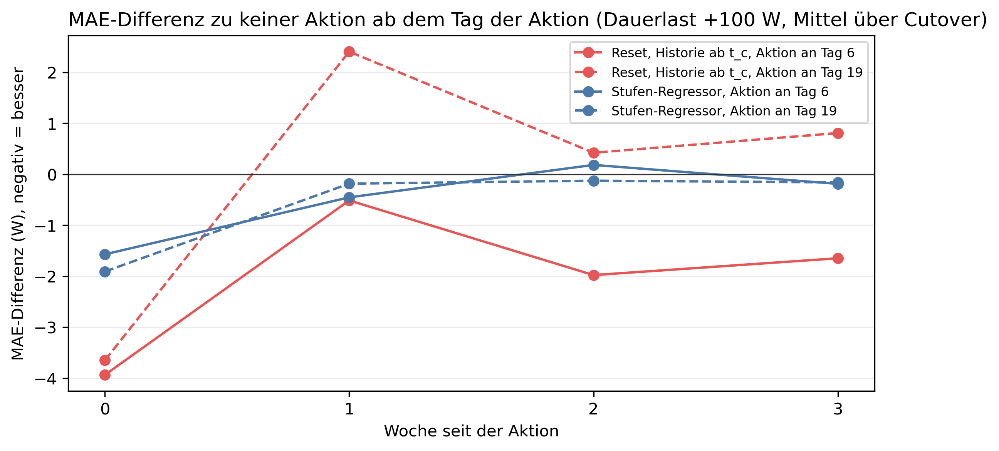

# K4 Adaptionsstrategien, Lauf k4_009

## Setup

- Cutover: 2013-10-15, 2014-02-12, 2014-06-12, 2014-10-10, 2015-02-07
- Ereignisse: Dauerlast +100 W, proportional jede Stunde × 1,3
- Aktion: fest an Tag 6 und 19 nach dem Cutover (Orakel), Historie ab t_c wie die Adaptionsregel
- Auswertung: 23 Prognosetage ab dem Tag der Aktion, Differenz zu keiner Aktion am selben Tag
- Commit: 3cb5c4c (mit lokalen Änderungen)

## Kennzahlen MAE

| Kennzahl | Wert | Bezug |
|---|---|---|
| Reset, Historie ab t_c, Aktion an Tag 6: Differenz zu keiner Aktion bei Dauerlast +100 W [W] | -2,1 | -1,5 % des Fehlers ohne Aktion, bei 4/5 Cutover besser |
| Stufen-Regressor, Aktion an Tag 6: Differenz zu keiner Aktion bei Dauerlast +100 W [W] | -0,6 | -0,4 % des Fehlers ohne Aktion, bei 4/5 Cutover besser |
| Aktion an Tag 19: beste Differenz bei Dauerlast +100 W [W] | -0,7 | späte Erkennung |

## Differenz der Aktion zu keiner Aktion (MAE), Mittel über 23 Prognosetage ab der Aktion, je Cutover [W], negativ = besser

| Ereignis | Aktion an Tag nach Cutover | Aktion | 2013-10-15 | 2014-02-12 | 2014-06-12 | 2014-10-10 | 2015-02-07 | Mittel | Cutover besser | Mittel in % des Fehlers ohne Aktion |
|---|---:|---|---:|---:|---:|---:|---:|---:|---|---:|
| proportional ×1,3 | 6 | Reset, Historie ab t_c | 1,0 | -3,9 | 3,9 | -3,6 | 0,5 | -0,4 | 2/5 | -0,2 |
| proportional ×1,3 | 6 | Stufen-Regressor | -0,3 | -0,2 | 0,3 | -0,3 | -1,9 | -0,5 | 4/5 | -0,3 |
| proportional ×1,3 | 19 | Reset, Historie ab t_c | 1,7 | 2,2 | -3,2 | -2,6 | 0,2 | -0,3 | 2/5 | -0,2 |
| proportional ×1,3 | 19 | Stufen-Regressor | -2,0 | -1,9 | -0,1 | 0,2 | -0,7 | -0,9 | 4/5 | -0,5 |
| Dauerlast +100 W | 6 | Reset, Historie ab t_c | -1,6 | -2,0 | 3,9 | -7,1 | -3,7 | -2,1 | 4/5 | -1,5 |
| Dauerlast +100 W | 6 | Stufen-Regressor | -0,8 | -0,8 | 2,0 | -0,8 | -2,4 | -0,6 | 4/5 | -0,4 |
| Dauerlast +100 W | 19 | Reset, Historie ab t_c | 2,9 | 1,8 | -3,4 | -2,0 | -0,1 | -0,2 | 3/5 | -0,1 |
| Dauerlast +100 W | 19 | Stufen-Regressor | -1,4 | -1,3 | -0,1 | 0,4 | -1,1 | -0,7 | 4/5 | -0,5 |

## Kennzahlen Tagesfehler

| Kennzahl | Wert | Bezug |
|---|---|---|
| Reset, Historie ab t_c, Aktion an Tag 6: Differenz zu keiner Aktion bei Dauerlast +100 W [W] | 1,2 | 1,7 % des Fehlers ohne Aktion, bei 2/5 Cutover besser |
| Stufen-Regressor, Aktion an Tag 6: Differenz zu keiner Aktion bei Dauerlast +100 W [W] | -0,3 | -0,4 % des Fehlers ohne Aktion, bei 3/5 Cutover besser |
| Aktion an Tag 19: beste Differenz bei Dauerlast +100 W [W] | -0,5 | späte Erkennung |

## Differenz der Aktion zu keiner Aktion (Tagesfehler), Mittel über 23 Prognosetage ab der Aktion, je Cutover [W], negativ = besser

| Ereignis | Aktion an Tag nach Cutover | Aktion | 2013-10-15 | 2014-02-12 | 2014-06-12 | 2014-10-10 | 2015-02-07 | Mittel | Cutover besser | Mittel in % des Fehlers ohne Aktion |
|---|---:|---|---:|---:|---:|---:|---:|---:|---|---:|
| proportional ×1,3 | 6 | Reset, Historie ab t_c | 3,2 | -4,5 | 7,0 | 2,4 | 1,7 | 2,0 | 1/5 | 2,2 |
| proportional ×1,3 | 6 | Stufen-Regressor | 0,4 | -0,5 | -1,1 | 3,9 | 1,2 | 0,8 | 2/5 | 0,9 |
| proportional ×1,3 | 19 | Reset, Historie ab t_c | -4,2 | 6,7 | -4,6 | -14,0 | 9,3 | -1,4 | 3/5 | -1,3 |
| proportional ×1,3 | 19 | Stufen-Regressor | -3,7 | 1,1 | -0,2 | -0,4 | 4,5 | 0,3 | 3/5 | 0,3 |
| Dauerlast +100 W | 6 | Reset, Historie ab t_c | -0,8 | -2,3 | 6,2 | 1,3 | 1,6 | 1,2 | 2/5 | 1,7 |
| Dauerlast +100 W | 6 | Stufen-Regressor | -1,9 | -1,4 | 1,7 | 0,5 | -0,2 | -0,3 | 3/5 | -0,4 |
| Dauerlast +100 W | 19 | Reset, Historie ab t_c | -2,7 | 8,0 | -5,7 | -9,6 | 7,3 | -0,5 | 3/5 | -0,7 |
| Dauerlast +100 W | 19 | Stufen-Regressor | -3,2 | 0,9 | -0,0 | 2,3 | 1,6 | 0,3 | 2/5 | 0,4 |

## Prognose minus Messung beim Tagesmittel ohne Aktion, Mittel über die Cutover, je Tag seit Cutover [W], negativ = Prognose zu niedrig

| Ereignis | Tag -3 | Tag -2 | Tag -1 | Tag 0 | Tag 1 | Tag 2 | Tag 3 | Tag 4 | Tag 5 | Tag 6 | Tag 7 | Tag 8 | Tag 9 | Tag 10 |
|---|---:|---:|---:|---:|---:|---:|---:|---:|---:|---:|---:|---:|---:|---:|
| proportional ×1,3 | 32,5 | -12,0 | -11,6 | -69,5 | -88,0 | -50,4 | -72,6 | -74,1 | -83,0 | -18,4 | -0,6 | -6,4 | 23,7 | -55,9 |
| Dauerlast +100 W | 32,5 | -12,0 | -11,6 | -73,2 | -73,3 | -35,6 | -44,3 | -38,2 | -40,5 | 15,3 | 26,4 | 18,8 | 41,5 | -27,2 |

## Hinweise

- Differenz: Fehler mit Aktion minus Fehler ohne Aktion, tageweise auf denselben Daten, über die Tage ab der Aktion gemittelt
- Cutover besser: Zahl der Cutover, bei denen die Differenz unter null liegt. Die Fenster überlappen, einzelne Cutover sind nicht unabhängig
- Tagesfehler: Betrag der Differenz zwischen prognostiziertem und gemessenem Tagesmittel (Tagesenergie), wie in K1, nur Tage mit lauter bewerteten Stunden. Gegenläufige Stundenfehler gleichen sich dabei aus

