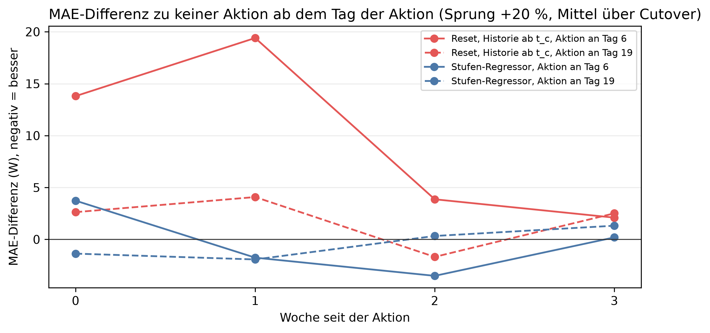

# K4 Adaptionsstrategien, Lauf k4_012

## Setup

- Cutover: CO1 (2014-07-15), CO2 (2014-10-24), CO3 (2015-03-01), CO4 (2015-06-10), CO5 (2015-10-22)
- Ereignis: Sprung, jede Stunde × 1,2
- Aktion: fest an Tag 6 und 19 nach dem Cutover (Orakel), Historie ab t_c wie die Adaptionsregel
- Auswertung: 23 Prognosetage ab dem Tag der Aktion, Differenz zu keiner Aktion am selben Tag
- Commit: 83b23e4 (mit lokalen Änderungen)

## Kennzahlen MAE

| Kennzahl | Wert | Bezug |
|---|---|---|
| Reset, Historie ab t_c, Aktion an Tag 6: Differenz zu keiner Aktion bei Sprung +20 % [W] | 11,3 | 5,9 % des Fehlers ohne Aktion, bei 0/5 Cutover besser |
| Stufen-Regressor, Aktion an Tag 6: Differenz zu keiner Aktion bei Sprung +20 % [W] | -0,5 | -0,3 % des Fehlers ohne Aktion, bei 2/5 Cutover besser |
| Aktion an Tag 19: beste Differenz bei Sprung +20 % [W] | -0,8 | späte Erkennung |

## Differenz der Aktion zu keiner Aktion (MAE), Mittel über 23 Prognosetage ab der Aktion, je Cutover [W], negativ = besser

| Ereignis | Aktion an Tag nach Cutover | Aktion | 2014-07-15 | 2014-10-24 | 2015-03-01 | 2015-06-10 | 2015-10-22 | Mittel | Cutover besser | Mittel in % des Fehlers ohne Aktion |
|---|---:|---|---:|---:|---:|---:|---:|---:|---|---:|
| Sprung +20 % | 6 | Reset, Historie ab t_c | 0,1 | 19,6 | 8,1 | 10,3 | 18,6 | 11,3 | 0/5 | 5,9 |
| Sprung +20 % | 6 | Stufen-Regressor | -5,0 | 1,8 | 3,1 | -3,3 | 0,8 | -0,5 | 2/5 | -0,3 |
| Sprung +20 % | 19 | Reset, Historie ab t_c | 4,4 | -4,8 | 11,6 | -5,4 | 3,1 | 1,7 | 2/5 | 0,9 |
| Sprung +20 % | 19 | Stufen-Regressor | 1,3 | -0,3 | -1,2 | -0,2 | -3,5 | -0,8 | 4/5 | -0,4 |

## Kennzahlen Tagesfehler

| Kennzahl | Wert | Bezug |
|---|---|---|
| Reset, Historie ab t_c, Aktion an Tag 6: Differenz zu keiner Aktion bei Sprung +20 % [W] | 10,6 | 12,0 % des Fehlers ohne Aktion, bei 1/5 Cutover besser |
| Stufen-Regressor, Aktion an Tag 6: Differenz zu keiner Aktion bei Sprung +20 % [W] | 0,5 | 0,6 % des Fehlers ohne Aktion, bei 2/5 Cutover besser |
| Aktion an Tag 19: beste Differenz bei Sprung +20 % [W] | -0,9 | späte Erkennung |

## Differenz der Aktion zu keiner Aktion (Tagesfehler), Mittel über 23 Prognosetage ab der Aktion, je Cutover [W], negativ = besser

| Ereignis | Aktion an Tag nach Cutover | Aktion | 2014-07-15 | 2014-10-24 | 2015-03-01 | 2015-06-10 | 2015-10-22 | Mittel | Cutover besser | Mittel in % des Fehlers ohne Aktion |
|---|---:|---|---:|---:|---:|---:|---:|---:|---|---:|
| Sprung +20 % | 6 | Reset, Historie ab t_c | -0,5 | 12,9 | 19,5 | 9,8 | 11,2 | 10,6 | 1/5 | 12,0 |
| Sprung +20 % | 6 | Stufen-Regressor | -4,4 | -1,1 | 4,9 | 1,5 | 1,8 | 0,5 | 2/5 | 0,6 |
| Sprung +20 % | 19 | Reset, Historie ab t_c | -19,2 | 6,4 | 4,6 | 2,0 | 14,8 | 1,7 | 1/5 | 1,8 |
| Sprung +20 % | 19 | Stufen-Regressor | -10,0 | 3,8 | 2,7 | 0,5 | -1,8 | -0,9 | 2/5 | -1,0 |

## Prognose minus Messung beim Tagesmittel ohne Aktion, Mittel über die Cutover, je Tag seit Cutover [W], negativ = Prognose zu niedrig

| Ereignis | Tag -3 | Tag -2 | Tag -1 | Tag 0 | Tag 1 | Tag 2 | Tag 3 | Tag 4 | Tag 5 | Tag 6 | Tag 7 | Tag 8 | Tag 9 | Tag 10 |
|---|---:|---:|---:|---:|---:|---:|---:|---:|---:|---:|---:|---:|---:|---:|
| Sprung +20 % | -114,6 | 21,6 | -42,3 | -9,3 | -106,2 | -38,7 | -41,2 | -89,3 | 42,3 | 125,3 | 63,6 | 52,7 | -42,9 | -7,6 |

## Hinweise

- Differenz: Fehler mit Aktion minus Fehler ohne Aktion, tageweise auf denselben Daten, über die Tage ab der Aktion gemittelt
- Cutover besser: Zahl der Cutover, bei denen die Differenz unter null liegt. Die Fenster überlappen, einzelne Cutover sind nicht unabhängig
- Tagesfehler: Betrag der Differenz zwischen prognostiziertem und gemessenem Tagesmittel (Tagesenergie), wie in K1, nur Tage mit lauter bewerteten Stunden. Gegenläufige Stundenfehler gleichen sich dabei aus

