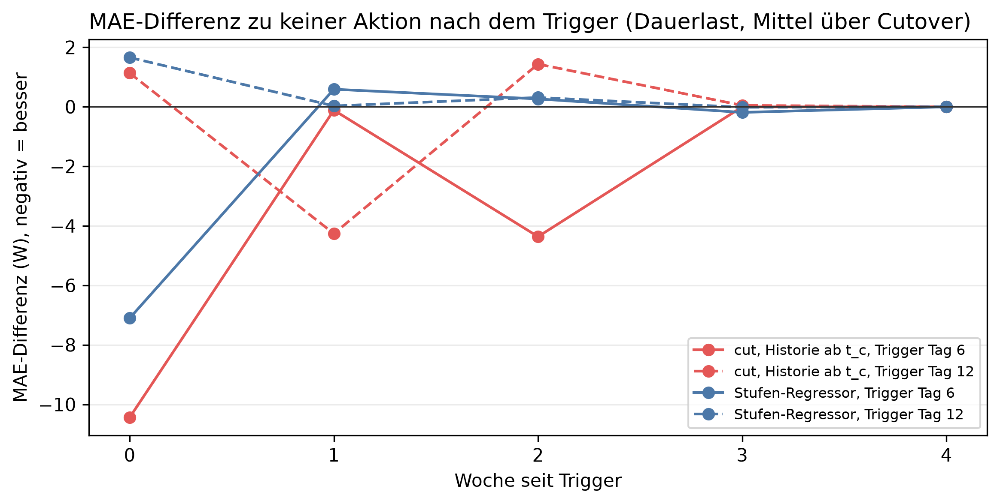

# K5 Adaptionsstrategien, Lauf k5_002

## Setup

- Cutover: 2013-10-15, 2014-01-15, 2014-04-15, 2014-07-15
- Ereignisse: Dauerlast +100 W, proportional jede Stunde × 1,3, dazu keine Änderung als Kontrolle
- Trigger: Aktion fest an Tag 6 und 12 nach dem Cutover (Orakel), t_c wie die Adaptionsregel
- Auswertung: 30 Prognosetage ab Trigger, gepaart gegen keine Aktion am selben Tag
- Commit: 3bef76f (mit lokalen Änderungen)

## Kennzahlen

| Kennzahl | Wert | Bezug |
|---|---|---|
| cut, Historie ab t_c, Trigger Tag 6: Netto-Effekt bei Dauerlast [W] | -3,3 | -2,4 % MAE, gleiche Richtung 4/4 Cutover |
| Stufen-Regressor, Trigger Tag 6: Netto-Effekt bei Dauerlast [W] | -1,0 | -0,7 % MAE, gleiche Richtung 4/4 Cutover |
| Trigger Tag 12: bester Netto-Effekt bei Dauerlast [W] | -0,6 | späte Erkennung |
| ohne Aktion: Mehrfehler bei Dauerlast in Woche 0 [W] | 32,1 | Woche 2: 2,4 W |

## Ohne Aktion: Mehrfehler gegenüber keiner Änderung je Woche seit Cutover [W]

| Ereignis | Woche 0 | Woche 1 | Woche 2 | Woche 3 | Woche 4 | Woche 5 | Woche 6 | Woche 7 | Woche 8 |
|---|---:|---:|---:|---:|---:|---:|---:|---:|---:|
| proportional | 55,9 | 40,7 | 43,0 | 38,8 | 39,7 | 42,6 | 41,3 | 38,9 | 38,3 |
| Dauerlast | 32,1 | 17,1 | 2,4 | 1,9 | 2,0 | 0,8 | 2,3 | 0,9 | 0,4 |

## Netto-Effekt der Aktion über die Auswertungstage, je Cutover [W], negativ = besser

| Ereignis | Trigger-Tag | Aktion | 2013-10-15 | 2014-01-15 | 2014-04-15 | 2014-07-15 | Mittel | gleiche Richtung | Mittel [%] |
|---|---:|---|---:|---:|---:|---:|---:|---|---:|
| proportional | 6 | cut, Historie ab t_c | -0,7 | -3,1 | -1,4 | 1,0 | -1,0 | 3/4 | -0,6 |
| proportional | 6 | Stufen-Regressor | -0,8 | -1,0 | -0,6 | -1,0 | -0,8 | 4/4 | -0,5 |
| proportional | 12 | cut, Historie ab t_c | -0,4 | -2,0 | -0,3 | 0,9 | -0,4 | 3/4 | -0,3 |
| proportional | 12 | Stufen-Regressor | 0,3 | -0,7 | 0,4 | 0,2 | 0,0 | 3/4 | 0,0 |
| Dauerlast | 6 | cut, Historie ab t_c | -2,7 | -3,5 | -3,9 | -3,1 | -3,3 | 4/4 | -2,4 |
| Dauerlast | 6 | Stufen-Regressor | -1,2 | -1,2 | -0,4 | -1,2 | -1,0 | 4/4 | -0,7 |
| Dauerlast | 12 | cut, Historie ab t_c | -0,5 | -1,0 | -0,2 | -0,7 | -0,6 | 4/4 | -0,4 |
| Dauerlast | 12 | Stufen-Regressor | 0,8 | -0,6 | 0,6 | 0,4 | 0,3 | 3/4 | 0,2 |

## Kosten eines Fehlalarms: Aktion ohne echte Änderung, je Cutover [W]

| Trigger-Tag | Aktion | 2013-10-15 | 2014-01-15 | 2014-04-15 | 2014-07-15 | Mittel | gleiche Richtung |
|---:|---|---:|---:|---:|---:|---:|---|
| 6 | cut, Historie ab t_c | 1,5 | -5,9 | -0,3 | 4,3 | -0,1 | 2/4 |
| 6 | Stufen-Regressor | 0,5 | -2,4 | -0,7 | 0,8 | -0,4 | 2/4 |
| 12 | cut, Historie ab t_c | 2,1 | -3,3 | -0,7 | 2,8 | 0,2 | 2/4 |
| 12 | Stufen-Regressor | 0,1 | 0,1 | 0,8 | -0,4 | 0,2 | 3/4 |

## Hinweise

- Netto: Differenz zu keiner Aktion bei echter Änderung minus Differenz derselben Aktion ohne Änderung
- gleiche Richtung: Cutover, deren Wert dasselbe Vorzeichen hat wie das Mittel. Die Fenster überlappen, einzelne Cutover sind nicht unabhängig

