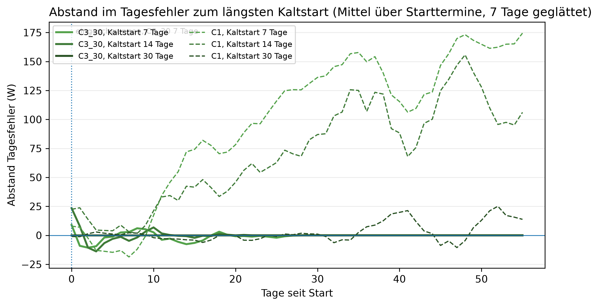
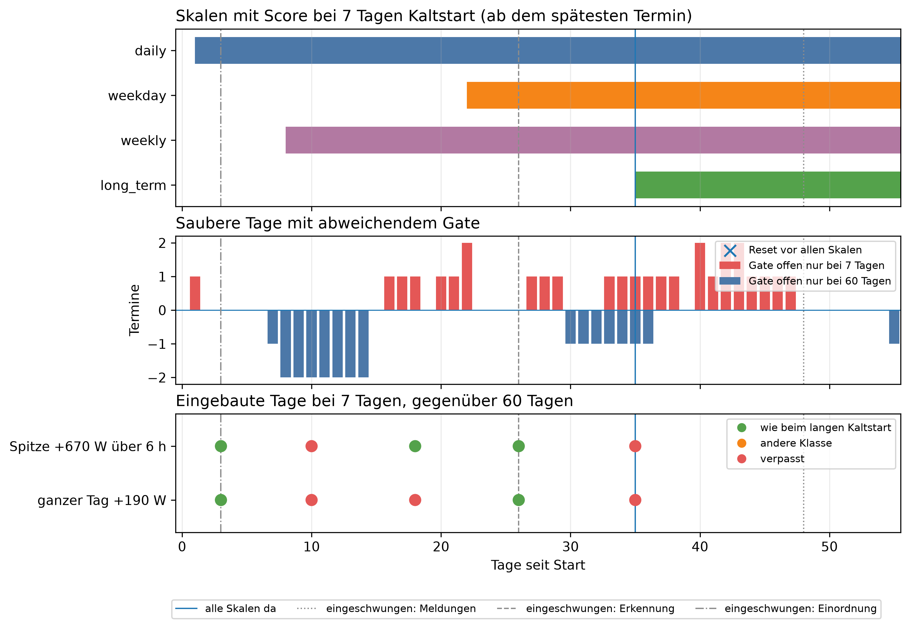

# E4 Kaltstart, Lauf e4_001

## Setup

- Starttermine: Standard-Cutover CO2 (2015-02-12), CO3 (2015-05-24), CO5 (2016-01-12) (validation)
- Kaltstart: E4a 7, 14, 30, 60 Tage, E4b 7, 60 Tage, jeweils alle Tage am ersten Entscheidungstag, der erste eingeordnete Tag zählt mit
- Auswertung: 56 Tage ab Start, je Starttermin dieselben Kalendertage für alle Kaltstart-Längen
- Prognose (E4a): C3_30 täglich nachtrainiert, C1 nur auf den Starttagen, Baseline B2, Seed 42
- Kreislauf (E4b): SYS3 LLM, ministral-3:8b, Prompt v30, Temperatur 0, Adaption an
- Injektionen: Spitze +670 W über 6 h, ganzer Tag +190 W, je Lauf eine, an Tag 3, 10, 18, 26, 35, eingeordnet am Tag danach
- Commit: 32b0600

## Antwort auf TF1: funktioniert mit 7 Tagen: nein (keine Fehlfunktion, von Anfang an nutzbar, passt sich an)

| Kriterium | Prüfung | erfüllt | Wert |
|---|---|---|---:|
| keine Fehlfunktion | Resets, solange nicht alle Skalen einen Score haben | ja | 0,0 |
| von Anfang an nutzbar | Skill der Prognose im Tagesfehler gegenüber der Baseline in Woche 1 [%] | ja | 6,8 |
| von Anfang an nutzbar | erster Tag mit Gate-Skala, spätester Termin | ja | 1,0 |
| passt sich an | Einschwingtag Prognose | ja | 0,0 |
| passt sich an | Einschwingtag Meldungen, spätester Termin | nein | 48,0 |
| passt sich an | Einschwingtag Erkennung, spätester Termin und Art | nein | 26,0 |
| passt sich an | Einschwingtag Einordnung, spätester Termin und Art | ja | 3,0 |
| adaptiv gegen statisch | Anteil der Fenster ab Woche 2, in denen statisch an jedem Termin schlechter ist | nein | 0,2 |

## Resets in der Einschwingzeit

| Starttermin | Kaltstart [Tage] | Szenario | Injektionstag | eingeordneter Tag | Tag seit Start | Klasse | Skalen mit Score | anhaltend auffällige Skalen |
|---|---:|---|---:|---|---:|---|---:|---:|

## Preis bis zum Einschwingen: 7 gegenüber 60 Tagen Kaltstart, alle Termine

| Kennzahl | Wert | Bezug |
|---|---|---|
| zusätzlicher Tagesfehler der Prognose [W], Tag 0-6 | 2,5 | bei 74,5 W mit langem Kaltstart (3,3 %) |
| zusätzlicher Tagesfehler der Prognose [W], Tag 7-13 | -5,6 | bei 69,4 W mit langem Kaltstart (-8,1 %) |
| zusätzlicher Tagesfehler der Prognose [W], Tag 14-27 | -0,5 | bei 78,2 W mit langem Kaltstart (-0,7 %) |
| zusätzlicher Tagesfehler der Prognose [W], Tag 28-55 | 0,0 | bei 80,2 W mit langem Kaltstart (0,0 %) |
| Meldetage nur mit kurzem Kaltstart | 28 | von 168 sauberen Tagen (16,7 %) |
| Meldetage nur mit langem Kaltstart | 23 | von 168 sauberen Tagen (13,7 %) |
| unknown-Tage, Tag 0-6 | 3 | von 21 sauberen Tagen (14,3 %) |
| verpasste Injektionen, ganzer Tag +190 W | 5 | von 7, die der lange Kaltstart meldet (71,4 %) |
| verpasste Injektionen, Spitze +670 W über 6 h | 4 | von 6, die der lange Kaltstart meldet (66,7 %) |
| Injektionen mit anderer Klasse, ganzer Tag +190 W | 0 | von 7, die der lange Kaltstart meldet (0,0 %) |
| Injektionen mit anderer Klasse, Spitze +670 W über 6 h | 0 | von 6, die der lange Kaltstart meldet (0,0 %) |
| Injektionen mit unknown statt Klasse, ganzer Tag +190 W | 0 | von 7, die der lange Kaltstart meldet (0,0 %) |
| Injektionen mit unknown statt Klasse, Spitze +670 W über 6 h | 0 | von 6, die der lange Kaltstart meldet (0,0 %) |

## Hinweise

- Tag 0 = erster prognostizierter Tag, eingeordnet wird an ihm der letzte Tag der Start-Historie. Ein Injektionstag k wird am Tag k + 1 eingeordnet
- Einschwingtag leer: im letzten Fenster, am letzten Tag bzw. am letzten Injektionstag noch abweichend, also nicht eingeschwungen
- Einschwingtage Erkennung und Einordnung nur so fein wie die Injektionstage
- MAPE C3_30 mit 7 Tagen in Tag 28-55: 58,2 % (Proposal-Kriterium 10 %, hier kein Maßstab)
- Kontrolle Prognose im Kreislauf gegen Walk-Forward bis zum ersten Reset, soll 0 sein: größte Abweichung 7 Tage 0,0 W, 60 Tage 0,0 W
- belastbar: Betrag der Differenz größer als 2 Standardfehler der gepaarten Differenzen, grobe Faustregel
- Einschränkungen: ein Haushalt, wenige Termine, aufeinanderfolgende Tage sind nicht unabhängig (Standardfehler eher zu klein), LLM mit Temperatur 0 als deterministisch angenommen (Ollama auf GPU nicht garantiert bitgenau)

## Anhang

### Einschwingen Prognose: erster Tag des Fensters, ab dem der Abstand zu 60 Tagen im Rauschen liegt

| Modell | Kaltstart [Tage] | Einschwingtag |
|---|---:|---:|
| C1 | 7 | - |
| C1 | 14 | - |
| C1 | 30 | 0 |
| C3_30 | 7 | 0 |
| C3_30 | 14 | 0 |
| C3_30 | 30 | 0 |

### Einschwingen Meldungen je Termin: saubere Tage mit Gate offen nur bei 7 bzw. nur bei 60 Tagen

| Starttermin | nur bei 7 Tagen | nur bei 60 Tagen | Einschwingtag |
|---|---:|---:|---:|
| 2015-02-12 | 6 | 9 | - |
| 2015-05-24 | 7 | 7 | 44 |
| 2016-01-12 | 15 | 7 | 48 |

### Einschwingen Erkennung und Einordnung je Termin: erster Injektionstag, ab dem alle späteren wie beim langen Kaltstart sind

| Starttermin | Szenario | Erkennung | Einordnung |
|---|---|---:|---:|
| 2015-02-12 | ganzer Tag +190 W | 26 | 3 |
| 2015-02-12 | Spitze +670 W über 6 h | 18 | 3 |
| 2015-05-24 | ganzer Tag +190 W | 18 | 3 |
| 2015-05-24 | Spitze +670 W über 6 h | 18 | 3 |
| 2016-01-12 | ganzer Tag +190 W | - | 3 |
| 2016-01-12 | Spitze +670 W über 6 h | - | 3 |

### Abstand im Tagesfehler zu 60 Tagen je Modell, gepaart über Termin und Tag, positiv = schlechter

| Modell | Kaltstart [Tage] | Tage seit Start | Differenz [W] | 2 Standardfehler [W] | Tage | Tage besser [%] | belastbar |
|---|---:|---|---:|---:|---:|---:|---|
| C1 | 7 | 0-6 | -13,1 | 24,8 | 21 | 57,1 | nein |
| C1 | 14 | 0-6 | 8,7 | 19,8 | 21 | 52,4 | nein |
| C1 | 30 | 0-6 | 0,5 | 4,2 | 21 | 33,3 | nein |
| C1 | 7 | 7-13 | 54,9 | 30,6 | 21 | 33,3 | ja |
| C1 | 14 | 7-13 | 30,0 | 33,2 | 21 | 42,9 | nein |
| C1 | 30 | 7-13 | -3,2 | 6,6 | 21 | 42,9 | nein |
| C1 | 7 | 14-27 | 101,9 | 32,6 | 42 | 26,2 | ja |
| C1 | 14 | 14-27 | 58,1 | 34,1 | 42 | 31,0 | ja |
| C1 | 30 | 14-27 | 0,1 | 7,8 | 42 | 33,3 | nein |
| C1 | 7 | 28-55 | 152,7 | 35,7 | 84 | 32,1 | ja |
| C1 | 14 | 28-55 | 113,9 | 37,3 | 84 | 25,0 | ja |
| C1 | 30 | 28-55 | 6,6 | 9,0 | 84 | 28,6 | nein |
| C3_30 | 7 | 0-6 | 2,5 | 18,2 | 21 | 38,1 | nein |
| C3_30 | 14 | 0-6 | -1,3 | 16,7 | 21 | 52,4 | nein |
| C3_30 | 30 | 0-6 | 0,0 | 0,0 | 21 | 0,0 | nein |
| C3_30 | 7 | 7-13 | -5,6 | 12,7 | 21 | 38,1 | nein |
| C3_30 | 14 | 7-13 | -0,4 | 7,5 | 21 | 42,9 | nein |
| C3_30 | 30 | 7-13 | 0,0 | 0,0 | 21 | 0,0 | nein |
| C3_30 | 7 | 14-27 | -0,5 | 3,4 | 42 | 38,1 | nein |
| C3_30 | 14 | 14-27 | -0,0 | 0,5 | 42 | 7,1 | nein |
| C3_30 | 30 | 14-27 | 0,0 | 0,0 | 42 | 0,0 | nein |
| C3_30 | 7 | 28-55 | 0,0 | 0,0 | 84 | 0,0 | nein |
| C3_30 | 14 | 28-55 | 0,0 | 0,0 | 84 | 0,0 | nein |
| C3_30 | 30 | 28-55 | 0,0 | 0,0 | 84 | 0,0 | nein |

### Meldetage und unknown an sauberen Tagen je Fenster

| Kaltstart [Tage] | Tage seit Start | Tage | Meldetage | unknown | Meldungen je 30 Tage | unknown je 30 Tage |
|---:|---|---:|---:|---:|---:|---:|
| 7 | 0-6 | 21 | 1 | 3 | 1,4 | 4,3 |
| 7 | 7-13 | 21 | 0 | 0 | 0,0 | 0,0 |
| 7 | 14-27 | 42 | 2 | 0 | 1,4 | 0,0 |
| 7 | 28-55 | 84 | 2 | 0 | 0,7 | 0,0 |
| 60 | 0-6 | 21 | 0 | 0 | 0,0 | 0,0 |
| 60 | 7-13 | 21 | 0 | 0 | 0,0 | 0,0 |
| 60 | 14-27 | 42 | 1 | 0 | 0,7 | 0,0 |
| 60 | 28-55 | 84 | 0 | 0 | 0,0 | 0,0 |

### Adaptiv gegen statisch: Tagesfehler statisch minus adaptiv je Termin [W], positiv = adaptiv besser

| Tage seit Start | Kaltstart [Tage] | Modell | 2015-02-12 | 2015-05-24 | 2016-01-12 | Mittel | gleiche Richtung |
|---|---:|---|---:|---:|---:|---:|---|
| 0-6 | 7 | C1 | -16,4 | 25,2 | 27,6 | 12,1 | 2/3 |
| 0-6 | 14 | C1 | -4,9 | 78,9 | 39,2 | 37,7 | 2/3 |
| 0-6 | 30 | C1 | -3,0 | 87,3 | 0,2 | 28,2 | 2/3 |
| 0-6 | 60 | C1 | -3,1 | 79,5 | 6,6 | 27,7 | 2/3 |
| 7-13 | 7 | C1 | -8,6 | 55,0 | 105,9 | 50,8 | 2/3 |
| 7-13 | 14 | C1 | -7,7 | -56,1 | 125,8 | 20,7 | 1/3 |
| 7-13 | 30 | C1 | 8,1 | -47,0 | -0,1 | -13,0 | 2/3 |
| 7-13 | 60 | C1 | 7,1 | -52,2 | 15,8 | -9,8 | 1/3 |
| 14-27 | 7 | C1 | 6,0 | 159,6 | 142,0 | 102,5 | 3/3 |
| 14-27 | 14 | C1 | 2,3 | -5,3 | 177,6 | 58,2 | 2/3 |
| 14-27 | 30 | C1 | 28,4 | -18,0 | -9,7 | 0,2 | 1/3 |
| 14-27 | 60 | C1 | 25,4 | -27,0 | 1,8 | 0,1 | 2/3 |
| 28-55 | 7 | C1 | 13,8 | 278,3 | 210,4 | 167,5 | 3/3 |
| 28-55 | 14 | C1 | 1,9 | 135,0 | 249,2 | 128,7 | 3/3 |
| 28-55 | 30 | C1 | 64,0 | 12,1 | -11,8 | 21,4 | 2/3 |
| 28-55 | 60 | C1 | 56,8 | -3,8 | -8,6 | 14,8 | 1/3 |

### Prognose je Fenster: Tagesfehler, MAE, MAPE und Skill im Tagesfehler gegenüber der Baseline, Mittel über Termine

| Kaltstart [Tage] | Tage seit Start | Modell | Tagesfehler [W] | MAE [W] | MAPE [%] | Tagesfehler Baseline [W] | Skill [%] |
|---:|---|---|---:|---:|---:|---:|---:|
| 7 | 0-6 | B2 | 82,6 | 173,5 | 48,2 | 82,6 | 0,0 |
| 7 | 0-6 | C1 | 89,1 | 162,4 | 54,0 | 82,6 | -7,9 |
| 7 | 0-6 | C3_30 | 77,0 | 157,8 | 52,4 | 82,6 | 6,8 |
| 7 | 7-13 | B2 | 67,9 | 220,6 | 59,8 | 67,9 | 0,0 |
| 7 | 7-13 | C1 | 114,5 | 182,3 | 49,1 | 67,9 | -68,5 |
| 7 | 7-13 | C3_30 | 63,7 | 164,1 | 47,2 | 67,9 | 6,2 |
| 7 | 14-27 | B2 | 99,9 | 234,8 | 64,4 | 99,9 | 0,0 |
| 7 | 14-27 | C1 | 180,3 | 238,0 | 63,8 | 99,9 | -80,4 |
| 7 | 14-27 | C3_30 | 77,7 | 189,4 | 59,2 | 99,9 | 22,2 |
| 7 | 28-55 | B2 | 81,8 | 198,9 | 59,7 | 81,8 | 0,0 |
| 7 | 28-55 | C1 | 247,7 | 287,4 | 93,6 | 81,8 | -202,7 |
| 7 | 28-55 | C3_30 | 80,2 | 167,9 | 58,2 | 81,8 | 2,0 |
| 14 | 0-6 | B2 | 82,6 | 173,5 | 48,2 | 82,6 | 0,0 |
| 14 | 0-6 | C1 | 110,9 | 167,9 | 57,6 | 82,6 | -34,3 |
| 14 | 0-6 | C3_30 | 73,2 | 153,2 | 50,5 | 82,6 | 11,4 |
| 14 | 7-13 | B2 | 67,9 | 220,6 | 59,8 | 67,9 | 0,0 |
| 14 | 7-13 | C1 | 89,6 | 168,7 | 44,5 | 67,9 | -31,9 |
| 14 | 7-13 | C3_30 | 69,0 | 161,0 | 44,3 | 67,9 | -1,5 |
| 14 | 14-27 | B2 | 99,9 | 234,8 | 64,4 | 99,9 | 0,0 |
| 14 | 14-27 | C1 | 136,4 | 202,1 | 50,7 | 99,9 | -36,5 |
| 14 | 14-27 | C3_30 | 78,2 | 186,7 | 57,3 | 99,9 | 21,7 |
| 14 | 28-55 | B2 | 81,8 | 198,9 | 59,7 | 81,8 | 0,0 |
| 14 | 28-55 | C1 | 208,9 | 238,2 | 70,7 | 81,8 | -155,3 |
| 14 | 28-55 | C3_30 | 80,2 | 167,9 | 58,2 | 81,8 | 2,0 |
| 30 | 0-6 | B2 | 82,6 | 173,5 | 48,2 | 82,6 | 0,0 |
| 30 | 0-6 | C1 | 102,7 | 173,6 | 63,1 | 82,6 | -24,4 |
| 30 | 0-6 | C3_30 | 74,5 | 162,1 | 56,8 | 82,6 | 9,8 |
| 30 | 7-13 | B2 | 67,9 | 220,6 | 59,8 | 67,9 | 0,0 |
| 30 | 7-13 | C1 | 56,4 | 167,5 | 51,6 | 67,9 | 17,0 |
| 30 | 7-13 | C3_30 | 69,4 | 162,4 | 46,3 | 67,9 | -2,1 |
| 30 | 14-27 | B2 | 99,9 | 234,8 | 64,4 | 99,9 | 0,0 |
| 30 | 14-27 | C1 | 78,5 | 193,6 | 62,3 | 99,9 | 21,5 |
| 30 | 14-27 | C3_30 | 78,2 | 186,4 | 57,2 | 99,9 | 21,7 |
| 30 | 28-55 | B2 | 81,8 | 198,9 | 59,7 | 81,8 | 0,0 |
| 30 | 28-55 | C1 | 101,6 | 204,7 | 84,0 | 81,8 | -24,2 |
| 30 | 28-55 | C3_30 | 80,2 | 167,9 | 58,2 | 81,8 | 2,0 |
| 60 | 0-6 | B2 | 82,6 | 173,5 | 48,2 | 82,6 | 0,0 |
| 60 | 0-6 | C1 | 102,2 | 172,2 | 62,0 | 82,6 | -23,8 |
| 60 | 0-6 | C3_30 | 74,5 | 162,1 | 56,8 | 82,6 | 9,8 |
| 60 | 7-13 | B2 | 67,9 | 220,6 | 59,8 | 67,9 | 0,0 |
| 60 | 7-13 | C1 | 59,6 | 164,8 | 49,5 | 67,9 | 12,2 |
| 60 | 7-13 | C3_30 | 69,4 | 162,4 | 46,3 | 67,9 | -2,1 |
| 60 | 14-27 | B2 | 99,9 | 234,8 | 64,4 | 99,9 | 0,0 |
| 60 | 14-27 | C1 | 78,3 | 187,7 | 58,0 | 99,9 | 21,6 |
| 60 | 14-27 | C3_30 | 78,2 | 186,4 | 57,2 | 99,9 | 21,7 |
| 60 | 28-55 | B2 | 81,8 | 198,9 | 59,7 | 81,8 | 0,0 |
| 60 | 28-55 | C1 | 95,0 | 191,9 | 75,2 | 81,8 | -16,1 |
| 60 | 28-55 | C3_30 | 80,2 | 167,9 | 58,2 | 81,8 | 2,0 |

### Kontrolle: erster Tag mit Score je Skala bei 7 Tagen, saubere Läufe, Historie = Kaltstart + Tag

| Kaltstart [Tage] | Skala | Termine | spätester Tag | Historie am spätesten Tag |
|---:|---|---:|---:|---:|
| 7 | daily | 3 | 1 | 8 |
| 7 | weekday | 3 | 22 | 29 |
| 7 | weekly | 3 | 8 | 15 |
| 7 | long_term | 3 | 35 | 42 |
| 7 | erste Gate-Skala | 3 | 1 | 8 |
| 7 | alle vier (Einschwingzeit) | 3 | 35 | 42 |
