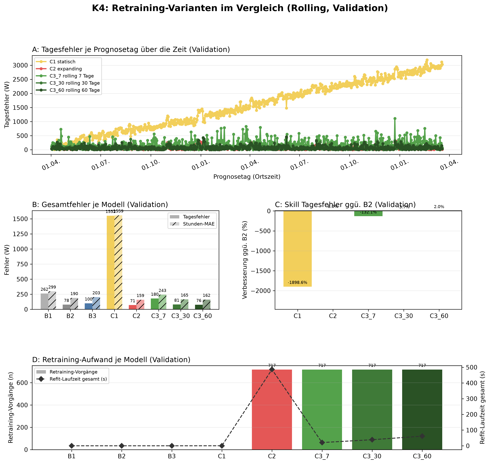
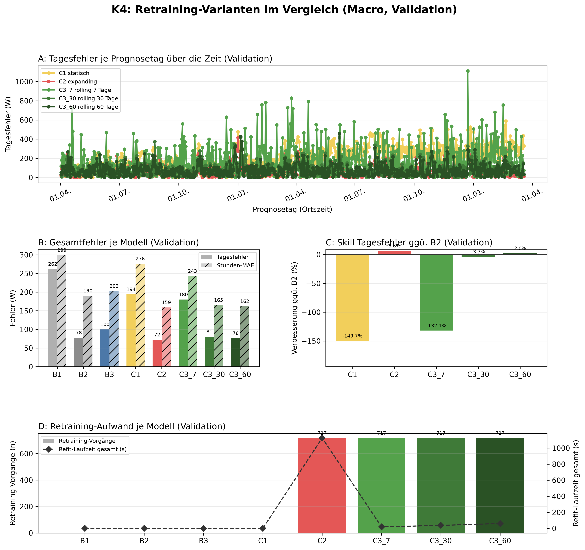

# K4 Retraining-Vergleich, Lauf k4_002

## Setup

- Split: validation, 2014-04-02 bis 2016-03-19, 718 Prognosetage (Ortszeit)
- Modus rolling: 60 Tage Historie vor Split-Start, wie der Online-Zyklus
- Modus macro: gesamte Historie vor Split-Start
- Naive Referenz: rolling B2, macro B2
- Prognose: 1 Tag ab lokaler Mitternacht, Intervall 80 %
- Konfiguration: forecast-model-0.1, Seed 42
- Commit: 32b0600 (mit lokalen Änderungen)

## Kennzahlen

| Kennzahl | Wert | Bezug |
|---|---|---|
| rolling: Tagesfehler bestes Modell C2 expanding [W] | 71,4 | B2 77,6 W |
| rolling: Skill der Prophet-Varianten im Tagesfehler ggü. B2 [%] | 8,0 | Spanne -1898,6 bis 8,0 % |
| rolling: Varianten belastbar schlechter als das beste Modell | 4 | von 4 |
| macro: Tagesfehler bestes Modell C2 expanding [W] | 72,5 | B2 77,6 W |
| macro: Skill der Prophet-Varianten im Tagesfehler ggü. B2 [%] | 6,6 | Spanne -149,7 bis 6,6 % |
| macro: Varianten belastbar schlechter als das beste Modell | 3 | von 4 |

## Gesamtfehler rolling

| Modell | Tagesfehler MAE [W] | Tagesfehler MAPE [%] | Skill Tagesfehler ggü. B2 [%] | Stunden-MAE [W] | Stunden-RMSE [W] | Stunden-MAPE [%] | Intervall-Abdeckung [%], Soll 80 | Refit-Zeit gesamt [s] |
|---|---:|---:|---:|---:|---:|---:|---:|---:|
| C2 expanding | 71,4 | 26,4 | 8,0 | 158,9 | 247,2 | 54,8 | 87,7 | 485,9 |
| C3_60 rolling 60 Tage | 76,1 | 26,5 | 2,0 | 161,9 | 248,1 | 55,8 | 87,6 | 61,4 |
| B2 naiv, Vortag | 77,6 | 23,2 | 0,0 | 190,3 | 331,0 | 57,0 | - | 0,0 |
| C3_30 rolling 30 Tage | 80,5 | 27,1 | -3,7 | 165,2 | 250,8 | 57,0 | 86,3 | 38,7 |
| B3 naiv, Vorwoche | 99,9 | 35,2 | -28,6 | 202,7 | 339,3 | 64,6 | - | 0,0 |
| C3_7 rolling 7 Tage | 180,2 | 55,6 | -132,1 | 242,9 | 334,7 | 89,7 | 63,8 | 20,7 |
| B1 naiv, letzter Wert | 262,0 | 74,2 | -237,4 | 299,1 | 461,6 | 103,9 | - | 0,0 |
| C1 statisch | 1551,6 | 493,4 | -1898,6 | 1558,8 | 1784,2 | 686,2 | 6,6 | 0,2 |

## Gesamtfehler macro

| Modell | Tagesfehler MAE [W] | Tagesfehler MAPE [%] | Skill Tagesfehler ggü. B2 [%] | Stunden-MAE [W] | Stunden-RMSE [W] | Stunden-MAPE [%] | Intervall-Abdeckung [%], Soll 80 | Refit-Zeit gesamt [s] |
|---|---:|---:|---:|---:|---:|---:|---:|---:|
| C2 expanding | 72,5 | 26,6 | 6,6 | 158,9 | 247,7 | 54,7 | 87,4 | 1126,5 |
| C3_60 rolling 60 Tage | 76,1 | 26,5 | 2,0 | 161,9 | 248,1 | 55,8 | 87,7 | 61,3 |
| B2 naiv, Vortag | 77,6 | 23,2 | 0,0 | 190,3 | 331,0 | 57,0 | - | 0,0 |
| C3_30 rolling 30 Tage | 80,5 | 27,1 | -3,7 | 165,2 | 250,8 | 57,0 | 86,3 | 37,6 |
| B3 naiv, Vorwoche | 99,9 | 35,2 | -28,6 | 202,7 | 339,3 | 64,6 | - | 0,0 |
| C3_7 rolling 7 Tage | 180,2 | 55,6 | -132,1 | 242,9 | 334,7 | 89,7 | 63,7 | 19,6 |
| C1 statisch | 193,9 | 71,1 | -149,7 | 276,2 | 323,7 | 123,4 | 51,5 | 0,7 |
| B1 naiv, letzter Wert | 262,0 | 74,2 | -237,4 | 299,1 | 461,6 | 103,9 | - | 0,0 |

## Abstand zum besten Prophet-Modell im Tagesfehler, gepaart je Prognosetag

| Modus | Modell | Referenz | Differenz [W] | 2 Standardfehler [W] | Tage | Tage besser [%] | belastbar |
|---|---|---|---:|---:|---:|---:|---|
| rolling | C3_60 rolling 60 Tage | C2 expanding | 4,6 | 3,6 | 716 | 45,3 | ja |
| rolling | C3_30 rolling 30 Tage | C2 expanding | 9,1 | 4,5 | 716 | 40,9 | ja |
| rolling | C3_7 rolling 7 Tage | C2 expanding | 108,7 | 12,2 | 716 | 24,6 | ja |
| rolling | C1 statisch | C2 expanding | 1480,2 | 63,6 | 716 | 0,8 | ja |
| macro | C3_60 rolling 60 Tage | C2 expanding | 3,6 | 4,1 | 716 | 48,3 | nein |
| macro | C3_30 rolling 30 Tage | C2 expanding | 8,0 | 4,8 | 716 | 41,3 | ja |
| macro | C3_7 rolling 7 Tage | C2 expanding | 107,7 | 12,3 | 716 | 26,7 | ja |
| macro | C1 statisch | C2 expanding | 121,4 | 9,1 | 716 | 17,5 | ja |

## Hinweise

- belastbar: Betrag der Differenz größer als 2 Standardfehler der gepaarten Differenzen, grobe Faustregel
- Tagesfehler: Fehler des Tagesmittels (Mittel der 24 Prognosewerte gegen das Ist-Tagesmittel), nicht der Mittelwert der Stundenfehler. Beste Variante, Skill und gepaarter Abstand beruhen auf ihm, die Stundenfehler stehen nur zum Vergleich
- rolling: Tagesfehler aus 716 von 718 Tagen (nur Tage mit Ist-Tagesmittel)
- rolling: 49 von 17233 Zielstunden nicht bewertet (Messwert fehlt 48, imputiert 1)
- macro: Tagesfehler aus 716 von 718 Tagen (nur Tage mit Ist-Tagesmittel)
- macro: 49 von 17233 Zielstunden nicht bewertet (Messwert fehlt 48, imputiert 1)

